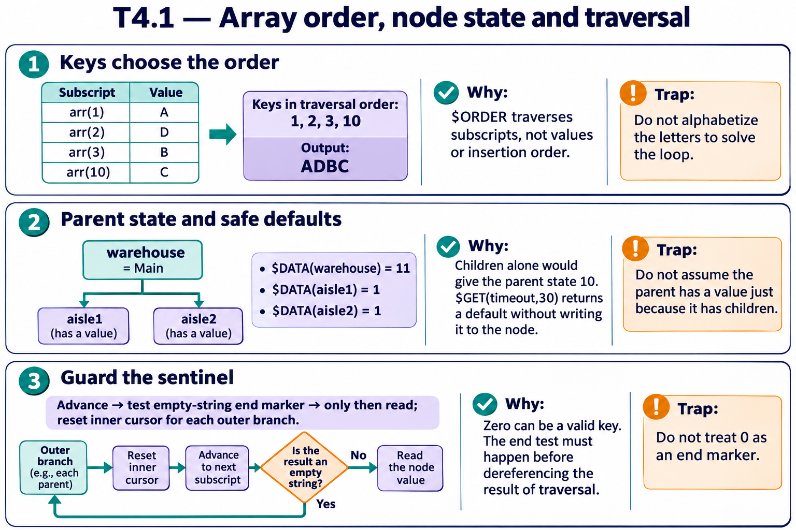
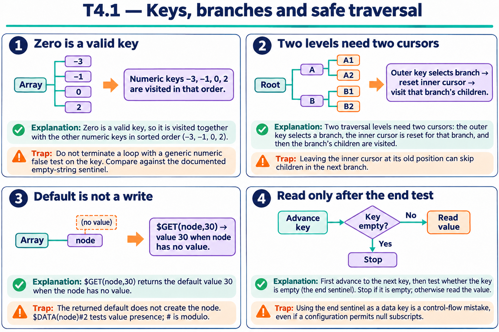

# T4.1 — Approfondimenti dagli esercizi

## Tutte le 18 domande approfondite

[Apri le schede domanda per domanda](<Domanda per domanda/README.md>) · [Tavole spiegate in inglese](tavole-esercizi.md)

Ogni domanda dispone ora di un commento specifico, un concetto ulteriore e una variante con soluzione. I tre casi seguenti sono percorsi tematici aggiuntivi. Le immagini sono in inglese.

[Teoria](../study.md) · [Quiz](../quiz.md) · [Tutti gli approfondimenti](../../../approfondimenti-esercizi.md)

Tre percorsi trasversali, da affiancare alle schede individuali, per capire il meccanismo dietro le risposte: scenario, ragionamento, distrattore, regola riutilizzabile e variante con soluzione. I riferimenti Q rimandano al quiz scaricato; la numerazione è locale al capitolo.

[Leggi esempi e spiegazioni dei pannelli](tavole-esercizi.md).

## Percorso consigliato

1. [Si ordinano le chiavi, poi si leggono i valori](<01 - Si ordinano le chiavi, poi si leggono i valori.md>) — Q1, Q3, Q5, Q6, Q8, Q10, Q13, Q18
2. [Un nodo e i suoi figli sono informazioni indipendenti](<02 - Un nodo e i suoi figli sono informazioni indipendenti.md>) — Q4, Q9, Q12, Q14, Q17
3. [Il controllo di fine precede l’accesso](<03 - Il controllo di fine precede l’accesso.md>) — Q2, Q7, Q11, Q15, Q16

[Indice di tutte le 18 domande del capitolo](mappa-domande.md). I percorsi sono tematici; ogni domanda ha inoltre una scheda individuale nella sottocartella dedicata.

## Precisazioni rispetto al quiz

Gli esempi di ordinamento presuppongono la collation dello scenario. Non confondere la chiave restituita da $ORDER con il valore del nodo; controllare la fine prima di dereferenziare.

Queste precisazioni si applicano agli approfondimenti nuovi. Il testo delle risposte scaricate rimane una testimonianza della fonte e non viene riscritto silenziosamente.

## Documentazione

- [$ORDER](https://docs.intersystems.com/irislatest/csp/docbook/DocBook.UI.Page.cls?KEY=RCOS_forder)
- [$DATA](https://docs.intersystems.com/irislatest/csp/docbook/DocBook.UI.Page.cls?KEY=RCOS_fdata)
- [$GET](https://docs.intersystems.com/irislatest/csp/docbook/DocBook.UI.Page.cls?KEY=RCOS_fget)

Gli snippet sono frammenti didattici: quando usano classi di esempio o macro, presuppongono le relative definizioni e include. Non costituiscono implementazioni complete né sono stati eseguiti in IRIS.
