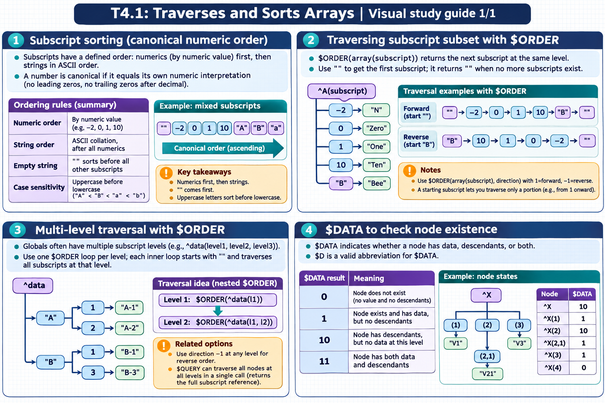

[All topics](../../index.md) · [Practice quiz](quiz.md)

# T4.1: Traverses and Sorts Arrays

[Approfondimenti dagli esercizi](<Approfondimenti esercizi/README.md>)

Saved 2 November 2026 from [exam-prep.es](https://exam-prep.es/exams/objectscript/knowledge/T4.1.html). Reference links require internet access.

### Contents

1. [Subscript sorting (canonical numeric order)](#1-subscript-sorting-canonical-numeric-order)
2. [Traversing subscript subset with $ORDER](#2-traversing-subscript-subset-with-order)
3. [Multi-level traversal with $ORDER](#3-multi-level-traversal-with-order)
4. [$DATA to check node existence](#4-data-to-check-node-existence)

### Visual study guide — sections 1–4



[View all chapter diagrams](visuals.md) · [Technical review notes](../../visual-technical-notes.md)

## 1. Subscript sorting (canonical numeric order)

### Key Points

- **Canonical numeric order**: Numeric subscripts sort by numeric value: -2, 0, 1, 10
- **String order**: Non-numeric subscripts sort in ASCII collation order after all numerics
- **Mixed subscripts**: Numerics come first, then strings: -2, 0, 1, 10, "A", "B", "a"
- **Canonical form**: A number is canonical if it equals its own numeric interpretation (no leading zeros, no trailing zeros after decimal)
- **Empty string**: The empty string "" sorts before all other subscripts
- **Case sensitivity**: Uppercase letters sort before lowercase ("A" &lt; "B" &lt; "a" &lt; "b")

### Detailed Notes

#### Overview

InterSystems IRIS stores global and local array subscripts in a well-defined collation order. Understanding this order is essential for traversing arrays predictably. The default collation places canonical numeric values first (sorted by numeric value), followed by non-numeric string values (sorted by ASCII/Unicode byte order).

#### Canonical Numeric Order

A subscript is treated as numeric if it is in **canonical form** -- meaning it equals the result of adding zero to it. For example, `1`, `-2`, `3.14`, and `0` are canonical, while `"01"`, `"3.0"`, and `"+5"` are not (those are treated as strings). Canonical numerics sort by their numeric value, so the order is: -2, -1, 0, 0.5, 1, 2, 10, 100.

```objectscript
 // Demonstrate subscript ordering
 SET data(-2) = "neg two"
 SET data(0) = "zero"
 SET data(1) = "one"
 SET data(10) = "ten"
 SET data("A") = "letter A"
 SET data("B") = "letter B"
 SET data("a") = "letter a"

 // Traversing will yield: -2, 0, 1, 10, "A", "B", "a"
 SET key = ""
 FOR {
     SET key = $ORDER(data(key))
     QUIT:key=""
     WRITE key, " = ", data(key), !
 }
```

#### String Collation

Non-canonical subscripts are stored as strings and sort by their byte values. This means uppercase ASCII letters (A-Z, codes 65-90) sort before lowercase letters (a-z, codes 97-122). Strings that look like numbers but are not canonical ("01", "3.0", "+5") sort as strings, not numbers.

```objectscript
 // "01" is NOT canonical numeric -- it sorts as a string
 SET arr(1) = "canonical one"
 SET arr("01") = "string zero-one"

 // Both nodes exist separately!
 // $ORDER yields: 1, then "01"
 SET key = ""
 FOR {
     SET key = $ORDER(arr(key))
     QUIT:key=""
     WRITE key, " -> ", arr(key), !
 }
 // Output: 1 -> canonical one
 //         01 -> string zero-one
```

#### Practical Implications

When designing globals, choose subscripts carefully. If you need predictable numeric sort, ensure values are canonical. If you mix types, be aware that `-3`, `0`, `5` sort first, then `"Apple"`, `"Banana"`, `"apple"` follow. This ordering is consistent across local arrays, process-private globals, and persistent globals.

### Documentation References

- [Subscript Sorting](https://docs.intersystems.com/irislatest/csp/docbook/DocBook.UI.Page.cls?KEY=GCOS_variables)
- [Canonical Form](https://docs.intersystems.com/irislatest/csp/docbook/DocBook.UI.Page.cls?KEY=GCOS_variables)
- [Collation and Subscript-Level Mapping](https://docs.intersystems.com/irislatest/csp/docbook/DocBook.UI.Page.cls?KEY=GGBL_structure)

## 2. Traversing subscript subset with $ORDER

### Key Points

- **$ORDER(array(subscript))**: Returns the next subscript at the same level after the given subscript
- **Empty string start**: Use `""` as starting subscript to get the first subscript
- **Loop termination**: $ORDER returns `""` when no more subscripts exist
- **Direction parameter**: $ORDER(array(subscript), direction) where 1=forward (default), -1=reverse
- **Value by reference**: $ORDER(array(subscript), direction, .datavalue) retrieves data in one call
- **Subscript subset**: Combine $ORDER with a starting point to traverse a portion of an array

### Detailed Notes

#### Overview

$ORDER is the fundamental function for traversing arrays in ObjectScript. It returns the next subscript at the same level, enabling iteration through all nodes of a global or local array. The function is efficient because it follows the internal B-tree structure directly.

#### Basic $ORDER Loop

The standard pattern starts with an empty string and loops until $ORDER returns an empty string:

```objectscript
 // Basic forward traversal
 SET ^colors(1) = "Red"
 SET ^colors(2) = "Green"
 SET ^colors(5) = "Blue"
 SET ^colors(10) = "Yellow"

 SET key = ""
 FOR {
     SET key = $ORDER(^colors(key))
     QUIT:key=""
     WRITE "Key: ", key, " Value: ", ^colors(key), !
 }
 // Output: Key: 1 Value: Red
 //         Key: 2 Value: Green
 //         Key: 5 Value: Blue
 //         Key: 10 Value: Yellow
```

#### Starting from a Specific Point

You can start traversal from any subscript -- $ORDER returns the NEXT subscript after the one you provide:

```objectscript
 // Start traversing from subscript 3 (gets next one: 5)
 SET key = 3
 FOR {
     SET key = $ORDER(^colors(key))
     QUIT:key=""
     WRITE key, " = ", ^colors(key), !
 }
 // Output: 5 = Blue
 //         10 = Yellow
```

#### Reverse Traversal with Direction -1

Pass -1 as the second argument to traverse in reverse order:

```objectscript
 // Reverse traversal
 SET key = ""
 FOR {
     SET key = $ORDER(^colors(key), -1)
     QUIT:key=""
     WRITE key, " = ", ^colors(key), !
 }
 // Output: 10 = Yellow
 //         5 = Blue
 //         2 = Green
 //         1 = Red
```

#### Retrieving Data with the Third Argument

The third argument (passed by reference) retrieves the node's data value in the same call, avoiding a separate global reference:

```objectscript
 // Efficient: get key AND value in one operation
 SET key = ""
 FOR {
     SET key = $ORDER(^colors(key), 1, value)
     QUIT:key=""
     WRITE key, " = ", value, !
 }
```

This is more efficient for globals because it avoids a second disk/cache lookup per iteration.

### Documentation References

- [$ORDER Function](https://docs.intersystems.com/irislatest/csp/docbook/DocBook.UI.Page.cls?KEY=RCOS_forder)
- [Traversing Globals](https://docs.intersystems.com/irislatest/csp/docbook/DocBook.UI.Page.cls?KEY=GGBL_using#GGBL_using_traversing)

## 3. Multi-level traversal with $ORDER

### Key Points

- **Multi-level arrays**: Globals often have multiple subscript levels: ^data(level1, level2, level3)
- **Nested loops**: Use one $ORDER loop per subscript level
- **$ORDER at each level**: Each inner loop starts with "" and traverses all subscripts at that level
- **Reverse traversal**: Use direction -1 at any level for reverse order
- **$QUERY alternative**: Traverses all nodes at all levels in a single call (returns full subscript reference)

### Detailed Notes

#### Overview

Real-world globals typically have multiple subscript levels. To traverse all data, you nest $ORDER loops, one for each level. Each loop independently iterates its subscript level within the context set by the outer loops.

#### Two-Level Traversal

```objectscript
 // Build a two-level structure
 SET ^students("Math", "Alice") = 95
 SET ^students("Math", "Bob") = 87
 SET ^students("Science", "Alice") = 92
 SET ^students("Science", "Charlie") = 88

 // Nested traversal
 SET subject = ""
 FOR {
     SET subject = $ORDER(^students(subject))
     QUIT:subject=""
     WRITE "Subject: ", subject, !
     SET student = ""
     FOR {
         SET student = $ORDER(^students(subject, student), 1, grade)
         QUIT:student=""
         WRITE "  ", student, " = ", grade, !
     }
 }
 // Output:
 //   Subject: Math
 //     Alice = 95
 //     Bob = 87
 //   Subject: Science
 //     Alice = 92
 //     Charlie = 88
```

#### Three-Level Traversal

```objectscript
 // Three-level structure: ^data(year, month, day) = info
 SET ^data(2025, 1, 15) = "Event A"
 SET ^data(2025, 3, 1) = "Event B"
 SET ^data(2025, 3, 20) = "Event C"
 SET ^data(2026, 1, 5) = "Event D"

 SET year = ""
 FOR {
     SET year = $ORDER(^data(year))
     QUIT:year=""
     SET month = ""
     FOR {
         SET month = $ORDER(^data(year, month))
         QUIT:month=""
         SET day = ""
         FOR {
             SET day = $ORDER(^data(year, month, day), 1, info)
             QUIT:day=""
             WRITE year, "-", month, "-", day, ": ", info, !
         }
     }
 }
```

#### Reverse Traversal at Any Level

```objectscript
 // Reverse outer level, forward inner level
 SET subject = ""
 FOR {
     SET subject = $ORDER(^students(subject), -1)
     QUIT:subject=""
     WRITE "Subject: ", subject, !
     SET student = ""
     FOR {
         SET student = $ORDER(^students(subject, student), 1, grade)
         QUIT:student=""
         WRITE "  ", student, " = ", grade, !
     }
 }
 // Output: Science first, then Math (reverse alphabetical)
```

#### Using $QUERY for Flat Traversal

$QUERY traverses all nodes at all levels in a single loop, returning the full reference as a string:

```objectscript
 SET ref = "^students"
 FOR {
     SET ref = $QUERY(@ref)
     QUIT:ref=""
     WRITE ref, " = ", @ref, !
 }
 // Output:
 //   ^students("Math","Alice") = 95
 //   ^students("Math","Bob") = 87
 //   ^students("Science","Alice") = 92
 //   ^students("Science","Charlie") = 88
```

### Documentation References

- [$ORDER Function](https://docs.intersystems.com/irislatest/csp/docbook/DocBook.UI.Page.cls?KEY=RCOS_forder)
- [$QUERY Function](https://docs.intersystems.com/irislatest/csp/docbook/DocBook.UI.Page.cls?KEY=RCOS_fquery)
- [Traversing Globals](https://docs.intersystems.com/irislatest/csp/docbook/DocBook.UI.Page.cls?KEY=GGBL_using#GGBL_using_traversing)

## 4. $DATA to check node existence

### Key Points

- **$DATA returns 0**: Node does not exist
- **$DATA returns 1**: Node exists and has data, but no descendants
- **$DATA returns 10**: Node has descendants but no data at this level
- **$DATA returns 11**: Node has both data and descendants
- **$D shorthand**: $D is a valid abbreviation for $DATA
- **Two-argument form**: $DATA(var, target) stores the node's value in target if it exists

### Detailed Notes

#### Overview

$DATA (abbreviated $D) is the standard way to check whether a variable or global node exists before accessing it. It returns an integer that indicates both whether data exists at that node and whether descendant nodes exist below it.

#### Return Values Explained

```objectscript
 KILL myarray
 SET myarray(1) = "data"
 SET myarray(2, "child") = "nested"
 SET myarray(3) = "parent"
 SET myarray(3, "child") = "nested"

 WRITE $DATA(myarray(0)), !     // 0  - does not exist
 WRITE $DATA(myarray(1)), !     // 1  - has data, no children
 WRITE $DATA(myarray(2)), !     // 10 - no data, has children
 WRITE $DATA(myarray(3)), !     // 11 - has data AND children
```

#### Using $DATA in Conditional Logic

```objectscript
 // Check if a node exists before reading
 IF $DATA(^config("timeout")) {
     SET timeout = ^config("timeout")
 } ELSE {
     SET timeout = 30  // default
 }

 // More concise: check for data presence (1 or 11)
 // Use modular arithmetic: $DATA returns 1 or 11 when data exists
 IF $DATA(^config("timeout")) # 2 {
     // Node has data (return value is 1 or 11)
     SET timeout = ^config("timeout")
 }

 // Check for descendants (10 or 11)
 IF $DATA(^config("timeout")) \ 10 {
     // Node has descendant subscripts
     WRITE "Has child nodes", !
 }
```

#### Two-Argument Form

The second argument receives the node's value (if data exists), avoiding a separate read:

```objectscript
 IF $DATA(^config("timeout"), value) # 2 {
     WRITE "Timeout is: ", value, !
 } ELSE {
     WRITE "No timeout configured", !
 }
```

#### Common Pattern: Checking Variable Existence

```objectscript
 // Check if a local variable is defined
 IF '$DATA(myVar) {
     SET myVar = "default"
 }

 // Shorthand $D
 IF $D(^globalNode) WRITE "Exists", !

 // $DATA on undefined variables returns 0
 KILL x
 WRITE $D(x), !    // 0
 SET x = 5
 WRITE $D(x), !    // 1
 SET x(1) = 10
 WRITE $D(x), !    // 11
```

#### $DATA vs $GET

$DATA tells you IF something exists; $GET retrieves the value with a default. They serve different purposes:

```objectscript
 // $GET returns the value or a default
 SET timeout = $GET(^config("timeout"), 30)

 // $DATA tells you about existence and structure
 SET status = $DATA(^config("timeout"))
```

### Documentation References

- [$DATA Function](https://docs.intersystems.com/irislatest/csp/docbook/DocBook.UI.Page.cls?KEY=RCOS_fdata)
- [Multidimensional Arrays](https://docs.intersystems.com/irislatest/csp/docbook/DocBook.UI.Page.cls?KEY=GCOS_variables)

## Exam Preparation Summary

### Critical Concepts to Master:

1. **Subscript collation**: Canonical numerics sort first by value, then strings sort by ASCII byte order
2. **Canonical form**: Know which values are canonical (1, -2, 3.14) vs non-canonical ("01", "3.0", "+5")
3. **$ORDER pattern**: Empty string start, FOR loop, QUIT:key="" termination
4. **$ORDER direction**: 1 for forward (default), -1 for reverse
5. **$ORDER third argument**: Retrieves data by reference, more efficient for globals
6. **Nested $ORDER**: One loop per subscript level for multi-level traversal
7. **$DATA return values**: 0 (nothing), 1 (data only), 10 (children only), 11 (both)
8. **$DATA modular arithmetic**: `# 2` to check for data, `\ 10` to check for descendants

### Common Exam Scenarios:

- Predicting the order of subscripts in a mixed numeric/string array
- Writing a correct $ORDER loop to traverse a global
- Determining the output of nested $ORDER traversal
- Choosing between $DATA, $GET, and $ORDER for a given task
- Identifying canonical vs non-canonical subscript values
- Using $ORDER with direction -1 for reverse traversal
- Using $QUERY vs nested $ORDER for flat traversal

### Hands-On Practice Recommendations:

- Create arrays with mixed numeric and string subscripts and verify the traversal order
- Write nested $ORDER loops for two-level and three-level globals
- Experiment with $DATA on nodes with and without data and descendants
- Use $ORDER with the third argument and compare performance to separate reads
- Practice reverse traversal and traversal from a specific starting point
- Try $QUERY on multi-level globals and compare to nested $ORDER approach
