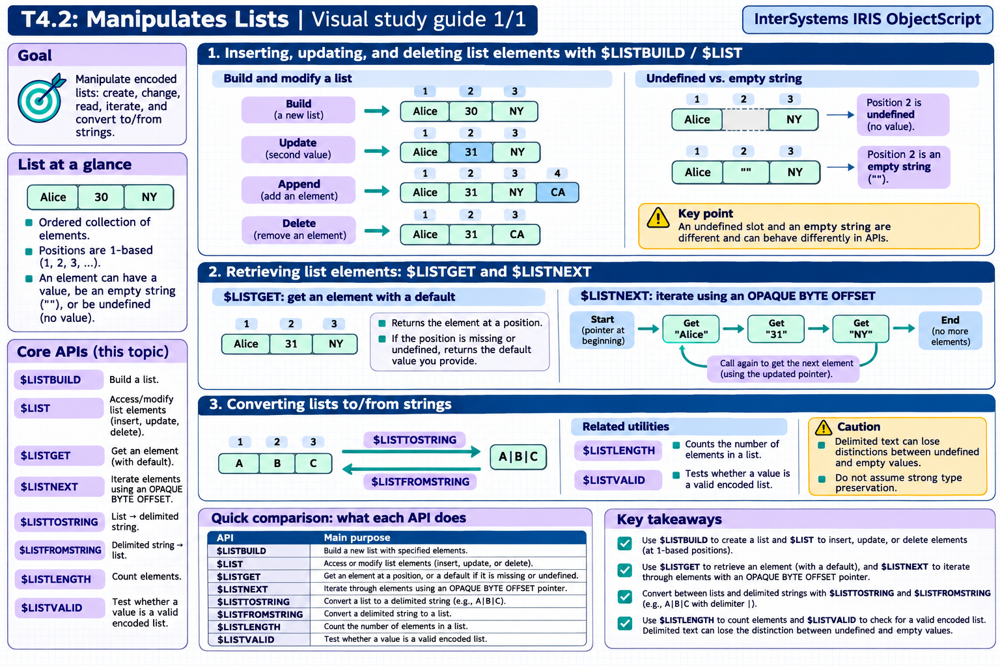

[Topic contents](../index.md) · [Full topic guide](../study.md) · [All topics](../../../index.md)

# T4.2: Manipulates Lists

Saved 2 November 2026 from [exam-prep.es](https://exam-prep.es/exams/objectscript/knowledge/T4.2.html). Reference links require internet access.

## 1. $LIST/$LISTBUILD to insert, update, and delete list elements



*This diagram covers sections 1–3; use the matching numbered panel for this page.* [Chapter diagrams](../visuals.md) · [Technical review notes](../../../visual-technical-notes.md)

### Key Points

- **$LISTBUILD($LB)**: Creates a list from comma-separated values: $LB("Alice", 30, "NY")
- **$LIST for read**: $LIST(list, position) extracts element at position (1-based)
- **$LIST for write**: SET $LIST(list, position) = value replaces an element
- **$LIST range**: $LIST(list, from, to) extracts a sublist
- **Undefined elements**: $LB("a",,"c") creates a list with an undefined second element
- **Appending**: SET $LIST(list, \*+1) = value appends to the end of a list
- **Removing**: SET $LIST(list, position) = "" sets to empty; use sublist concatenation to truly delete

### Detailed Notes

#### Overview

Lists in ObjectScript are encoded binary structures (not delimited strings). They are created with $LISTBUILD (abbreviated $LB) and manipulated with $LIST (abbreviated $LI). Lists preserve data types internally and can contain strings, numbers, and undefined elements.

#### Creating Lists with $LISTBUILD

```objectscript
 // Create a simple list
 SET myList = $LISTBUILD("Alice", 30, "New York")

 // Shorthand $LB
 SET colors = $LB("Red", "Green", "Blue")

 // List with undefined element (note the double comma)
 SET sparse = $LB("first",, "third")

 // Empty list
 SET empty = $LB()

 // Single element
 SET single = $LB("only")
```

#### Reading List Elements with $LIST

```objectscript
 SET person = $LB("Alice", 30, "New York")

 // Extract individual elements (1-based indexing)
 WRITE $LIST(person, 1), !    // Alice
 WRITE $LIST(person, 2), !    // 30
 WRITE $LIST(person, 3), !    // New York

 // $LI shorthand
 WRITE $LI(person, 1), !      // Alice

 // Extract a sublist (from position 2 to 3)
 SET subset = $LIST(person, 2, 3)
 // subset is $LB(30, "New York")

 // Extract from position to end
 SET fromSecond = $LIST(person, 2, *)
 // fromSecond is $LB(30, "New York")
```

#### Modifying List Elements with SET $LIST

```objectscript
 SET person = $LB("Alice", 30, "New York")

 // Update an element
 SET $LIST(person, 2) = 31
 // person is now $LB("Alice", 31, "New York")

 // Append to the end using *+1
 SET $LIST(person, *+1) = "alice@example.com"
 // person is now $LB("Alice", 31, "New York", "alice@example.com")

 // Replace first element
 SET $LIST(person, 1) = "Bob"
```

#### Removing Elements

There is no direct delete operation. To remove an element, you concatenate sublists excluding the unwanted element:

```objectscript
 SET list = $LB("A", "B", "C", "D", "E")

 // Remove element at position 3 ("C")
 SET list = $LIST(list, 1, 2) _ $LIST(list, 4, *)
 // Result: $LB("A", "B", "D", "E")

 // Remove first element
 SET list = $LIST(list, 2, *)
 // Result: $LB("B", "D", "E")

 // Remove last element
 SET list = $LIST(list, 1, *-1)
 // Result: $LB("B", "D")
```

#### Building Lists Incrementally

```objectscript
 SET list = ""
 FOR i = 1:1:5 {
     SET list = list _ $LB(i * 10)
 }
 // list is $LB(10, 20, 30, 40, 50)
```

### Documentation References

- [$LISTBUILD Function](https://docs.intersystems.com/irislatest/csp/docbook/DocBook.UI.Page.cls?KEY=RCOS_flistbuild)
- [$LIST Function](https://docs.intersystems.com/irislatest/csp/docbook/DocBook.UI.Page.cls?KEY=RCOS_flist)
- [List Operations](https://docs.intersystems.com/irislatest/csp/docbook/DocBook.UI.Page.cls?KEY=GCOS_commands)
