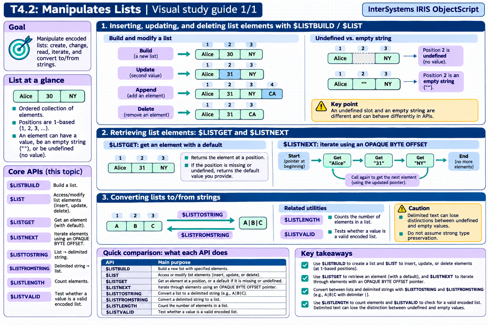

[Topic contents](../index.md) · [Full topic guide](../study.md) · [All topics](../../../index.md)

# T4.2: Manipulates Lists

Saved 2 November 2026 from [exam-prep.es](https://exam-prep.es/exams/objectscript/knowledge/T4.2.html). Reference links require internet access.

## 2. $LISTGET and $LISTNEXT for retrieval



*This diagram covers sections 1–3; use the matching numbered panel for this page.* [Chapter diagrams](../visuals.md) · [Technical review notes](../../../visual-technical-notes.md)

### Key Points

- **$LISTGET($LG)**: Safe retrieval -- returns default value if element is undefined or missing
- **$LG(list, position, default)**: Three arguments: list, position, default value
- **$LISTNEXT**: Iterates through a list using a pointer variable -- most efficient for sequential access
- **$LISTNEXT(list, pointer, value)**: Updates pointer and value on each call, returns 1 while elements remain
- **Pointer initialization**: Always set pointer to 0 before starting $LISTNEXT iteration
- **Performance**: $LISTNEXT is faster than $LIST for sequential traversal of long lists

### Detailed Notes

#### Overview

$LISTGET provides safe access to list elements with default values for missing or undefined elements. $LISTNEXT provides efficient sequential iteration through lists. Together, these functions handle the most common list access patterns.

#### $LISTGET for Safe Access

```objectscript
 SET person = $LB("Alice", 30, "New York")

 // Basic retrieval with default
 WRITE $LISTGET(person, 1, "Unknown"), !     // Alice
 WRITE $LISTGET(person, 4, "N/A"), !         // N/A (position 4 doesn't exist)

 // $LG shorthand
 WRITE $LG(person, 2, 0), !                  // 30
 WRITE $LG(person, 99, "default"), !          // default

 // With sparse lists (undefined elements)
 SET sparse = $LB("first",, "third")
 WRITE $LG(sparse, 2, "MISSING"), !           // MISSING (element 2 is undefined)

 // Without default, $LG returns "" for missing elements
 WRITE $LG(person, 10), !                     // "" (empty string)
```

#### $LISTGET vs $LIST

```objectscript
 SET list = $LB("A",, "C")

 // $LIST throws an error on undefined element
 // WRITE $LIST(list, 2)  // <NULL VALUE> error!

 // $LISTGET returns default safely
 WRITE $LISTGET(list, 2, "default"), !    // default

 // $LIST also errors on out-of-range position
 // WRITE $LIST(list, 10)  // <NULL VALUE> error!

 // $LISTGET handles it gracefully
 WRITE $LISTGET(list, 10, "N/A"), !       // N/A
```

#### $LISTNEXT for Sequential Iteration

```objectscript
 SET colors = $LB("Red", "Green", "Blue", "Yellow")

 // Initialize pointer to 0
 SET ptr = 0
 WHILE $LISTNEXT(colors, ptr, value) {
     WRITE "Color: ", value, !
 }
 // Output: Red, Green, Blue, Yellow (one per line)
```

#### $LISTNEXT with Sparse Lists

```objectscript
 SET data = $LB("first",, "third",, "fifth")

 SET ptr = 0
 SET pos = 0
 WHILE $LISTNEXT(data, ptr, value) {
     SET pos = pos + 1
     IF $DATA(value) {
         WRITE "Position ", pos, ": ", value, !
     } ELSE {
         WRITE "Position ", pos, ": <undefined>", !
     }
 }
 // Output:
 //   Position 1: first
 //   Position 2: <undefined>
 //   Position 3: third
 //   Position 4: <undefined>
 //   Position 5: fifth
```

#### Performance Comparison

For large lists, $LISTNEXT is significantly faster because it maintains an internal pointer and reads sequentially. $LIST(list, n) must scan from the beginning each time to find position n.

```objectscript
 // Building a large list
 SET bigList = ""
 FOR i = 1:1:10000 {
     SET bigList = bigList _ $LB(i)
 }

 // SLOW: $LIST with index (O(n^2) overall)
 FOR i = 1:1:$LISTLENGTH(bigList) {
     SET val = $LIST(bigList, i)
 }

 // FAST: $LISTNEXT with pointer (O(n) overall)
 SET ptr = 0
 WHILE $LISTNEXT(bigList, ptr, val) {
     // process val
 }
```

### Documentation References

- [$LISTGET Function](https://docs.intersystems.com/irislatest/csp/docbook/DocBook.UI.Page.cls?KEY=RCOS_flistget)
- [$LISTNEXT Function](https://docs.intersystems.com/irislatest/csp/docbook/DocBook.UI.Page.cls?KEY=RCOS_flistnext)
