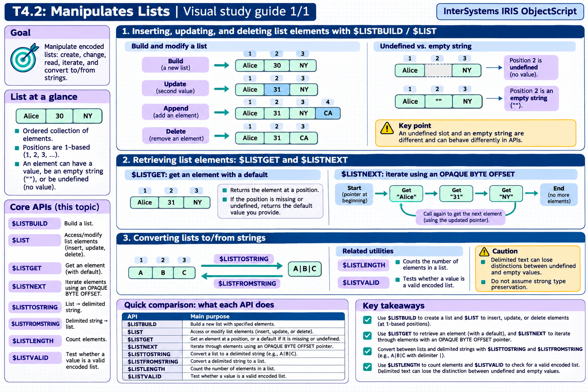

[Topic contents](../index.md) · [Full topic guide](../study.md) · [All topics](../../../index.md)

# T4.2: Manipulates Lists

Saved 2 November 2026 from [exam-prep.es](https://exam-prep.es/exams/objectscript/knowledge/T4.2.html). Reference links require internet access.

## 3. Converting lists to/from strings



*This diagram covers sections 1–3; use the matching numbered panel for this page.* [Chapter diagrams](../visuals.md) · [Technical review notes](../../../visual-technical-notes.md)

### Key Points

- **$LISTTOSTRING**: Converts a list to a delimited string: $LISTTOSTRING(list, delimiter)
- **$LISTFROMSTRING**: Converts a delimited string to a list: $LISTFROMSTRING(string, delimiter)
- **Default delimiter**: Comma is the default delimiter for both functions
- **$LISTLENGTH($LL)**: Returns the number of elements in a list
- **$LISTVALID**: Tests whether a value is a valid list (returns 1 or 0)
- **Lists vs strings**: Lists preserve data types and support undefined elements; strings do not

### Detailed Notes

#### Overview

ObjectScript provides functions to convert between its native list format (created by $LISTBUILD) and delimited strings. This is essential when interfacing with external systems, displaying data, or processing delimited input files.

#### $LISTTOSTRING: List to Delimited String

```objectscript
 SET colors = $LB("Red", "Green", "Blue")

 // Default delimiter is comma
 WRITE $LISTTOSTRING(colors), !
 // Output: Red,Green,Blue

 // Custom delimiter
 WRITE $LISTTOSTRING(colors, "|"), !
 // Output: Red|Green|Blue

 // Tab-delimited
 WRITE $LISTTOSTRING(colors, $CHAR(9)), !
 // Output: Red<tab>Green<tab>Blue

 // With numeric elements
 SET nums = $LB(10, 20, 30)
 WRITE $LISTTOSTRING(nums, "-"), !
 // Output: 10-20-30
```

#### $LISTFROMSTRING: Delimited String to List

```objectscript
 SET csv = "Alice,30,New York"

 // Default delimiter is comma
 SET list = $LISTFROMSTRING(csv)
 WRITE $LIST(list, 1), !    // Alice
 WRITE $LIST(list, 2), !    // 30
 WRITE $LIST(list, 3), !    // New York

 // Custom delimiter
 SET piped = "Red|Green|Blue"
 SET colors = $LISTFROMSTRING(piped, "|")
 WRITE $LIST(colors, 2), !  // Green

 // Note: all elements become STRINGS
 // "30" from CSV is stored as string "30", not integer 30
```

#### $LISTLENGTH: Counting Elements

```objectscript
 SET colors = $LB("Red", "Green", "Blue")
 WRITE $LISTLENGTH(colors), !    // 3

 // $LL shorthand
 WRITE $LL(colors), !             // 3

 // Sparse list -- undefined elements count
 SET sparse = $LB("a",, "c")
 WRITE $LL(sparse), !             // 3

 // Empty list
 WRITE $LL($LB()), !              // 0
```

#### $LISTVALID: Validating List Format

```objectscript
 SET list = $LB("a", "b", "c")
 WRITE $LISTVALID(list), !        // 1

 SET str = "a,b,c"
 WRITE $LISTVALID(str), !         // 0

 SET empty = ""
 WRITE $LISTVALID(empty), !       // 1 (empty string is valid empty list)
```

#### Practical Conversion Patterns

```objectscript
 // Read CSV line and convert to list for processing
 SET csvLine = "John,Smith,42,Engineer"
 SET fields = $LISTFROMSTRING(csvLine, ",")
 SET firstName = $LG(fields, 1)
 SET lastName = $LG(fields, 2)
 SET age = $LG(fields, 3)

 // Build a list and output as pipe-delimited
 SET output = $LB(firstName, lastName, age + 1)
 WRITE $LISTTOSTRING(output, "|"), !
 // Output: John|Smith|43

 // Counting items in a delimited string via list conversion
 SET tags = "iris,objectscript,sql,globals"
 WRITE "Number of tags: ", $LL($LISTFROMSTRING(tags, ",")), !
 // Output: Number of tags: 4
```

#### $LISTFIND: Searching within Lists

```objectscript
 SET colors = $LB("Red", "Green", "Blue", "Yellow")

 // Find position of "Blue"
 WRITE $LISTFIND(colors, "Blue"), !     // 3

 // Not found returns 0
 WRITE $LISTFIND(colors, "Purple"), !   // 0

 // Case-sensitive
 WRITE $LISTFIND(colors, "red"), !      // 0
```

### Documentation References

- [$LISTTOSTRING Function](https://docs.intersystems.com/irislatest/csp/docbook/DocBook.UI.Page.cls?KEY=RCOS_flisttostring)
- [$LISTFROMSTRING Function](https://docs.intersystems.com/irislatest/csp/docbook/DocBook.UI.Page.cls?KEY=RCOS_flistfromstring)
- [$LISTLENGTH Function](https://docs.intersystems.com/irislatest/csp/docbook/DocBook.UI.Page.cls?KEY=RCOS_flistlength)
- [$LISTVALID Function](https://docs.intersystems.com/irislatest/csp/docbook/DocBook.UI.Page.cls?KEY=RCOS_flistvalid)
- [$LISTFIND Function](https://docs.intersystems.com/irislatest/csp/docbook/DocBook.UI.Page.cls?KEY=RCOS_flistfind)
