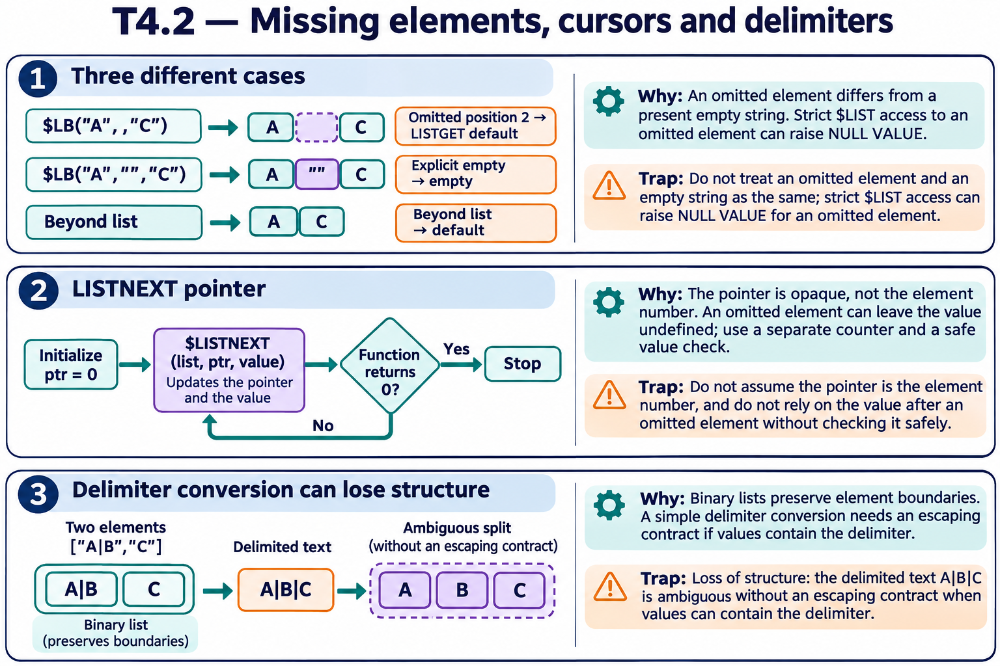

# T4.2 · 01 — Elemento omesso, stringa vuota e indice assente

[Indice degli approfondimenti](README.md) · [Quiz originale](../quiz.md) · [Teoria](../study.md)

**Esercizi di partenza:** [Q1](../quiz.md#question-1-single) · [Q3](../quiz.md#question-3-single) · [Q11](../quiz.md#question-11-single) · [Q12](../quiz.md#question-12-multiple). L’approfondimento rielabora il concetto e aggiunge una variante; non riproduce soltanto la risposta del quiz.

## Il caso concreto

x=$LISTBUILD("A",,"C") contiene una posizione omessa. La lettura stretta della seconda posizione solleva NULL VALUE.

```objectscript
set x=$LISTBUILD("A",,"C")
write $LISTGET(x,2,"N/A"), !
write $LISTGET(x,5,"N/A")
```

## Ragionamento passo per passo

Entrambe le letture protette restituiscono N/A: una posizione omessa e una oltre la fine condividono il fallback. Un elemento esplicito "" è invece un valore definito vuoto e non va equiparato all’omissione. La lista deve comunque essere valida: il default non sanifica byte arbitrari.

## Perché il distrattore è plausibile

Supporre che ogni posizione inferiore a $LISTLENGTH contenga un valore leggibile con $LIST, o che il fallback distingua da solo tutte le cause.

## Lo spunto da portare oltre l’esercizio

Scegli l’API in base al contratto: lettura obbligatoria oppure valore opzionale con default.



*Leggi il pannello 1; gli altri due collegano il caso agli altri approfondimenti del capitolo.*

## Variante: prova prima di leggere la soluzione

x=$LB("A","","C"). $LISTGET(x,2,"N/A") restituisce N/A?

<details>
<summary>Soluzione ragionata</summary>

No: restituisce la stringa vuota esplicita.

</details>

## Riferimenti e precisazioni

- [$LISTGET](https://docs.intersystems.com/irislatest/csp/docbook/DocBook.UI.Page.cls?KEY=RCOS_flistget)
- [$LISTNEXT](https://docs.intersystems.com/irislatest/csp/docbook/DocBook.UI.Page.cls?KEY=RCOS_flistnext)
- [$LIST](https://docs.intersystems.com/irislatest/csp/docbook/DocBook.UI.Page.cls?KEY=RCOS_flist)

[Note specifiche del capitolo](README.md#precisazioni-rispetto-al-quiz) · [Metodo e limiti della revisione](../../../approfondimenti-esercizi.md#metodo-e-limiti)
