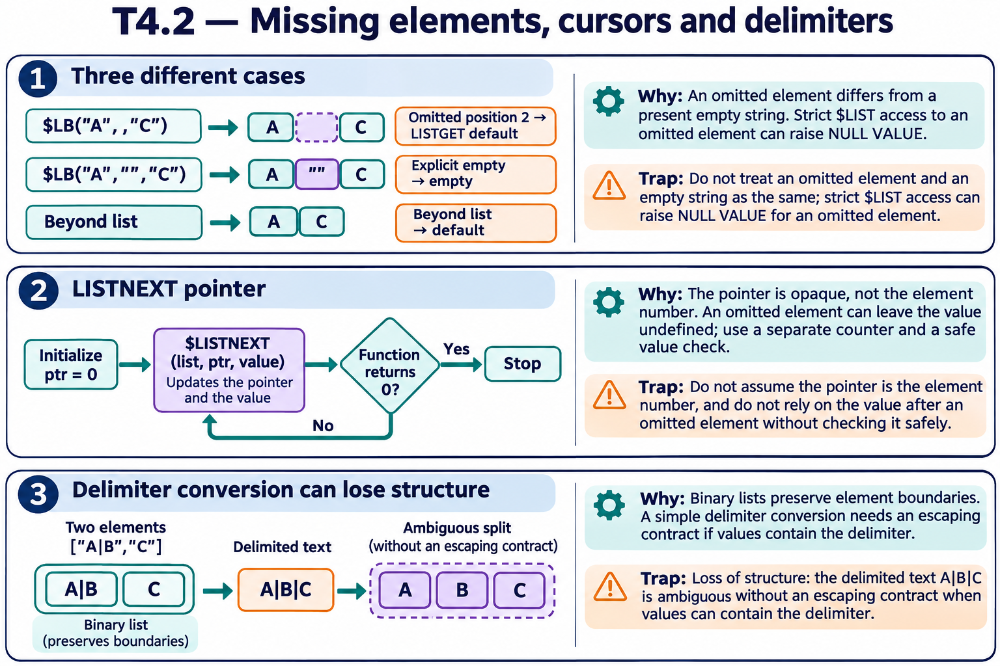

# T4.2 · 02 — Iterare non significa incrementare un numero di posizione

[Indice degli approfondimenti](README.md) · [Quiz originale](../quiz.md) · [Teoria](../study.md)

**Esercizi di partenza:** [Q6](../quiz.md#question-6-single) · [Q8](../quiz.md#question-8-single) · [Q15](../quiz.md#question-15-single). L’approfondimento rielabora il concetto e aggiunge una variante; non riproduce soltanto la risposta del quiz.

## Il caso concreto

Per una scansione sequenziale $LISTNEXT aggiorna un puntatore interno passato per riferimento.

```objectscript
set ptr=0
while $LISTNEXT(items,ptr,value) {
  if $DATA(value)#2 { write value,! }
  else { write "elemento omesso",! }
}
```

## Ragionamento passo per passo

ptr va inizializzato a zero e lasciato alla funzione. Il valore di ritorno indica se è stato incontrato un elemento; non garantisce che l’elemento avesse un valore definito. Il controllo su value mantiene corretto il ciclo anche con omissioni. Il codice presuppone items come lista valida.

## Perché il distrattore è plausibile

Fare ptr=ptr+1 o stampare value senza gestire gli elementi omessi.

## Lo spunto da portare oltre l’esercizio

Un cursore di formato è diverso dall’indice logico dell’elemento.



*Leggi il pannello 2; gli altri due collegano il caso agli altri approfondimenti del capitolo.*

## Variante: prova prima di leggere la soluzione

Vuoi anche numerare gli elementi visitati. Devi usare ptr come contatore?

<details>
<summary>Soluzione ragionata</summary>

No: mantieni un contatore separato, incrementato a ogni visita.

</details>

## Riferimenti e precisazioni

- [$LISTGET](https://docs.intersystems.com/irislatest/csp/docbook/DocBook.UI.Page.cls?KEY=RCOS_flistget)
- [$LISTNEXT](https://docs.intersystems.com/irislatest/csp/docbook/DocBook.UI.Page.cls?KEY=RCOS_flistnext)
- [$LIST](https://docs.intersystems.com/irislatest/csp/docbook/DocBook.UI.Page.cls?KEY=RCOS_flist)

[Note specifiche del capitolo](README.md#precisazioni-rispetto-al-quiz) · [Metodo e limiti della revisione](../../../approfondimenti-esercizi.md#metodo-e-limiti)
