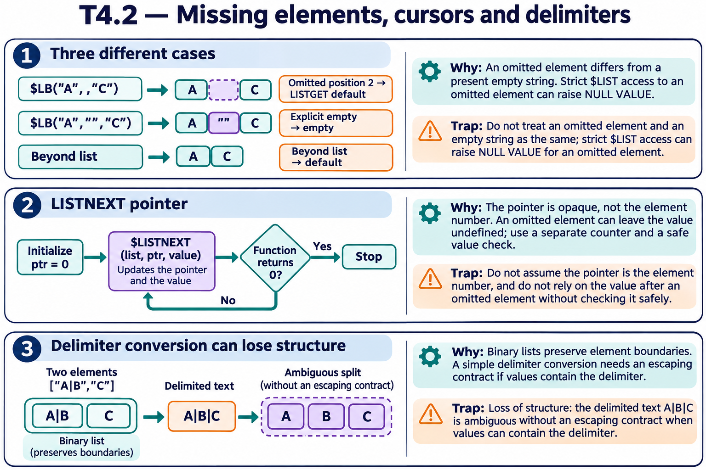

# T4.2 · 03 — Una lista codificata evita l’ambiguità dei delimitatori

[Indice degli approfondimenti](README.md) · [Quiz originale](../quiz.md) · [Teoria](../study.md)

**Esercizi di partenza:** [Q2](../quiz.md#question-2-single) · [Q4](../quiz.md#question-4-single) · [Q5](../quiz.md#question-5-single) · [Q7](../quiz.md#question-7-single) · [Q9](../quiz.md#question-9-single) · [Q10](../quiz.md#question-10-single) · [Q13](../quiz.md#question-13-single) · [Q14](../quiz.md#question-14-single). L’approfondimento rielabora il concetto e aggiunge una variante; non riproduce soltanto la risposta del quiz.

## Il caso concreto

Il valore di un elemento può contenere il carattere che una stringa delimitata usa come separatore.

```objectscript
set x=$LISTBUILD("A|B","C")
write $LISTLENGTH(x), !
write $LISTGET(x,1)
```

## Ragionamento passo per passo

La lista contiene due elementi e il primo è A|B. Se la converti in una stringa con separatore | senza un protocollo di escaping, A|B|C non permette di ricostruire univocamente i due elementi originali. Le posizioni delle funzioni $LIST sono uno-based; un range 2..4 comprende tre elementi.

## Perché il distrattore è plausibile

Pensare che convertire in testo delimitato e riconvertire sia sempre reversibile oppure usare indici JSON zero-based.

## Lo spunto da portare oltre l’esercizio

Il formato del contenitore fa parte del significato dei dati: non scegliere soltanto quello più leggibile a occhio.



*Leggi il pannello 3; gli altri due collegano il caso agli altri approfondimenti del capitolo.*

## Variante: prova prima di leggere la soluzione

A|B e C diventano A|B|C. Quanti campi vede un parser ingenuo a delimitatore |?

<details>
<summary>Soluzione ragionata</summary>

Tre, perdendo la struttura originale a due elementi.

</details>

## Riferimenti e precisazioni

- [$LISTGET](https://docs.intersystems.com/irislatest/csp/docbook/DocBook.UI.Page.cls?KEY=RCOS_flistget)
- [$LISTNEXT](https://docs.intersystems.com/irislatest/csp/docbook/DocBook.UI.Page.cls?KEY=RCOS_flistnext)
- [$LIST](https://docs.intersystems.com/irislatest/csp/docbook/DocBook.UI.Page.cls?KEY=RCOS_flist)

[Note specifiche del capitolo](README.md#precisazioni-rispetto-al-quiz) · [Metodo e limiti della revisione](../../../approfondimenti-esercizi.md#metodo-e-limiti)
