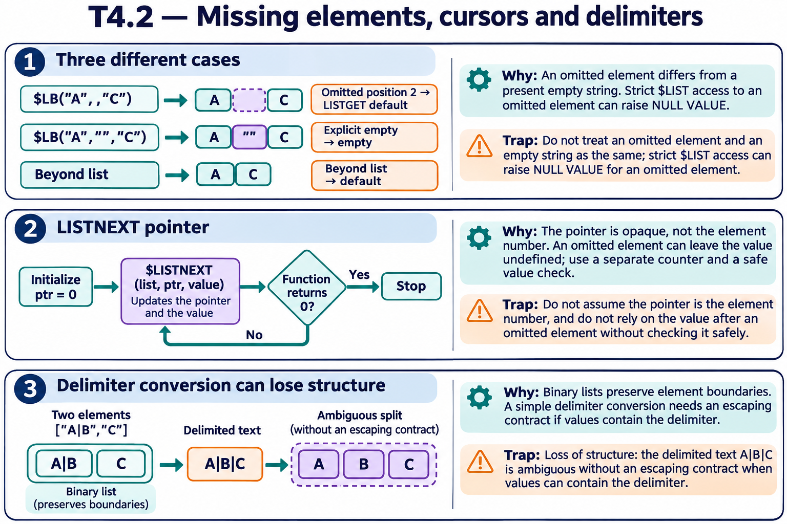
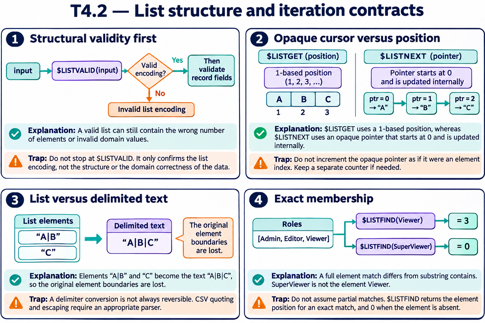

# T4.2 — Approfondimenti dagli esercizi

## Tutte le 15 domande approfondite

[Apri le schede domanda per domanda](<Domanda per domanda/README.md>) · [Tavole spiegate in inglese](tavole-esercizi.md)

Ogni domanda dispone ora di un commento specifico, un concetto ulteriore e una variante con soluzione. I tre casi seguenti sono percorsi tematici aggiuntivi. Le immagini sono in inglese.

[Teoria](../study.md) · [Quiz](../quiz.md) · [Tutti gli approfondimenti](../../../approfondimenti-esercizi.md)

Tre percorsi trasversali, da affiancare alle schede individuali, per capire il meccanismo dietro le risposte: scenario, ragionamento, distrattore, regola riutilizzabile e variante con soluzione. I riferimenti Q rimandano al quiz scaricato; la numerazione è locale al capitolo.

[Leggi esempi e spiegazioni dei pannelli](tavole-esercizi.md).

## Percorso consigliato

1. [Elemento omesso, stringa vuota e indice assente](<01 - Elemento omesso, stringa vuota e indice assente.md>) — Q1, Q3, Q11, Q12
2. [Iterare non significa incrementare un numero di posizione](<02 - Iterare non significa incrementare un numero di posizione.md>) — Q6, Q8, Q15
3. [Una lista codificata evita l’ambiguità dei delimitatori](<03 - Una lista codificata evita l’ambiguità dei delimitatori.md>) — Q2, Q4, Q5, Q7, Q9, Q10, Q13, Q14

[Indice di tutte le 15 domande del capitolo](mappa-domande.md). I percorsi sono tematici; ogni domanda ha inoltre una scheda individuale nella sottocartella dedicata.

## Precisazioni rispetto al quiz

Il puntatore di $LISTNEXT è opaco, non un indice 1,2,3. Con un elemento omesso la funzione può restituire 1 lasciando value non definita: il ciclo deve gestire esplicitamente questo caso. Non usare la rappresentazione binaria come contratto applicativo sui tipi.

Queste precisazioni si applicano agli approfondimenti nuovi. Il testo delle risposte scaricate rimane una testimonianza della fonte e non viene riscritto silenziosamente.

## Documentazione

- [$LISTGET](https://docs.intersystems.com/irislatest/csp/docbook/DocBook.UI.Page.cls?KEY=RCOS_flistget)
- [$LISTNEXT](https://docs.intersystems.com/irislatest/csp/docbook/DocBook.UI.Page.cls?KEY=RCOS_flistnext)
- [$LIST](https://docs.intersystems.com/irislatest/csp/docbook/DocBook.UI.Page.cls?KEY=RCOS_flist)

Gli snippet sono frammenti didattici: quando usano classi di esempio o macro, presuppongono le relative definizioni e include. Non costituiscono implementazioni complete né sono stati eseguiti in IRIS.
