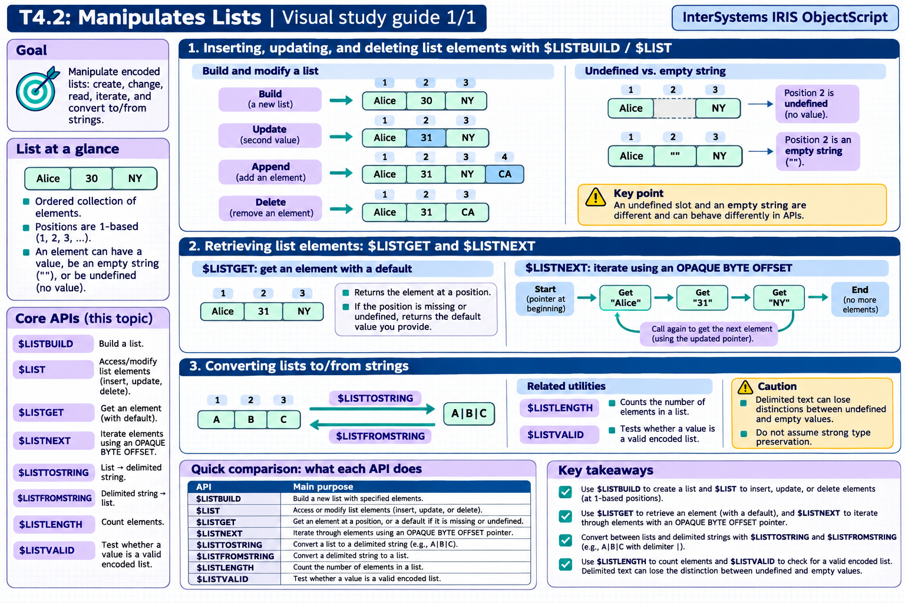

[All topics](../../index.md) · [Practice quiz](quiz.md)

# T4.2: Manipulates Lists

[Approfondimenti dagli esercizi](<Approfondimenti esercizi/README.md>)

Saved 2 November 2026 from [exam-prep.es](https://exam-prep.es/exams/objectscript/knowledge/T4.2.html). Reference links require internet access.

### Contents

1. [$LIST/$LISTBUILD to insert, update, and delete list elements](#1-listlistbuild-to-insert-update-and-delete-list-elements)
2. [$LISTGET and $LISTNEXT for retrieval](#2-listget-and-listnext-for-retrieval)
3. [Converting lists to/from strings](#3-converting-lists-tofrom-strings)

### Visual study guide — sections 1–3



[View all chapter diagrams](visuals.md) · [Technical review notes](../../visual-technical-notes.md)

## 1. $LIST/$LISTBUILD to insert, update, and delete list elements

### Key Points

- **$LISTBUILD($LB)**: Creates a list from comma-separated values: $LB("Alice", 30, "NY")
- **$LIST for read**: $LIST(list, position) extracts element at position (1-based)
- **$LIST for write**: SET $LIST(list, position) = value replaces an element
- **$LIST range**: $LIST(list, from, to) extracts a sublist
- **Undefined elements**: $LB("a",,"c") creates a list with an undefined second element
- **Appending**: SET $LIST(list, \*+1) = value appends to the end of a list
- **Removing**: SET $LIST(list, position) = "" sets to empty; use sublist concatenation to truly delete

### Detailed Notes

#### Overview

Lists in ObjectScript are encoded binary structures (not delimited strings). They are created with $LISTBUILD (abbreviated $LB) and manipulated with $LIST (abbreviated $LI). Lists preserve data types internally and can contain strings, numbers, and undefined elements.

#### Creating Lists with $LISTBUILD

```objectscript
 // Create a simple list
 SET myList = $LISTBUILD("Alice", 30, "New York")

 // Shorthand $LB
 SET colors = $LB("Red", "Green", "Blue")

 // List with undefined element (note the double comma)
 SET sparse = $LB("first",, "third")

 // Empty list
 SET empty = $LB()

 // Single element
 SET single = $LB("only")
```

#### Reading List Elements with $LIST

```objectscript
 SET person = $LB("Alice", 30, "New York")

 // Extract individual elements (1-based indexing)
 WRITE $LIST(person, 1), !    // Alice
 WRITE $LIST(person, 2), !    // 30
 WRITE $LIST(person, 3), !    // New York

 // $LI shorthand
 WRITE $LI(person, 1), !      // Alice

 // Extract a sublist (from position 2 to 3)
 SET subset = $LIST(person, 2, 3)
 // subset is $LB(30, "New York")

 // Extract from position to end
 SET fromSecond = $LIST(person, 2, *)
 // fromSecond is $LB(30, "New York")
```

#### Modifying List Elements with SET $LIST

```objectscript
 SET person = $LB("Alice", 30, "New York")

 // Update an element
 SET $LIST(person, 2) = 31
 // person is now $LB("Alice", 31, "New York")

 // Append to the end using *+1
 SET $LIST(person, *+1) = "alice@example.com"
 // person is now $LB("Alice", 31, "New York", "alice@example.com")

 // Replace first element
 SET $LIST(person, 1) = "Bob"
```

#### Removing Elements

There is no direct delete operation. To remove an element, you concatenate sublists excluding the unwanted element:

```objectscript
 SET list = $LB("A", "B", "C", "D", "E")

 // Remove element at position 3 ("C")
 SET list = $LIST(list, 1, 2) _ $LIST(list, 4, *)
 // Result: $LB("A", "B", "D", "E")

 // Remove first element
 SET list = $LIST(list, 2, *)
 // Result: $LB("B", "D", "E")

 // Remove last element
 SET list = $LIST(list, 1, *-1)
 // Result: $LB("B", "D")
```

#### Building Lists Incrementally

```objectscript
 SET list = ""
 FOR i = 1:1:5 {
     SET list = list _ $LB(i * 10)
 }
 // list is $LB(10, 20, 30, 40, 50)
```

### Documentation References

- [$LISTBUILD Function](https://docs.intersystems.com/irislatest/csp/docbook/DocBook.UI.Page.cls?KEY=RCOS_flistbuild)
- [$LIST Function](https://docs.intersystems.com/irislatest/csp/docbook/DocBook.UI.Page.cls?KEY=RCOS_flist)
- [List Operations](https://docs.intersystems.com/irislatest/csp/docbook/DocBook.UI.Page.cls?KEY=GCOS_commands)

## 2. $LISTGET and $LISTNEXT for retrieval

### Key Points

- **$LISTGET($LG)**: Safe retrieval -- returns default value if element is undefined or missing
- **$LG(list, position, default)**: Three arguments: list, position, default value
- **$LISTNEXT**: Iterates through a list using a pointer variable -- most efficient for sequential access
- **$LISTNEXT(list, pointer, value)**: Updates pointer and value on each call, returns 1 while elements remain
- **Pointer initialization**: Always set pointer to 0 before starting $LISTNEXT iteration
- **Performance**: $LISTNEXT is faster than $LIST for sequential traversal of long lists

### Detailed Notes

#### Overview

$LISTGET provides safe access to list elements with default values for missing or undefined elements. $LISTNEXT provides efficient sequential iteration through lists. Together, these functions handle the most common list access patterns.

#### $LISTGET for Safe Access

```objectscript
 SET person = $LB("Alice", 30, "New York")

 // Basic retrieval with default
 WRITE $LISTGET(person, 1, "Unknown"), !     // Alice
 WRITE $LISTGET(person, 4, "N/A"), !         // N/A (position 4 doesn't exist)

 // $LG shorthand
 WRITE $LG(person, 2, 0), !                  // 30
 WRITE $LG(person, 99, "default"), !          // default

 // With sparse lists (undefined elements)
 SET sparse = $LB("first",, "third")
 WRITE $LG(sparse, 2, "MISSING"), !           // MISSING (element 2 is undefined)

 // Without default, $LG returns "" for missing elements
 WRITE $LG(person, 10), !                     // "" (empty string)
```

#### $LISTGET vs $LIST

```objectscript
 SET list = $LB("A",, "C")

 // $LIST throws an error on undefined element
 // WRITE $LIST(list, 2)  // <NULL VALUE> error!

 // $LISTGET returns default safely
 WRITE $LISTGET(list, 2, "default"), !    // default

 // $LIST also errors on out-of-range position
 // WRITE $LIST(list, 10)  // <NULL VALUE> error!

 // $LISTGET handles it gracefully
 WRITE $LISTGET(list, 10, "N/A"), !       // N/A
```

#### $LISTNEXT for Sequential Iteration

```objectscript
 SET colors = $LB("Red", "Green", "Blue", "Yellow")

 // Initialize pointer to 0
 SET ptr = 0
 WHILE $LISTNEXT(colors, ptr, value) {
     WRITE "Color: ", value, !
 }
 // Output: Red, Green, Blue, Yellow (one per line)
```

#### $LISTNEXT with Sparse Lists

```objectscript
 SET data = $LB("first",, "third",, "fifth")

 SET ptr = 0
 SET pos = 0
 WHILE $LISTNEXT(data, ptr, value) {
     SET pos = pos + 1
     IF $DATA(value) {
         WRITE "Position ", pos, ": ", value, !
     } ELSE {
         WRITE "Position ", pos, ": <undefined>", !
     }
 }
 // Output:
 //   Position 1: first
 //   Position 2: <undefined>
 //   Position 3: third
 //   Position 4: <undefined>
 //   Position 5: fifth
```

#### Performance Comparison

For large lists, $LISTNEXT is significantly faster because it maintains an internal pointer and reads sequentially. $LIST(list, n) must scan from the beginning each time to find position n.

```objectscript
 // Building a large list
 SET bigList = ""
 FOR i = 1:1:10000 {
     SET bigList = bigList _ $LB(i)
 }

 // SLOW: $LIST with index (O(n^2) overall)
 FOR i = 1:1:$LISTLENGTH(bigList) {
     SET val = $LIST(bigList, i)
 }

 // FAST: $LISTNEXT with pointer (O(n) overall)
 SET ptr = 0
 WHILE $LISTNEXT(bigList, ptr, val) {
     // process val
 }
```

### Documentation References

- [$LISTGET Function](https://docs.intersystems.com/irislatest/csp/docbook/DocBook.UI.Page.cls?KEY=RCOS_flistget)
- [$LISTNEXT Function](https://docs.intersystems.com/irislatest/csp/docbook/DocBook.UI.Page.cls?KEY=RCOS_flistnext)

## 3. Converting lists to/from strings

### Key Points

- **$LISTTOSTRING**: Converts a list to a delimited string: $LISTTOSTRING(list, delimiter)
- **$LISTFROMSTRING**: Converts a delimited string to a list: $LISTFROMSTRING(string, delimiter)
- **Default delimiter**: Comma is the default delimiter for both functions
- **$LISTLENGTH($LL)**: Returns the number of elements in a list
- **$LISTVALID**: Tests whether a value is a valid list (returns 1 or 0)
- **Lists vs strings**: Lists preserve data types and support undefined elements; strings do not

### Detailed Notes

#### Overview

ObjectScript provides functions to convert between its native list format (created by $LISTBUILD) and delimited strings. This is essential when interfacing with external systems, displaying data, or processing delimited input files.

Conversion is convenient for interchange, but it is not always a lossless round trip: if a field contains the chosen delimiter, converting back can split it into extra pieces. For example, `Ada^Lovelace^London` is unambiguous only if the fields do not contain `^`. Keep an encoded list when element boundaries or omitted positions must be preserved.

#### $LISTTOSTRING: List to Delimited String

```objectscript
 SET colors = $LB("Red", "Green", "Blue")

 // Default delimiter is comma
 WRITE $LISTTOSTRING(colors), !
 // Output: Red,Green,Blue

 // Custom delimiter
 WRITE $LISTTOSTRING(colors, "|"), !
 // Output: Red|Green|Blue

 // Tab-delimited
 WRITE $LISTTOSTRING(colors, $CHAR(9)), !
 // Output: Red<tab>Green<tab>Blue

 // With numeric elements
 SET nums = $LB(10, 20, 30)
 WRITE $LISTTOSTRING(nums, "-"), !
 // Output: 10-20-30
```

#### $LISTFROMSTRING: Delimited String to List

```objectscript
 SET csv = "Alice,30,New York"

 // Default delimiter is comma
 SET list = $LISTFROMSTRING(csv)
 WRITE $LIST(list, 1), !    // Alice
 WRITE $LIST(list, 2), !    // 30
 WRITE $LIST(list, 3), !    // New York

 // Custom delimiter
 SET piped = "Red|Green|Blue"
 SET colors = $LISTFROMSTRING(piped, "|")
 WRITE $LIST(colors, 2), !  // Green

 // Note: all elements become STRINGS
 // "30" from CSV is stored as string "30", not integer 30
```

#### $LISTLENGTH: Counting Elements

```objectscript
 SET colors = $LB("Red", "Green", "Blue")
 WRITE $LISTLENGTH(colors), !    // 3

 // $LL shorthand
 WRITE $LL(colors), !             // 3

 // Sparse list -- undefined elements count
 SET sparse = $LB("a",, "c")
 WRITE $LL(sparse), !             // 3

 // Empty list
 WRITE $LL($LB()), !              // 0
```

#### $LISTVALID: Validating List Format

```objectscript
 SET list = $LB("a", "b", "c")
 WRITE $LISTVALID(list), !        // 1

 SET str = "a,b,c"
 WRITE $LISTVALID(str), !         // 0

 SET empty = ""
 WRITE $LISTVALID(empty), !       // 1 (empty string is valid empty list)
```

#### Practical Conversion Patterns

```objectscript
 // Read CSV line and convert to list for processing
 SET csvLine = "John,Smith,42,Engineer"
 SET fields = $LISTFROMSTRING(csvLine, ",")
 SET firstName = $LG(fields, 1)
 SET lastName = $LG(fields, 2)
 SET age = $LG(fields, 3)

 // Build a list and output as pipe-delimited
 SET output = $LB(firstName, lastName, age + 1)
 WRITE $LISTTOSTRING(output, "|"), !
 // Output: John|Smith|43

 // Counting items in a delimited string via list conversion
 SET tags = "iris,objectscript,sql,globals"
 WRITE "Number of tags: ", $LL($LISTFROMSTRING(tags, ",")), !
 // Output: Number of tags: 4
```

#### $LISTFIND: Searching within Lists

```objectscript
 SET colors = $LB("Red", "Green", "Blue", "Yellow")

 // Find position of "Blue"
 WRITE $LISTFIND(colors, "Blue"), !     // 3

 // Not found returns 0
 WRITE $LISTFIND(colors, "Purple"), !   // 0

 // Case-sensitive
 WRITE $LISTFIND(colors, "red"), !      // 0
```

### Documentation References

- [$LISTTOSTRING Function](https://docs.intersystems.com/irislatest/csp/docbook/DocBook.UI.Page.cls?KEY=RCOS_flisttostring)
- [$LISTFROMSTRING Function](https://docs.intersystems.com/irislatest/csp/docbook/DocBook.UI.Page.cls?KEY=RCOS_flistfromstring)
- [$LISTLENGTH Function](https://docs.intersystems.com/irislatest/csp/docbook/DocBook.UI.Page.cls?KEY=RCOS_flistlength)
- [$LISTVALID Function](https://docs.intersystems.com/irislatest/csp/docbook/DocBook.UI.Page.cls?KEY=RCOS_flistvalid)
- [$LISTFIND Function](https://docs.intersystems.com/irislatest/csp/docbook/DocBook.UI.Page.cls?KEY=RCOS_flistfind)

## Exam Preparation Summary

### Critical Concepts to Master:

1. **$LISTBUILD creates binary lists**: Not the same as delimited strings -- they are encoded structures
2. **1-based indexing**: List positions start at 1, not 0
3. **$LIST vs $LISTGET**: $LIST errors on undefined/missing; $LISTGET returns a default safely
4. **$LISTNEXT efficiency**: O(n) sequential access vs O(n^2) for indexed $LIST in a loop
5. **$LISTNEXT pointer**: Must be initialized to 0 before iteration
6. **Undefined elements**: $LB("a",,"c") has an undefined second element -- $LIST errors, $LISTGET returns default
7. **$LISTTOSTRING/$LISTFROMSTRING**: Convert between list and delimited string formats
8. **$LISTLENGTH**: Counts ALL elements including undefined ones
9. **Appending**: Use `_ $LB(newVal)` for concatenation or `SET $LIST(list, \*+1) = val`

### Common Exam Scenarios:

- Choosing between $LIST and $LISTGET for safe retrieval
- Writing a $LISTNEXT loop to process all elements
- Converting between CSV strings and $LISTBUILD lists
- Handling undefined elements in sparse lists
- Determining the output of $LISTLENGTH on sparse lists
- Removing an element from a list by sublist concatenation
- Using $LISTFIND to search for a value in a list

### Hands-On Practice Recommendations:

- Create lists with $LISTBUILD and extract elements with $LIST and $LISTGET
- Experiment with sparse lists and observe error behavior with $LIST vs $LISTGET
- Write $LISTNEXT loops and compare to indexed $LIST loops
- Convert delimited strings to lists and back
- Practice appending and removing elements from lists
- Use $LISTVALID to test various values for list validity
- Build a utility that reads CSV data, converts to lists, and processes each record
