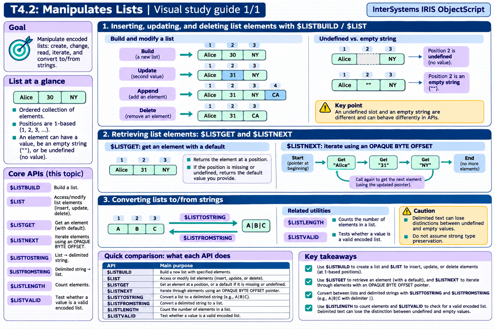

# T4.2: Manipulates Lists — visual study guides

[Approfondimenti dagli esercizi](<Approfondimenti esercizi/README.md>)

[Chapter contents](index.md) · [Full guide](study.md) · [Practice questions](quiz.md)

Generated learning summaries. Read the full notes for detailed explanations and exact code. [Technical review notes](../../visual-technical-notes.md).

## Visual guide — sections 1–3

Covers:

- 1. $LIST/$LISTBUILD to insert, update, and delete list elements
- 2. $LISTGET and $LISTNEXT for retrieval
- 3. Converting lists to/from strings
