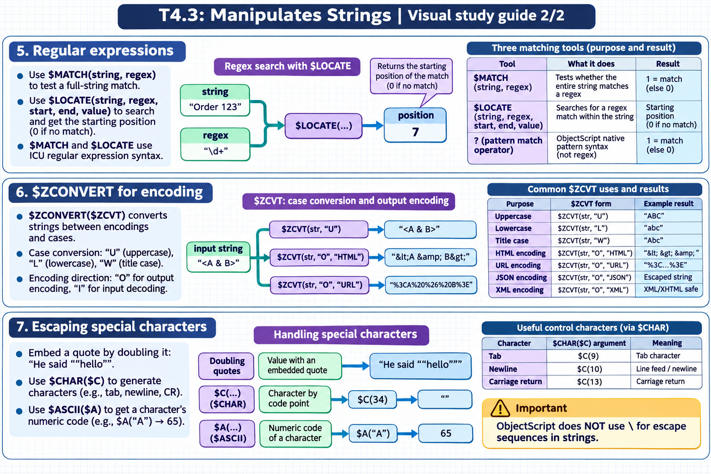

[Topic contents](../index.md) · [Full topic guide](../study.md) · [All topics](../../../index.md)

# T4.3: Manipulates Strings

Saved 2 November 2026 from [exam-prep.es](https://exam-prep.es/exams/objectscript/knowledge/T4.3.html). Reference links require internet access.

## 5. Regular expressions



*This diagram covers sections 5–7; use the matching numbered panel for this page.* [Chapter diagrams](../visuals.md) · [Technical review notes](../../../visual-technical-notes.md)

### Key Points

- **$MATCH(string, regex)**: Returns 1 if the entire string matches the regex pattern
- **$LOCATE(string, regex, start, end, value)**: Searches for a regex match within the string
- **Pattern match operator (?)**: ObjectScript native pattern syntax (not regex): string ? pattern
- **ICU regex syntax**: $MATCH and $LOCATE use ICU regular expression syntax
- **$LOCATE returns position**: Returns the starting position of the match (0 if no match)

### Detailed Notes

#### Overview

ObjectScript offers two pattern matching systems: ICU regular expressions ($MATCH, $LOCATE) and the native ObjectScript pattern match operator (?). Regular expressions are more powerful and flexible; the native operator is simpler for basic validation.

#### $MATCH: Full String Match

```objectscript
 // $MATCH tests if ENTIRE string matches the regex
 WRITE $MATCH("hello123", "[a-z]+\d+"), !        // 1 (matches)
 WRITE $MATCH("hello123!", "[a-z]+\d+"), !        // 0 (! not matched)

 // Email validation
 SET email = "user@example.com"
 WRITE $MATCH(email, "[^@]+@[^@]+\.[^@]+"), !     // 1

 // Phone number format
 SET phone = "555-123-4567"
 WRITE $MATCH(phone, "\d{3}-\d{3}-\d{4}"), !      // 1

 // Case-insensitive with (?i)
 WRITE $MATCH("Hello", "(?i)hello"), !             // 1
```

#### $LOCATE: Search Within String

```objectscript
 SET text = "The price is $42.50 today"

 // Find a number pattern
 SET pos = $LOCATE(text, "\d+\.?\d*")
 WRITE "Found at position: ", pos, !              // 16

 // With start position, end position, and matched value
 SET start = 1
 SET pos = $LOCATE(text, "\d+\.?\d*", start, .end, .matched)
 WRITE "Match: ", matched, !                      // 42.50
 WRITE "Start: ", pos, " End: ", end, !           // Start: 16 End: 21

 // Find all matches in a loop
 SET text = "abc 123 def 456 ghi 789"
 SET start = 1
 FOR {
     SET pos = $LOCATE(text, "\d+", start, .end, .matched)
     QUIT:pos=0
     WRITE "Found: ", matched, " at ", pos, !
     SET start = end
 }
 // Output:
 //   Found: 123 at 5
 //   Found: 456 at 13
 //   Found: 789 at 21
```

#### Native Pattern Match Operator (?)

```objectscript
 // Pattern syntax: count + code
 // N = numeric, A = alphabetic, P = punctuation
 // E = any character, L = lowercase, U = uppercase

 // Exactly 3 digits
 WRITE "123" ? 3N, !                // 1
 WRITE "12A" ? 3N, !                // 0

 // Variable count: .N means "zero or more digits"
 WRITE "123" ? .N, !                // 1
 WRITE "" ? .N, !                   // 1

 // 1 or more alpha followed by 1 or more numeric
 WRITE "abc123" ? 1.A1.N, !         // 1

 // Literal characters in quotes
 WRITE "2025-01-15" ? 4N1"-"2N1"-"2N, !   // 1

 // US phone: (555) 123-4567
 WRITE "(555) 123-4567" ? 1"("3N1") "3N1"-"4N, !  // 1
```

### Documentation References

- [$MATCH Function](https://docs.intersystems.com/irislatest/csp/docbook/DocBook.UI.Page.cls?KEY=RCOS_fmatch)
- [$LOCATE Function](https://docs.intersystems.com/irislatest/csp/docbook/DocBook.UI.Page.cls?KEY=RCOS_flocate)
- [Pattern Matching](https://docs.intersystems.com/irislatest/csp/docbook/DocBook.UI.Page.cls?KEY=GCOS_operators#GCOS_operators_pattern)
- [Regular Expressions](https://docs.intersystems.com/irislatest/csp/docbook/DocBook.UI.Page.cls?KEY=GCOS_regexp)
