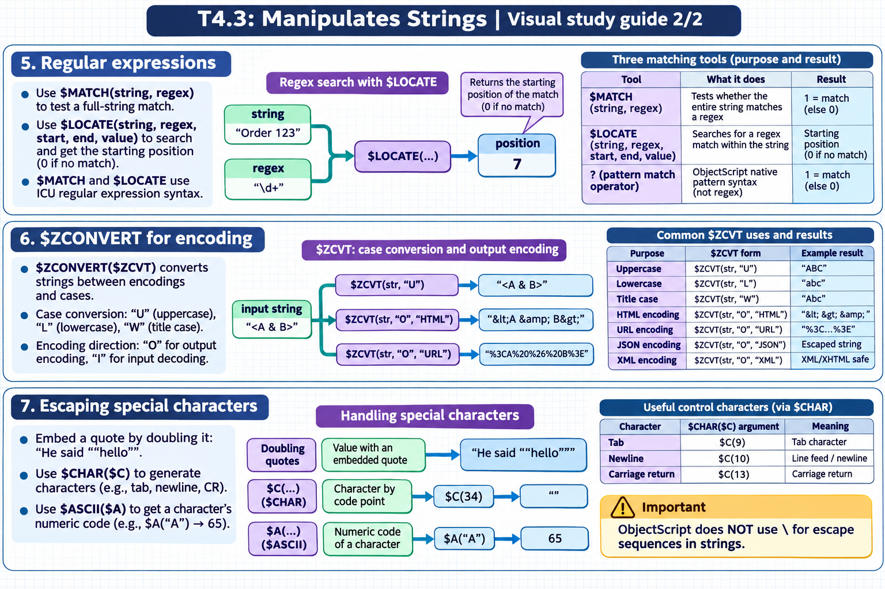

[Topic contents](../index.md) · [Full topic guide](../study.md) · [All topics](../../../index.md)

# T4.3: Manipulates Strings

Saved 2 November 2026 from [exam-prep.es](https://exam-prep.es/exams/objectscript/knowledge/T4.3.html). Reference links require internet access.

## 6. $ZCONVERT for encoding



*This diagram covers sections 5–7; use the matching numbered panel for this page.* [Chapter diagrams](../visuals.md) · [Technical review notes](../../../visual-technical-notes.md)

### Key Points

- **$ZCONVERT($ZCVT)**: Converts strings between encodings and cases
- **Case conversion**: $ZCVT(str, "U") uppercase, $ZCVT(str, "L") lowercase, $ZCVT(str, "W") title case
- **Encoding direction**: "O" for output encoding, "I" for input decoding
- **HTML encoding**: $ZCVT(str, "O", "HTML") converts &lt; &gt; & " to HTML entities
- **URL encoding**: $ZCVT(str, "O", "URL") percent-encodes special characters
- **JSON encoding**: $ZCVT(str, "O", "JSON") escapes for JSON string values
- **XML encoding**: $ZCVT(str, "O", "XML") converts for XML/XHTML content

### Detailed Notes

#### Overview

$ZCONVERT (abbreviated $ZCVT) is a versatile function used for case conversion and encoding/decoding strings for various output formats. It is essential for web development, data integration, and security (preventing injection attacks).

#### Case Conversion

```objectscript
 SET str = "Hello World"

 // Uppercase
 WRITE $ZCONVERT(str, "U"), !         // HELLO WORLD

 // Lowercase
 WRITE $ZCONVERT(str, "L"), !         // hello world

 // Title case (first letter of each word)
 SET str2 = "hello world"
 WRITE $ZCVT(str2, "W"), !            // Hello World

 // Works with Unicode characters
 SET french = "ecole"
 WRITE $ZCVT(french, "U"), !          // ECOLE
```

#### HTML Encoding (Output)

```objectscript
 SET html = "<script>alert('XSS')</script>"

 // Encode for safe HTML output
 WRITE $ZCVT(html, "O", "HTML"), !
 // Output: &lt;script&gt;alert(&#39;XSS&#39;)&lt;/script&gt;

 // Decode HTML entities back
 SET encoded = "&lt;b&gt;Bold&lt;/b&gt;"
 WRITE $ZCVT(encoded, "I", "HTML"), !
 // Output: <b>Bold</b>
```

#### URL Encoding

```objectscript
 SET query = "name=John Smith&city=New York"

 // Encode for URL
 WRITE $ZCVT(query, "O", "URL"), !
 // Output: name%3DJohn+Smith%26city%3DNew+York

 // Decode URL-encoded string
 SET encoded = "Hello%20World%21"
 WRITE $ZCVT(encoded, "I", "URL"), !
 // Output: Hello World!
```

#### JSON Encoding

```objectscript
 SET str = "He said ""hello"" and left"

 // Encode for JSON string value
 WRITE $ZCVT(str, "O", "JSON"), !
 // Output: He said \"hello\" and left

 // Handles control characters
 SET withTab = "Line1" _ $CHAR(9) _ "Line2"
 WRITE $ZCVT(withTab, "O", "JSON"), !
 // Output: Line1\tLine2
```

#### XML Encoding

```objectscript
 SET xml = "<tag attr=""value"">Data & more</tag>"

 WRITE $ZCVT(xml, "O", "XML"), !
 // Output: &lt;tag attr=&quot;value&quot;&gt;Data &amp; more&lt;/tag&gt;
```

#### UTF-8 Encoding

```objectscript
 // Convert to/from UTF-8 bytes
 SET str = "Hello"
 SET utf8 = $ZCVT(str, "O", "UTF8")
 SET back = $ZCVT(utf8, "I", "UTF8")
```

### Documentation References

- [$ZCONVERT Function](https://docs.intersystems.com/irislatest/csp/docbook/DocBook.UI.Page.cls?KEY=RCOS_fzconvert)
