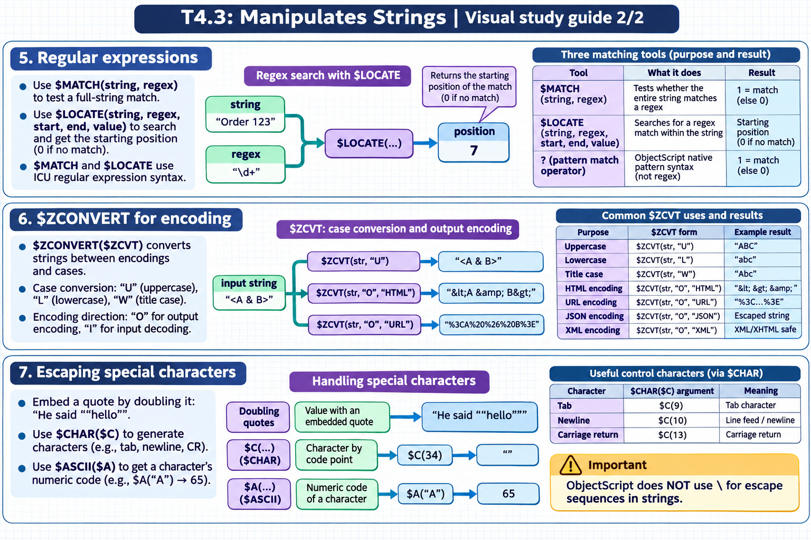

[Topic contents](../index.md) · [Full topic guide](../study.md) · [All topics](../../../index.md)

# T4.3: Manipulates Strings

Saved 2 November 2026 from [exam-prep.es](https://exam-prep.es/exams/objectscript/knowledge/T4.3.html). Reference links require internet access.

## 7. Escaping special characters



*This diagram covers sections 5–7; use the matching numbered panel for this page.* [Chapter diagrams](../visuals.md) · [Technical review notes](../../../visual-technical-notes.md)

### Key Points

- **Doubling quotes**: Embed a quote in a string by doubling it: "He said ""hello"""
- **$CHAR($C)**: Generate characters by ASCII/Unicode code point: $C(34) for double quote
- **$ASCII($A)**: Get the numeric code of a character: $A("A") returns 65
- **Control characters**: Use $CHAR for tab (9), newline (10), carriage return (13)
- **No backslash escapes**: ObjectScript does NOT use \ for escape sequences in strings

### Detailed Notes

#### Overview

ObjectScript strings are delimited by double quotes. To include special characters within strings, you either double the quote character or use $CHAR to generate characters by their code point. There are no backslash escape sequences like in C or JavaScript.

#### Doubling Quotes

```objectscript
 // Embed a double quote by doubling it
 SET msg = "He said ""hello"" to everyone"
 WRITE msg, !
 // Output: He said "hello" to everyone

 // Multiple quotes
 SET str = "The value is ""42"" not ""43"""
 WRITE str, !
 // Output: The value is "42" not "43"

 // Empty quoted string within a string
 SET str = "An empty string is """"."
 WRITE str, !
 // Output: An empty string is "".
```

#### $CHAR and $ASCII

```objectscript
 // $CHAR generates characters from code points
 WRITE $CHAR(65), !                 // A
 WRITE $CHAR(97), !                 // a
 WRITE $CHAR(48), !                 // 0

 // Multiple characters at once
 WRITE $CHAR(72, 101, 108, 108, 111), !   // Hello

 // Special characters
 SET tab = $CHAR(9)
 SET lf = $CHAR(10)
 SET cr = $CHAR(13)
 SET crlf = $CHAR(13, 10)
 SET quote = $CHAR(34)

 // $C shorthand
 SET pipe = $C(124)                 // |

 // $ASCII returns the code point
 WRITE $ASCII("A"), !               // 65
 WRITE $ASCII("a"), !               // 97
 WRITE $ASCII("0"), !               // 48

 // $A shorthand; get specific position
 SET str = "Hello"
 WRITE $A(str, 1), !                // 72 (H)
 WRITE $A(str, 5), !                // 111 (o)

 // -1 for position beyond string length
 WRITE $A(str, 99), !               // -1
```

#### Practical Escaping Patterns

```objectscript
 // Building SQL with quoted values (for illustration -- use parameters in practice!)
 SET name = "O'Brien"
 // In SQL, single quotes are doubled
 SET escaped = $REPLACE(name, "'", "''")
 WRITE "SELECT * FROM Table WHERE Name = '", escaped, "'", !
 // Output: SELECT * FROM Table WHERE Name = 'O''Brien'

 // Building JSON manually (prefer %DynamicObject in practice)
 SET key = "name"
 SET val = "John ""JD"" Doe"
 SET json = "{" _ $C(34) _ key _ $C(34) _ ":" _ $C(34) _ $ZCVT(val, "O", "JSON") _ $C(34) _ "}"
 WRITE json, !
 // Output: {"name":"John \"JD\" Doe"}

 // Build a string with mixed special characters
 SET header = "Name" _ $C(9) _ "Age" _ $C(9) _ "City"
 SET row = "Alice" _ $C(9) _ "30" _ $C(9) _ "NYC"
 WRITE header, !
 WRITE row, !
 // Tab-separated output
```

#### Character Testing

```objectscript
 // Check if character is a digit
 SET ch = "5"
 SET code = $A(ch)
 IF (code >= 48) && (code <= 57) {
     WRITE ch, " is a digit", !
 }

 // Check if character is uppercase letter
 SET ch = "A"
 SET code = $A(ch)
 IF (code >= 65) && (code <= 90) {
     WRITE ch, " is uppercase", !
 }
```

### Documentation References

- [$CHAR Function](https://docs.intersystems.com/irislatest/csp/docbook/DocBook.UI.Page.cls?KEY=RCOS_fchar)
- [$ASCII Function](https://docs.intersystems.com/irislatest/csp/docbook/DocBook.UI.Page.cls?KEY=RCOS_fascii)
- [String Literals](https://docs.intersystems.com/irislatest/csp/docbook/DocBook.UI.Page.cls?KEY=GCOS_types#GCOS_types_string)
