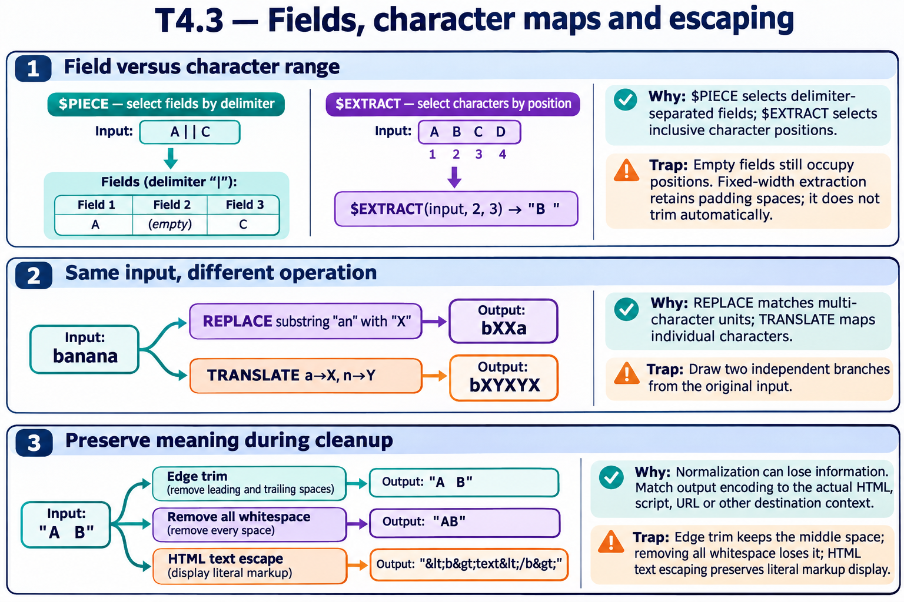

# T4.3 · 01 — Posizione di campo e posizione di carattere

[Indice degli approfondimenti](README.md) · [Quiz originale](../quiz.md) · [Teoria](../study.md)

**Esercizi di partenza:** [Q1](../quiz.md#question-1-single) · [Q2](../quiz.md#question-2-single) · [Q3](../quiz.md#question-3-single) · [Q4](../quiz.md#question-4-single) · [Q15](../quiz.md#question-15-single) · [Q17](../quiz.md#question-17-single). L’approfondimento rielabora il concetto e aggiunge una variante; non riproduce soltanto la risposta del quiz.

## Il caso concreto

Smith^John^New York^NY ha quattro campi. Cambiare il terzo non richiede di calcolare gli offset dei caratteri.

```objectscript
set rec="Smith^John^New York^NY"
set $PIECE(rec,"^",3)="Boston"
write rec
write $PIECE("A-B-C-D-E","-",2,4)
```

## Ragionamento passo per passo

Il record diventa Smith^John^Boston^NY. L’intervallo 2..4 restituisce B-C-D, estremi inclusi. $EXTRACT(9,16) seleziona invece otto caratteri: in un formato a larghezza fissa anche gli spazi fanno parte dell’output.

## Perché il distrattore è plausibile

Applicare l’indice del campo come se fosse un offset di carattere oppure rimuovere mentalmente gli spazi del record fisso.

## Lo spunto da portare oltre l’esercizio

Prima di manipolare il testo, definisci l’unità di posizione: campo o carattere.



*Leggi il pannello 1; gli altri due collegano il caso agli altri approfondimenti del capitolo.*

## Variante: prova prima di leggere la soluzione

Quanti caratteri include l’intervallo 9..16?

<details>
<summary>Soluzione ragionata</summary>

Otto: 16-9+1.

</details>

## Riferimenti e precisazioni

- [$PIECE](https://docs.intersystems.com/irislatest/csp/docbook/DocBook.UI.Page.cls?KEY=RCOS_fpiece)
- [$EXTRACT](https://docs.intersystems.com/irislatest/csp/docbook/DocBook.UI.Page.cls?KEY=RCOS_fextract)
- [$TRANSLATE](https://docs.intersystems.com/irislatest/csp/docbook/DocBook.UI.Page.cls?KEY=RCOS_ftranslate)
- [$REPLACE](https://docs.intersystems.com/irislatest/csp/docbook/DocBook.UI.Page.cls?KEY=RCOS_freplace)

[Note specifiche del capitolo](README.md#precisazioni-rispetto-al-quiz) · [Metodo e limiti della revisione](../../../approfondimenti-esercizi.md#metodo-e-limiti)
