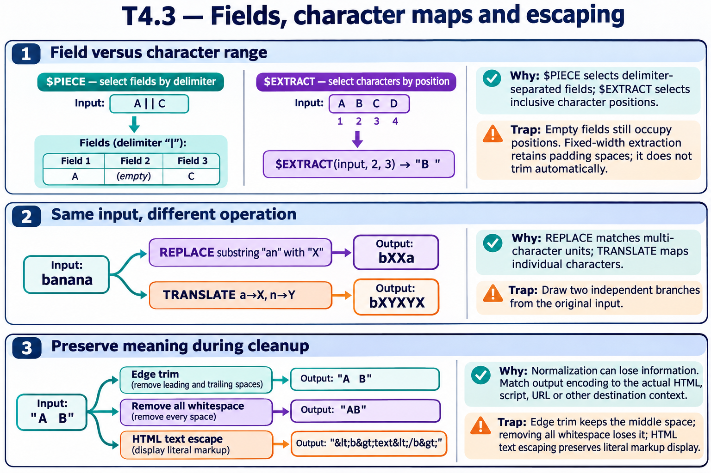

# T4.3 · 02 — Sostituire sequenze e tradurre caratteri

[Indice degli approfondimenti](README.md) · [Quiz originale](../quiz.md) · [Teoria](../study.md)

**Esercizi di partenza:** [Q5](../quiz.md#question-5-single) · [Q6](../quiz.md#question-6-single) · [Q7](../quiz.md#question-7-single) · [Q8](../quiz.md#question-8-single) · [Q18](../quiz.md#question-18-single). L’approfondimento rielabora il concetto e aggiunge una variante; non riproduce soltanto la risposta del quiz.

## Il caso concreto

banana viene trasformata con $REPLACE e $TRANSLATE usando gli stessi caratteri, ma le due funzioni hanno unità diverse.

```objectscript
write $REPLACE("banana","an","X"), !
write $TRANSLATE("banana","an","XY")
```

## Ragionamento passo per passo

$REPLACE riconosce la sequenza an e la sostituisce con X: bXXa. $TRANSLATE mappa ogni a in X e ogni n in Y: bXYXYX. Una ricerca di parola o sequenza non è quindi equivalente a una tabella di trasformazione dei singoli caratteri.

## Perché il distrattore è plausibile

Trattare XY come una singola sostituzione di an dentro $TRANSLATE.

## Lo spunto da portare oltre l’esercizio

Chiediti se l’operazione agisce su sottostringhe o su caratteri indipendenti.



*Leggi il pannello 2; gli altri due collegano il caso agli altri approfondimenti del capitolo.*

## Variante: prova prima di leggere la soluzione

Con $TRANSLATE("banana","an","") che cosa rimane?

<details>
<summary>Soluzione ragionata</summary>

b: vengono eliminati tutti gli a e tutti gli n.

</details>

## Riferimenti e precisazioni

- [$PIECE](https://docs.intersystems.com/irislatest/csp/docbook/DocBook.UI.Page.cls?KEY=RCOS_fpiece)
- [$EXTRACT](https://docs.intersystems.com/irislatest/csp/docbook/DocBook.UI.Page.cls?KEY=RCOS_fextract)
- [$TRANSLATE](https://docs.intersystems.com/irislatest/csp/docbook/DocBook.UI.Page.cls?KEY=RCOS_ftranslate)
- [$REPLACE](https://docs.intersystems.com/irislatest/csp/docbook/DocBook.UI.Page.cls?KEY=RCOS_freplace)

[Note specifiche del capitolo](README.md#precisazioni-rispetto-al-quiz) · [Metodo e limiti della revisione](../../../approfondimenti-esercizi.md#metodo-e-limiti)
