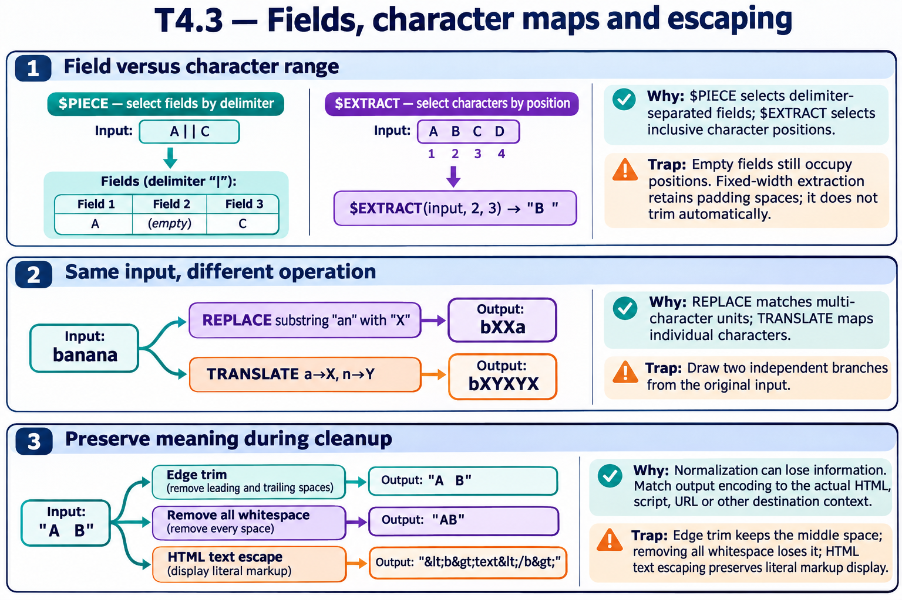

# T4.3 · 03 — Normalizzare non è sempre preservare il significato

[Indice degli approfondimenti](README.md) · [Quiz originale](../quiz.md) · [Teoria](../study.md)

**Esercizi di partenza:** [Q9](../quiz.md#question-9-single) · [Q10](../quiz.md#question-10-single) · [Q11](../quiz.md#question-11-single) · [Q12](../quiz.md#question-12-single) · [Q13](../quiz.md#question-13-single) · [Q14](../quiz.md#question-14-single) · [Q16](../quiz.md#question-16-single). L’approfondimento rielabora il concetto e aggiunge una variante; non riproduce soltanto la risposta del quiz.

## Il caso concreto

Togliere spazi ai bordi e rimuovere tutti gli spazi produce risultati diversi. Anche codificare HTML e convertire in maiuscolo rispondono a obiettivi distinti.

## Ragionamento passo per passo

Per "  Hello World  ", un trim dei bordi conserva lo spazio interno; una rimozione globale produce HelloWorld. La normalizzazione deve rispettare il dominio: un nome, un codice e testo da visualizzare non hanno lo stesso contratto. Un valore HTML-encoded non è automaticamente corretto per SQL, URL o altri contesti.

## Perché il distrattore è plausibile

Applicare una trasformazione distruttiva universale o interpretare encoding come autorizzazione o parametrizzazione.

## Lo spunto da portare oltre l’esercizio

Specifica il risultato desiderato con un esempio prima di scegliere l’operazione.

*Leggi il pannello 3; gli altri due collegano il caso agli altri approfondimenti del capitolo.*

## Variante: prova prima di leggere la soluzione

Per un nome completo vuoi eliminare gli spazi esterni: "Ada Lovelace" deve diventare "AdaLovelace"?

Soluzione ragionata

No: lo spazio interno è significativo e va preservato.

## Riferimenti e precisazioni

- [$PIECE](https://docs.intersystems.com/irislatest/csp/docbook/DocBook.UI.Page.cls?KEY=RCOS_fpiece)
- [$EXTRACT](https://docs.intersystems.com/irislatest/csp/docbook/DocBook.UI.Page.cls?KEY=RCOS_fextract)
- [$TRANSLATE](https://docs.intersystems.com/irislatest/csp/docbook/DocBook.UI.Page.cls?KEY=RCOS_ftranslate)
- [$REPLACE](https://docs.intersystems.com/irislatest/csp/docbook/DocBook.UI.Page.cls?KEY=RCOS_freplace)

[Note specifiche del capitolo](README.md#precisazioni-rispetto-al-quiz) · [Metodo e limiti della revisione](../../../approfondimenti-esercizi.md#metodo-e-limiti)
