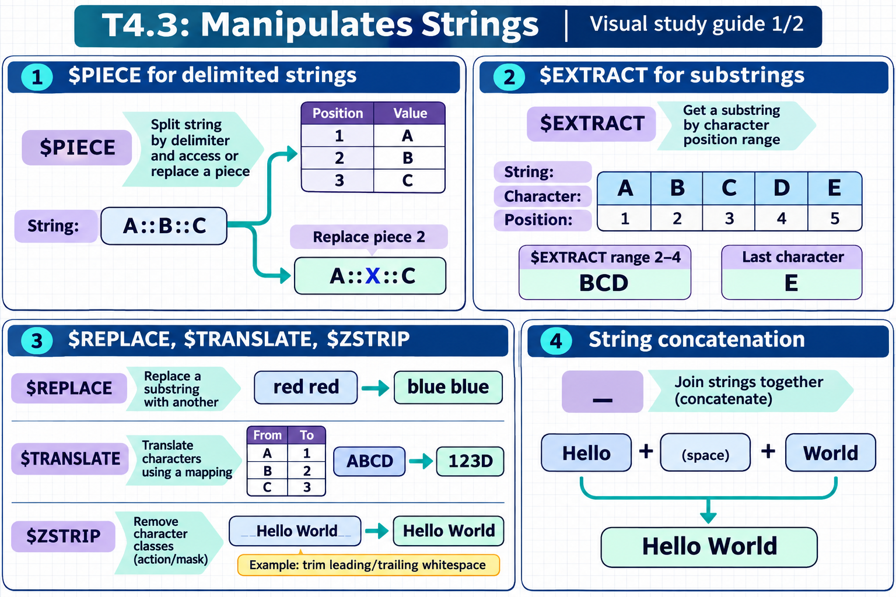
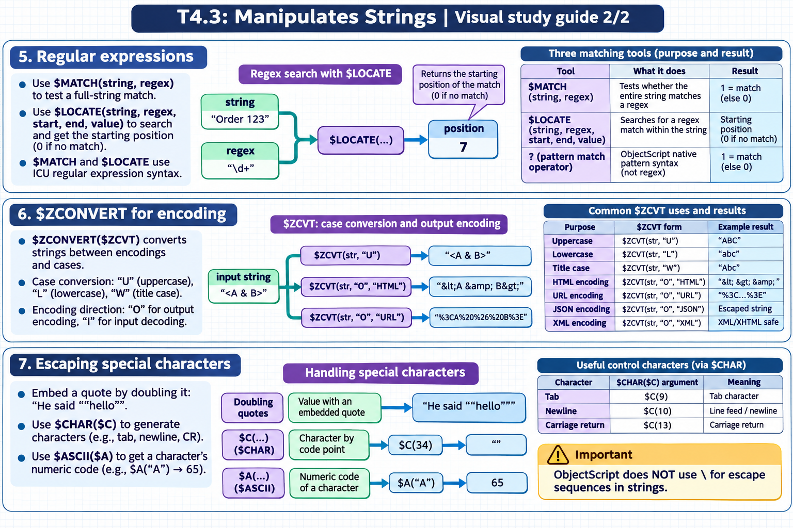
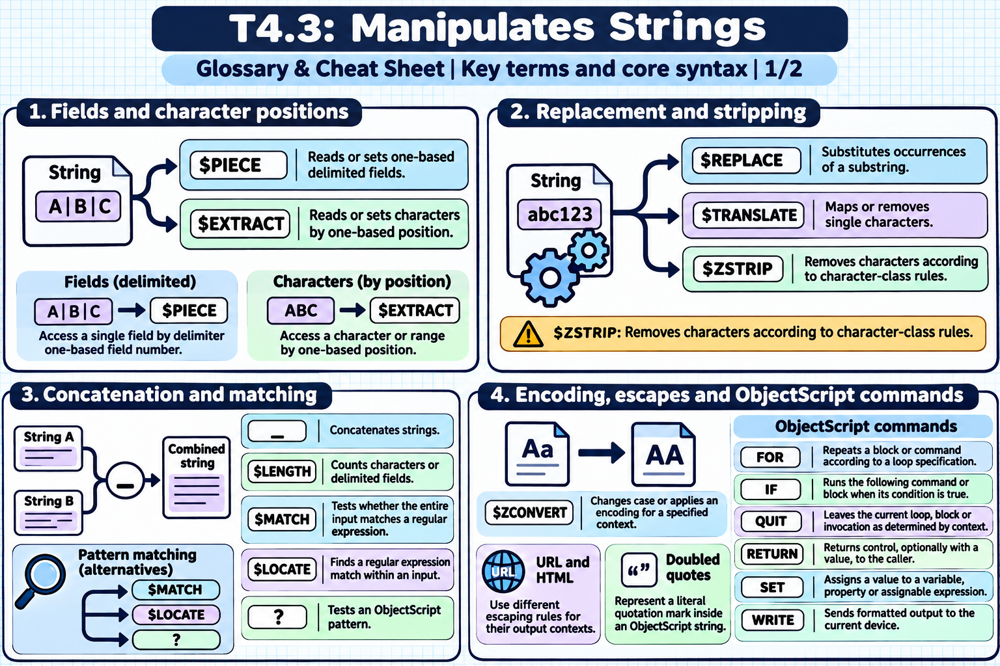
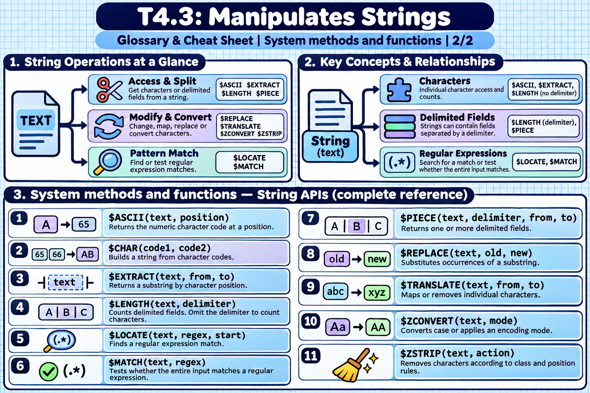

# T4.3: Manipulates Strings — visual study guides

[Approfondimenti dagli esercizi](<Approfondimenti esercizi/README.md>)

[Chapter contents](index.md) · [Full guide](study.md) · [Practice questions](quiz.md)

Generated learning summaries. Read the full notes for detailed explanations and exact code. [Technical review notes](../../visual-technical-notes.md).

## Visual guide — sections 1–4

Covers:

- 1. $PIECE for delimited strings
- 2. $EXTRACT for substrings
- 3. $REPLACE, $TRANSLATE, $ZSTRIP
- 4. String concatenation

## Visual guide — sections 5–7

Covers:

- 5. Regular expressions
- 6. $ZCONVERT for encoding
- 7. Escaping special characters

## Glossary & Cheat Sheet

[Open the text recap](study.md#glossary--cheat-sheet).
