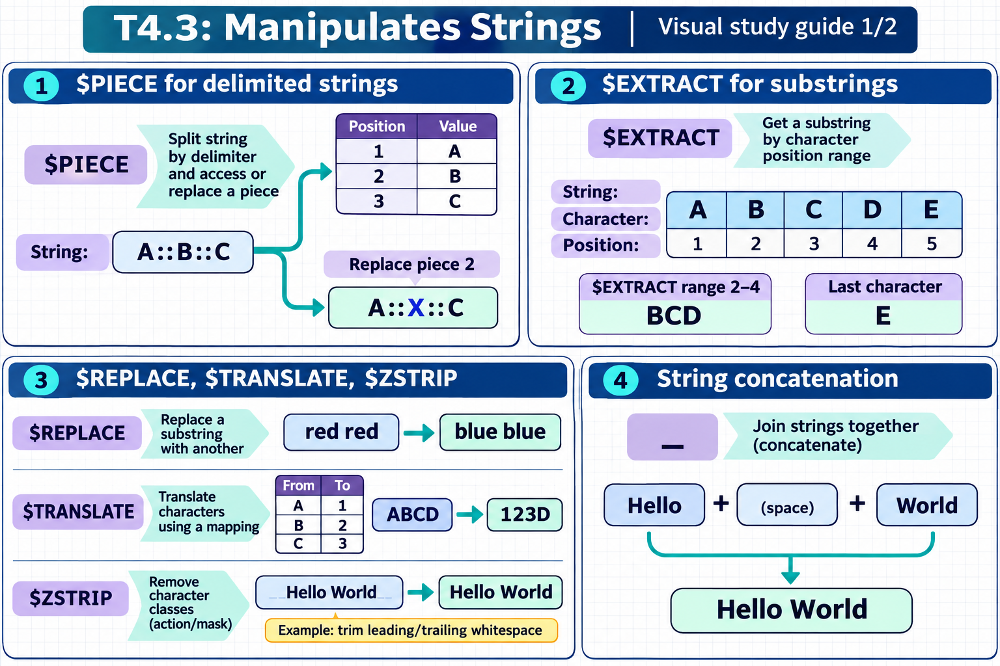
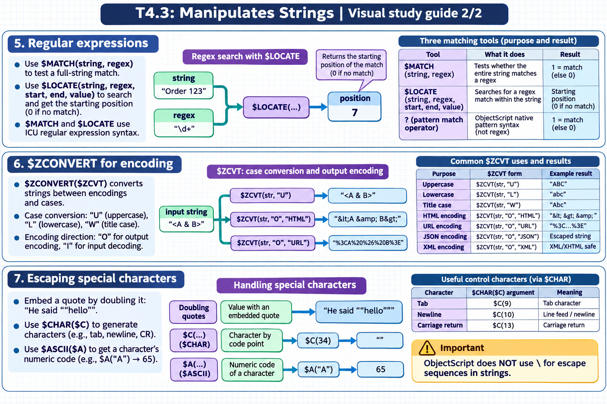

[All topics](../../index.md) · [Practice quiz](quiz.md)

# T4.3: Manipulates Strings

[Approfondimenti dagli esercizi](<Approfondimenti esercizi/README.md>)

Saved 2 November 2026 from [exam-prep.es](https://exam-prep.es/exams/objectscript/knowledge/T4.3.html). Reference links require internet access.

### Contents

1. [$PIECE for delimited strings](#1-piece-for-delimited-strings)
2. [$EXTRACT for substrings](#2-extract-for-substrings)
3. [$REPLACE, $TRANSLATE, $ZSTRIP](#3-replace-translate-zstrip)
4. [String concatenation](#4-string-concatenation)
5. [Regular expressions](#5-regular-expressions)
6. [$ZCONVERT for encoding](#6-zconvert-for-encoding)
7. [Escaping special characters](#7-escaping-special-characters)

### Visual study guide — sections 1–4



[View all chapter diagrams](visuals.md) · [Technical review notes](../../visual-technical-notes.md)

## 1. $PIECE for delimited strings

### Key Points

- **$PIECE($P)**: Extracts a substring based on a delimiter and piece number
- **$P(string, delimiter, from, to)**: Extracts pieces from position "from" to "to"
- **SET $PIECE**: Modifies a specific piece in-place: SET $P(var, delim, pos) = newValue
- **1-based positions**: First piece is position 1
- **Multi-character delimiters**: Delimiter can be more than one character: $P(str, "::", 2)
- **Beyond range**: Requesting a piece beyond the last delimiter returns empty string

### Detailed Notes

#### Overview

$PIECE is one of the most frequently used ObjectScript functions. It works with delimited strings, extracting or replacing segments based on a specified delimiter. Unlike lists, $PIECE works on plain strings without any special encoding.

#### Basic Extraction

```objectscript
 SET record = "Smith^John^42^New York"

 // Extract individual pieces (1-based)
 WRITE $PIECE(record, "^", 1), !     // Smith
 WRITE $PIECE(record, "^", 2), !     // John
 WRITE $PIECE(record, "^", 3), !     // 42
 WRITE $PIECE(record, "^", 4), !     // New York

 // $P shorthand
 WRITE $P(record, "^", 1), !         // Smith

 // Piece beyond range returns ""
 WRITE $P(record, "^", 10), !        // (empty string)
```

#### Extracting Multiple Pieces

```objectscript
 SET record = "Smith^John^42^New York^Engineer"

 // Extract pieces 2 through 4
 WRITE $P(record, "^", 2, 4), !      // John^42^New York

 // Extract from piece 3 to end
 WRITE $P(record, "^", 3, *), !      // 42^New York^Engineer

 // First piece only (default when no position given)
 WRITE $P(record, "^"), !            // Smith
```

#### Modifying Pieces with SET $PIECE

```objectscript
 SET record = "Smith^John^42^New York"

 // Replace piece 3 (age)
 SET $PIECE(record, "^", 3) = 43
 WRITE record, !    // Smith^John^43^New York

 // $P shorthand for SET
 SET $P(record, "^", 4) = "Boston"
 WRITE record, !    // Smith^John^43^Boston

 // Setting a piece beyond current range extends the string
 SET $P(record, "^", 6) = "Active"
 WRITE record, !    // Smith^John^43^Boston^^Active
 // Note: piece 5 is empty, creating two consecutive delimiters
```

#### Building Strings Piece by Piece

```objectscript
 // Start with empty string and build incrementally
 SET msg = ""
 SET $P(msg, "|", 1) = "MSH"
 SET $P(msg, "|", 2) = "^~\&"
 SET $P(msg, "|", 3) = "SENDING_APP"
 WRITE msg, !    // MSH|^~\&|SENDING_APP
```

#### Multi-Character Delimiters

```objectscript
 SET data = "key1::value1::key2::value2"
 WRITE $P(data, "::", 1), !    // key1
 WRITE $P(data, "::", 2), !    // value1
 WRITE $P(data, "::", 4), !    // value2
```

#### Counting Pieces with $LENGTH

```objectscript
 SET csv = "a,b,c,d,e"
 WRITE $LENGTH(csv, ","), !    // 5 (number of comma-delimited pieces)

 SET empty = ""
 WRITE $LENGTH(empty, ","), !  // 1 (empty string = 1 piece)
```

### Documentation References

- [$PIECE Function](https://docs.intersystems.com/irislatest/csp/docbook/DocBook.UI.Page.cls?KEY=RCOS_fpiece)
- [SET $PIECE](https://docs.intersystems.com/irislatest/csp/docbook/DocBook.UI.Page.cls?KEY=RCOS_fpiece#RCOS_fpiece_set)

## 2. $EXTRACT for substrings

### Key Points

- **$EXTRACT($E)**: Extracts characters by position: $E(string, from, to)
- **Single character**: $E(string, n) extracts the nth character (1-based)
- **Range**: $E(string, from, to) extracts a substring
- **SET $EXTRACT**: Replaces characters in-place: SET $E(var, from, to) = replacement
- **From end**: $E(string, \*) gets last character; $E(string, \*-n) counts from end
- **$LENGTH**: Returns the number of characters in a string

### Detailed Notes

#### Overview

$EXTRACT works at the character level, extracting or replacing individual characters or substrings by position. Unlike $PIECE which works with delimiters, $EXTRACT uses numeric positions within the string.

#### Basic Character Extraction

```objectscript
 SET name = "ObjectScript"

 // Single character (1-based)
 WRITE $EXTRACT(name, 1), !        // O
 WRITE $EXTRACT(name, 7), !        // S

 // $E shorthand
 WRITE $E(name, 1), !              // O

 // Character range
 WRITE $E(name, 1, 6), !           // Object
 WRITE $E(name, 7, 12), !          // Script

 // From end
 WRITE $E(name, *), !              // t (last char)
 WRITE $E(name, *-5, *), !         // Script (last 6 chars)
```

#### Modifying with SET $EXTRACT

```objectscript
 SET word = "Hello"

 // Replace single character
 SET $E(word, 1) = "J"
 WRITE word, !                     // Jello

 // Replace range (different length OK)
 SET $E(word, 1, 3) = "Mars"
 WRITE word, !                     // Marslo

 // Replace with shorter string
 SET word = "Hello World"
 SET $E(word, 6, 6) = "-"
 WRITE word, !                     // Hello-World
```

#### Using $LENGTH for String Length

```objectscript
 SET str = "ObjectScript"
 WRITE $LENGTH(str), !             // 12

 // Get last N characters
 SET n = 6
 WRITE $E(str, $L(str) - n + 1, $L(str)), !   // Script

 // Or more concisely
 WRITE $E(str, *-5, *), !                       // Script
```

#### Practical Patterns

```objectscript
 // Check if string starts with a prefix
 SET filename = "report_2025.pdf"
 IF $E(filename, 1, 7) = "report_" {
     WRITE "It's a report file", !
 }

 // Check file extension
 SET ext = $E(filename, *-2, *)
 WRITE "Extension: ", ext, !       // pdf

 // Pad a string to fixed width
 SET num = "42"
 SET padded = $E("00000" _ num, *-4, *)
 WRITE padded, !                   // 00042

 // Truncate a string
 SET longStr = "This is a very long string"
 SET truncated = $E(longStr, 1, 10) _ "..."
 WRITE truncated, !                // This is a ...
```

### Documentation References

- [$EXTRACT Function](https://docs.intersystems.com/irislatest/csp/docbook/DocBook.UI.Page.cls?KEY=RCOS_fextract)
- [$LENGTH Function](https://docs.intersystems.com/irislatest/csp/docbook/DocBook.UI.Page.cls?KEY=RCOS_flength)

## 3. $REPLACE, $TRANSLATE, $ZSTRIP

### Key Points

- **$REPLACE**: Replaces all occurrences of a substring: $REPLACE(string, old, new)
- **$TRANSLATE($TR)**: Character-by-character replacement: $TR(string, fromChars, toChars)
- **$TRANSLATE deletion**: If toChars is shorter, unmatched fromChars are deleted
- **$ZSTRIP**: Removes characters by category/mask: $ZSTRIP(string, mask, removeChars, keepChars)
- **$ZSTRIP masks**: "&lt;" strip leading, "&gt;" strip trailing, "\*" strip all, "&lt;&gt;" strip both ends

### Detailed Notes

#### Overview

These three functions handle different string transformation needs: $REPLACE for substring replacement, $TRANSLATE for character-level mapping, and $ZSTRIP for removing categories of characters.

#### $REPLACE: Substring Replacement

```objectscript
 SET str = "Hello World, Hello IRIS"

 // Replace all occurrences
 WRITE $REPLACE(str, "Hello", "Hi"), !
 // Output: Hi World, Hi IRIS

 // Case-sensitive
 WRITE $REPLACE(str, "hello", "hi"), !
 // Output: Hello World, Hello IRIS (no change -- case mismatch)

 // Remove by replacing with empty string
 WRITE $REPLACE(str, " Hello", ""), !
 // Output: Hello World, IRIS

 // Replace multi-character sequences
 SET path = "C:\Users\Admin\Documents"
 WRITE $REPLACE(path, "\", "/"), !
 // Output: C:/Users/Admin/Documents
```

#### $TRANSLATE: Character-by-Character Mapping

```objectscript
 // Map characters one-to-one
 SET str = "Hello World"
 WRITE $TRANSLATE(str, "lo", "LO"), !
 // Output: HeLLO WOrLd

 // $TR shorthand
 WRITE $TR(str, "HW", "hw"), !
 // Output: hello world

 // Delete characters (toChars shorter than fromChars)
 SET phone = "(555) 123-4567"
 WRITE $TR(phone, "()- ", ""), !
 // Output: 5551234567

 // ROT13 encoding
 SET msg = "Hello"
 SET from = "ABCDEFGHIJKLMNOPQRSTUVWXYZabcdefghijklmnopqrstuvwxyz"
 SET to   = "NOPQRSTUVWXYZABCDEFGHIJKLMnopqrstuvwxyzabcdefghijklm"
 WRITE $TR(msg, from, to), !
 // Output: Uryyb

 // Convert to uppercase (simple ASCII)
 SET lower = "hello world"
 WRITE $TR(lower, "abcdefghijklmnopqrstuvwxyz", "ABCDEFGHIJKLMNOPQRSTUVWXYZ"), !
 // Output: HELLO WORLD
 // Better: use $ZCONVERT(lower, "U") -- see item 6
```

#### $ZSTRIP: Category-Based Removal

```objectscript
 SET str = "  Hello 123 World!  "

 // Strip leading and trailing whitespace
 WRITE $ZSTRIP(str, "<>W"), !
 // Output: Hello 123 World!

 // Strip all whitespace
 WRITE $ZSTRIP(str, "*W"), !
 // Output: Hello123World!

 // Strip leading whitespace only
 WRITE $ZSTRIP(str, "<W"), !
 // Output: Hello 123 World!  (trailing space preserved)

 // Strip all non-numeric characters
 SET mixed = "abc123def456"
 WRITE $ZSTRIP(mixed, "*A"), !
 // Output: 123456 (strips all alpha, leaving digits)

 // Strip specific characters
 SET data = "###Hello###"
 WRITE $ZSTRIP(data, "<>", "#"), !
 // Output: Hello (strips # from both ends)

 // Common masks:
 // "W" = whitespace, "A" = alphabetic, "N" = numeric
 // "P" = punctuation, "C" = control characters
 // "L" = lowercase, "U" = uppercase, "E" = everything

 // Strip all punctuation
 SET text = "Hello, World! How are you?"
 WRITE $ZSTRIP(text, "*P"), !
 // Output: Hello World How are you
```

### Documentation References

- [$REPLACE Function](https://docs.intersystems.com/irislatest/csp/docbook/DocBook.UI.Page.cls?KEY=RCOS_freplace)
- [$TRANSLATE Function](https://docs.intersystems.com/irislatest/csp/docbook/DocBook.UI.Page.cls?KEY=RCOS_ftranslate)
- [$ZSTRIP Function](https://docs.intersystems.com/irislatest/csp/docbook/DocBook.UI.Page.cls?KEY=RCOS_fzstrip)

## 4. String concatenation

### Key Points

- **Concatenation operator (_)**: The underscore joins strings: "Hello" _ " " _ "World"
- **No template literals**: ObjectScript does not support string interpolation or template strings
- **Type coercion**: Non-string values are automatically converted when concatenated
- **Building strings in loops**: Common pattern to build output incrementally
- **$CHAR for special characters**: Use $CHAR(n) to concatenate non-printable characters

### Detailed Notes

#### Overview

ObjectScript uses the underscore character (_) as its string concatenation operator. There is no string interpolation or template literal syntax -- all string building uses explicit concatenation.

#### Basic Concatenation

```objectscript
 SET first = "John"
 SET last = "Smith"

 // Simple concatenation
 SET fullName = first _ " " _ last
 WRITE fullName, !                  // John Smith

 // Multiple concatenations
 SET greeting = "Hello, " _ first _ " " _ last _ "!"
 WRITE greeting, !                  // Hello, John Smith!

 // Numeric coercion
 SET age = 42
 SET msg = first _ " is " _ age _ " years old"
 WRITE msg, !                       // John is 42 years old
```

#### Special Characters with $CHAR

```objectscript
 // Newline character
 SET crlf = $CHAR(13, 10)
 SET multiLine = "Line 1" _ crlf _ "Line 2"

 // Tab character
 SET tab = $CHAR(9)
 SET tsv = "Col1" _ tab _ "Col2" _ tab _ "Col3"

 // Double quote within a string
 SET quoted = "He said " _ $CHAR(34) _ "hello" _ $CHAR(34)
 WRITE quoted, !                    // He said "hello"
```

#### Building Strings in Loops

```objectscript
 // Build a comma-separated list
 SET result = ""
 SET sep = ""
 FOR i = 1:1:5 {
     SET result = result _ sep _ i
     SET sep = ","
 }
 WRITE result, !                    // 1,2,3,4,5

 // Alternative: build then strip trailing separator
 SET result = ""
 FOR i = 1:1:5 {
     SET result = result _ i _ ","
 }
 SET result = $E(result, 1, *-1)    // Remove trailing comma
 WRITE result, !                    // 1,2,3,4,5
```

#### Concatenation vs WRITE

```objectscript
 // WRITE outputs directly (more efficient for display)
 WRITE "Name: ", first, " ", last, !

 // Concatenation builds a string value (for storage/return)
 SET output = "Name: " _ first _ " " _ last
 RETURN output
```

### Documentation References

- [Concatenation Operator](https://docs.intersystems.com/irislatest/csp/docbook/DocBook.UI.Page.cls?KEY=GCOS_operators#GCOS_operators_string)
- [$CHAR Function](https://docs.intersystems.com/irislatest/csp/docbook/DocBook.UI.Page.cls?KEY=RCOS_fchar)

### Visual study guide — sections 5–7



[View all chapter diagrams](visuals.md) · [Technical review notes](../../visual-technical-notes.md)

## 5. Regular expressions

### Key Points

- **$MATCH(string, regex)**: Returns 1 if the entire string matches the regex pattern
- **$LOCATE(string, regex, start, end, value)**: Searches for a regex match within the string
- **Pattern match operator (?)**: ObjectScript native pattern syntax (not regex): string ? pattern
- **ICU regex syntax**: $MATCH and $LOCATE use ICU regular expression syntax
- **$LOCATE returns position**: Returns the starting position of the match (0 if no match)

### Detailed Notes

#### Overview

ObjectScript offers two pattern matching systems: ICU regular expressions ($MATCH, $LOCATE) and the native ObjectScript pattern match operator (?). Regular expressions are more powerful and flexible; the native operator is simpler for basic validation.

#### $MATCH: Full String Match

```objectscript
 // $MATCH tests if ENTIRE string matches the regex
 WRITE $MATCH("hello123", "[a-z]+\d+"), !        // 1 (matches)
 WRITE $MATCH("hello123!", "[a-z]+\d+"), !        // 0 (! not matched)

 // Email validation
 SET email = "user@example.com"
 WRITE $MATCH(email, "[^@]+@[^@]+\.[^@]+"), !     // 1

 // Phone number format
 SET phone = "555-123-4567"
 WRITE $MATCH(phone, "\d{3}-\d{3}-\d{4}"), !      // 1

 // Case-insensitive with (?i)
 WRITE $MATCH("Hello", "(?i)hello"), !             // 1
```

#### $LOCATE: Search Within String

```objectscript
 SET text = "The price is $42.50 today"

 // Find a number pattern
 SET pos = $LOCATE(text, "\d+\.?\d*")
 WRITE "Found at position: ", pos, !              // 16

 // With start position, end position, and matched value
 SET start = 1
 SET pos = $LOCATE(text, "\d+\.?\d*", start, .end, .matched)
 WRITE "Match: ", matched, !                      // 42.50
 WRITE "Start: ", pos, " End: ", end, !           // Start: 16 End: 21

 // Find all matches in a loop
 SET text = "abc 123 def 456 ghi 789"
 SET start = 1
 FOR {
     SET pos = $LOCATE(text, "\d+", start, .end, .matched)
     QUIT:pos=0
     WRITE "Found: ", matched, " at ", pos, !
     SET start = end
 }
 // Output:
 //   Found: 123 at 5
 //   Found: 456 at 13
 //   Found: 789 at 21
```

#### Native Pattern Match Operator (?)

```objectscript
 // Pattern syntax: count + code
 // N = numeric, A = alphabetic, P = punctuation
 // E = any character, L = lowercase, U = uppercase

 // Exactly 3 digits
 WRITE "123" ? 3N, !                // 1
 WRITE "12A" ? 3N, !                // 0

 // Variable count: .N means "zero or more digits"
 WRITE "123" ? .N, !                // 1
 WRITE "" ? .N, !                   // 1

 // 1 or more alpha followed by 1 or more numeric
 WRITE "abc123" ? 1.A1.N, !         // 1

 // Literal characters in quotes
 WRITE "2025-01-15" ? 4N1"-"2N1"-"2N, !   // 1

 // US phone: (555) 123-4567
 WRITE "(555) 123-4567" ? 1"("3N1") "3N1"-"4N, !  // 1
```

### Documentation References

- [$MATCH Function](https://docs.intersystems.com/irislatest/csp/docbook/DocBook.UI.Page.cls?KEY=RCOS_fmatch)
- [$LOCATE Function](https://docs.intersystems.com/irislatest/csp/docbook/DocBook.UI.Page.cls?KEY=RCOS_flocate)
- [Pattern Matching](https://docs.intersystems.com/irislatest/csp/docbook/DocBook.UI.Page.cls?KEY=GCOS_operators#GCOS_operators_pattern)
- [Regular Expressions](https://docs.intersystems.com/irislatest/csp/docbook/DocBook.UI.Page.cls?KEY=GCOS_regexp)

## 6. $ZCONVERT for encoding

### Key Points

- **$ZCONVERT($ZCVT)**: Converts strings between encodings and cases
- **Case conversion**: $ZCVT(str, "U") uppercase, $ZCVT(str, "L") lowercase, $ZCVT(str, "W") title case
- **Encoding direction**: "O" for output encoding, "I" for input decoding
- **HTML encoding**: $ZCVT(str, "O", "HTML") converts &lt; &gt; & " to HTML entities
- **URL encoding**: $ZCVT(str, "O", "URL") percent-encodes special characters
- **JSON encoding**: $ZCVT(str, "O", "JSON") escapes for JSON string values
- **XML encoding**: $ZCVT(str, "O", "XML") converts for XML/XHTML content

### Detailed Notes

#### Overview

$ZCONVERT (abbreviated $ZCVT) is a versatile function used for case conversion and encoding/decoding strings for various output formats. It is essential for web development, data integration, and security (preventing injection attacks).

#### Case Conversion

```objectscript
 SET str = "Hello World"

 // Uppercase
 WRITE $ZCONVERT(str, "U"), !         // HELLO WORLD

 // Lowercase
 WRITE $ZCONVERT(str, "L"), !         // hello world

 // Title case (first letter of each word)
 SET str2 = "hello world"
 WRITE $ZCVT(str2, "W"), !            // Hello World

 // Works with Unicode characters
 SET french = "ecole"
 WRITE $ZCVT(french, "U"), !          // ECOLE
```

#### HTML Encoding (Output)

```objectscript
 SET html = "<script>alert('XSS')</script>"

 // Encode for safe HTML output
 WRITE $ZCVT(html, "O", "HTML"), !
 // Output: &lt;script&gt;alert(&#39;XSS&#39;)&lt;/script&gt;

 // Decode HTML entities back
 SET encoded = "&lt;b&gt;Bold&lt;/b&gt;"
 WRITE $ZCVT(encoded, "I", "HTML"), !
 // Output: <b>Bold</b>
```

#### URL Encoding

```objectscript
 SET query = "name=John Smith&city=New York"

 // Encode for URL
 WRITE $ZCVT(query, "O", "URL"), !
 // Output: name%3DJohn+Smith%26city%3DNew+York

 // Decode URL-encoded string
 SET encoded = "Hello%20World%21"
 WRITE $ZCVT(encoded, "I", "URL"), !
 // Output: Hello World!
```

#### JSON Encoding

```objectscript
 SET str = "He said ""hello"" and left"

 // Encode for JSON string value
 WRITE $ZCVT(str, "O", "JSON"), !
 // Output: He said \"hello\" and left

 // Handles control characters
 SET withTab = "Line1" _ $CHAR(9) _ "Line2"
 WRITE $ZCVT(withTab, "O", "JSON"), !
 // Output: Line1\tLine2
```

#### XML Encoding

```objectscript
 SET xml = "<tag attr=""value"">Data & more</tag>"

 WRITE $ZCVT(xml, "O", "XML"), !
 // Output: &lt;tag attr=&quot;value&quot;&gt;Data &amp; more&lt;/tag&gt;
```

#### UTF-8 Encoding

```objectscript
 // Convert to/from UTF-8 bytes
 SET str = "Hello"
 SET utf8 = $ZCVT(str, "O", "UTF8")
 SET back = $ZCVT(utf8, "I", "UTF8")
```

### Documentation References

- [$ZCONVERT Function](https://docs.intersystems.com/irislatest/csp/docbook/DocBook.UI.Page.cls?KEY=RCOS_fzconvert)

## 7. Escaping special characters

### Key Points

- **Doubling quotes**: Embed a quote in a string by doubling it: "He said ""hello"""
- **$CHAR($C)**: Generate characters by ASCII/Unicode code point: $C(34) for double quote
- **$ASCII($A)**: Get the numeric code of a character: $A("A") returns 65
- **Control characters**: Use $CHAR for tab (9), newline (10), carriage return (13)
- **No backslash escapes**: ObjectScript does NOT use \ for escape sequences in strings

### Detailed Notes

#### Overview

ObjectScript strings are delimited by double quotes. To include special characters within strings, you either double the quote character or use $CHAR to generate characters by their code point. There are no backslash escape sequences like in C or JavaScript.

#### Doubling Quotes

```objectscript
 // Embed a double quote by doubling it
 SET msg = "He said ""hello"" to everyone"
 WRITE msg, !
 // Output: He said "hello" to everyone

 // Multiple quotes
 SET str = "The value is ""42"" not ""43"""
 WRITE str, !
 // Output: The value is "42" not "43"

 // Empty quoted string within a string
 SET str = "An empty string is """"."
 WRITE str, !
 // Output: An empty string is "".
```

#### $CHAR and $ASCII

```objectscript
 // $CHAR generates characters from code points
 WRITE $CHAR(65), !                 // A
 WRITE $CHAR(97), !                 // a
 WRITE $CHAR(48), !                 // 0

 // Multiple characters at once
 WRITE $CHAR(72, 101, 108, 108, 111), !   // Hello

 // Special characters
 SET tab = $CHAR(9)
 SET lf = $CHAR(10)
 SET cr = $CHAR(13)
 SET crlf = $CHAR(13, 10)
 SET quote = $CHAR(34)

 // $C shorthand
 SET pipe = $C(124)                 // |

 // $ASCII returns the code point
 WRITE $ASCII("A"), !               // 65
 WRITE $ASCII("a"), !               // 97
 WRITE $ASCII("0"), !               // 48

 // $A shorthand; get specific position
 SET str = "Hello"
 WRITE $A(str, 1), !                // 72 (H)
 WRITE $A(str, 5), !                // 111 (o)

 // -1 for position beyond string length
 WRITE $A(str, 99), !               // -1
```

#### Practical Escaping Patterns

```objectscript
 // Building SQL with quoted values (for illustration -- use parameters in practice!)
 SET name = "O'Brien"
 // In SQL, single quotes are doubled
 SET escaped = $REPLACE(name, "'", "''")
 WRITE "SELECT * FROM Table WHERE Name = '", escaped, "'", !
 // Output: SELECT * FROM Table WHERE Name = 'O''Brien'

 // Building JSON manually (prefer %DynamicObject in practice)
 SET key = "name"
 SET val = "John ""JD"" Doe"
 SET json = "{" _ $C(34) _ key _ $C(34) _ ":" _ $C(34) _ $ZCVT(val, "O", "JSON") _ $C(34) _ "}"
 WRITE json, !
 // Output: {"name":"John \"JD\" Doe"}

 // Build a string with mixed special characters
 SET header = "Name" _ $C(9) _ "Age" _ $C(9) _ "City"
 SET row = "Alice" _ $C(9) _ "30" _ $C(9) _ "NYC"
 WRITE header, !
 WRITE row, !
 // Tab-separated output
```

#### Character Testing

```objectscript
 // Check if character is a digit
 SET ch = "5"
 SET code = $A(ch)
 IF (code >= 48) && (code <= 57) {
     WRITE ch, " is a digit", !
 }

 // Check if character is uppercase letter
 SET ch = "A"
 SET code = $A(ch)
 IF (code >= 65) && (code <= 90) {
     WRITE ch, " is uppercase", !
 }
```

### Documentation References

- [$CHAR Function](https://docs.intersystems.com/irislatest/csp/docbook/DocBook.UI.Page.cls?KEY=RCOS_fchar)
- [$ASCII Function](https://docs.intersystems.com/irislatest/csp/docbook/DocBook.UI.Page.cls?KEY=RCOS_fascii)
- [String Literals](https://docs.intersystems.com/irislatest/csp/docbook/DocBook.UI.Page.cls?KEY=GCOS_types#GCOS_types_string)

## Exam Preparation Summary

### Critical Concepts to Master:

1. **$PIECE vs $EXTRACT**: $PIECE works with delimiters, $EXTRACT works with character positions
2. **SET $PIECE / SET $EXTRACT**: Both can modify strings in-place
3. **$REPLACE vs $TRANSLATE**: $REPLACE replaces substrings; $TRANSLATE maps characters one-to-one
4. **$ZSTRIP masks**: Know "&lt;" (leading), "&gt;" (trailing), "\*" (all), and character classes (W, A, N, P)
5. **$ZCONVERT directions**: "O" for output encoding, "I" for input decoding; "U"/"L"/"W" for case
6. **$MATCH vs $LOCATE**: $MATCH tests entire string; $LOCATE searches within a string
7. **Pattern operator (?)**: Native syntax with codes (N, A, E, P, L, U) -- different from regex
8. **Quote escaping**: Double the quote character -- no backslash escapes in ObjectScript
9. **$CHAR/$ASCII**: Convert between characters and numeric code points
10. **$LENGTH with delimiter**: $L(str, delim) counts pieces, not characters

### Common Exam Scenarios:

- Extracting fields from delimited records using $PIECE
- Modifying specific pieces with SET $PIECE
- Choosing between $REPLACE and $TRANSLATE for a transformation task
- Stripping whitespace or specific characters with $ZSTRIP
- HTML-encoding user input with $ZCONVERT for XSS prevention
- Writing regex patterns for $MATCH validation
- Escaping quotes in string literals
- Using $EXTRACT to get substrings by position

### Hands-On Practice Recommendations:

- Parse HL7 messages using $PIECE with ^ and | delimiters
- Build and modify delimited strings using SET $PIECE
- Use $TRANSLATE to remove unwanted characters from user input
- Practice $ZSTRIP with different masks on various string types
- Encode and decode strings with $ZCONVERT for HTML, URL, JSON, and XML
- Write $MATCH patterns for email, phone, and date validation
- Use $LOCATE to find and extract all matches from a text string
- Experiment with the native pattern operator (?) for simple validations
