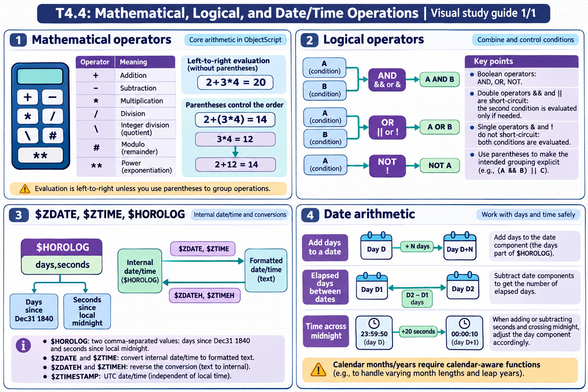

[Topic contents](../index.md) · [Full topic guide](../study.md) · [All topics](../../../index.md)

# T4.4: Mathematical, Logical, and Date/Time Operations

Saved 2 November 2026 from [exam-prep.es](https://exam-prep.es/exams/objectscript/knowledge/T4.4.html). Reference links require internet access.

## 3. $ZDATE, $ZTIME, $HOROLOG



*This diagram covers sections 1–4; use the matching numbered panel for this page.* [Chapter diagrams](../visuals.md) · [Technical review notes](../../../visual-technical-notes.md)

### Key Points

- **$HOROLOG ($H)**: System date/time as "days,seconds" -- days since Dec 31, 1840; seconds since midnight
- **$ZDATE($ZD)**: Converts $H date to formatted string: $ZD($H, format)
- **$ZDATEH($ZDH)**: Converts formatted string back to $H internal date
- **$ZTIME($ZT)**: Converts $H seconds to formatted time string
- **$ZTIMEH($ZTH)**: Converts formatted time string back to $H seconds
- **$NOW()**: Returns UTC timestamp with fractional seconds
- **$ZTIMESTAMP ($ZTS)**: UTC timestamp in $HOROLOG format with fractional seconds

### Detailed Notes

#### Overview

InterSystems IRIS stores dates and times internally using $HOROLOG format: a two-piece comma-separated value where the first piece is the number of days since December 31, 1840, and the second piece is the number of seconds since midnight. All date/time formatting functions convert to and from this internal format.

#### $HOROLOG Basics

```objectscript
 // Current date and time
 WRITE $HOROLOG, !
 // Example output: 67551,45123
 // 67551 = days since 12/31/1840
 // 45123 = seconds since midnight

 // Extract date and time parts
 SET datepart = $PIECE($H, ",", 1)
 SET timepart = $PIECE($H, ",", 2)
 WRITE "Days: ", datepart, !
 WRITE "Seconds: ", timepart, !

 // $H is the shorthand for $HOROLOG
 WRITE $H, !
```

#### $ZDATE: Formatting Dates

```objectscript
 // Format codes:
 // 1 = MM/DD/YYYY (US format)
 // 2 = DD Mmm YYYY (e.g., 15 Jan 2025)
 // 3 = YYYY-MM-DD (ISO format)
 // 4 = DD/MM/YYYY (European format)
 // 5 = Mmm DD, YYYY (e.g., Jan 15, 2025)
 // 8 = YYYYMMDD (compact)

 SET today = $PIECE($H, ",", 1)

 WRITE $ZDATE(today, 1), !         // 01/15/2025
 WRITE $ZDATE(today, 2), !         // 15 Jan 2025
 WRITE $ZDATE(today, 3), !         // 2025-01-15
 WRITE $ZDATE(today, 4), !         // 15/01/2025
 WRITE $ZDATE(today, 5), !         // Jan 15, 2025
 WRITE $ZDATE(today, 8), !         // 20250115

 // Full $H value (includes time display with some formats)
 WRITE $ZDATE($H, 3), !            // 2025-01-15

 // With separator and year digits
 WRITE $ZDATE(today, 1, "-"), !    // 01-15-2025
```

#### $ZDATEH: Parsing Date Strings

```objectscript
 // Convert formatted date string back to $H date integer
 SET intDate = $ZDATEH("01/15/2025", 1)
 WRITE intDate, !                   // 67196 (days since 12/31/1840)

 SET intDate = $ZDATEH("2025-01-15", 3)
 WRITE intDate, !                   // 67196

 SET intDate = $ZDATEH("20250115", 8)
 WRITE intDate, !                   // 67196
```

#### $ZTIME: Formatting Times

```objectscript
 SET seconds = $PIECE($H, ",", 2)

 // Format 1: HH:MM:SS (24-hour)
 WRITE $ZTIME(seconds, 1), !       // 12:32:03

 // Format 2: HH:MM:SS AM/PM
 WRITE $ZTIME(seconds, 2), !       // 12:32:03 PM

 // Format 3: HH:MM:SS (same as 1)
 WRITE $ZTIME(seconds, 3), !       // 12:32:03

 // Just hours and minutes
 WRITE $ZTIME(seconds, 1, 2), !    // 12:32 (precision=2)
```

#### $ZTIMEH: Parsing Time Strings

```objectscript
 // Convert time string to seconds since midnight
 SET secs = $ZTIMEH("14:30:00")
 WRITE secs, !                      // 52200

 SET secs = $ZTIMEH("2:30 PM", 2)
 WRITE secs, !                      // 52200
```

#### $NOW() and $ZTIMESTAMP

```objectscript
 // $NOW() returns local timestamp with fractional seconds
 WRITE $NOW(), !
 // Example: 67551,45123.456789

 // $ZTIMESTAMP returns UTC with fractional seconds
 WRITE $ZTIMESTAMP, !
 // Example: 67551,63123.456789 (UTC, may differ from local)
 // $ZTS is the shorthand
 WRITE $ZTS, !
```

### Documentation References

- [$HOROLOG Special Variable](https://docs.intersystems.com/irislatest/csp/docbook/DocBook.UI.Page.cls?KEY=RCOS_vhorolog)
- [$ZDATE Function](https://docs.intersystems.com/irislatest/csp/docbook/DocBook.UI.Page.cls?KEY=RCOS_fzdate)
- [$ZDATEH Function](https://docs.intersystems.com/irislatest/csp/docbook/DocBook.UI.Page.cls?KEY=RCOS_fzdateh)
- [$ZTIME Function](https://docs.intersystems.com/irislatest/csp/docbook/DocBook.UI.Page.cls?KEY=RCOS_fztime)
- [$ZTIMESTAMP Special Variable](https://docs.intersystems.com/irislatest/csp/docbook/DocBook.UI.Page.cls?KEY=RCOS_vztimestamp)
- [$NOW Function](https://docs.intersystems.com/irislatest/csp/docbook/DocBook.UI.Page.cls?KEY=RCOS_fnow)
