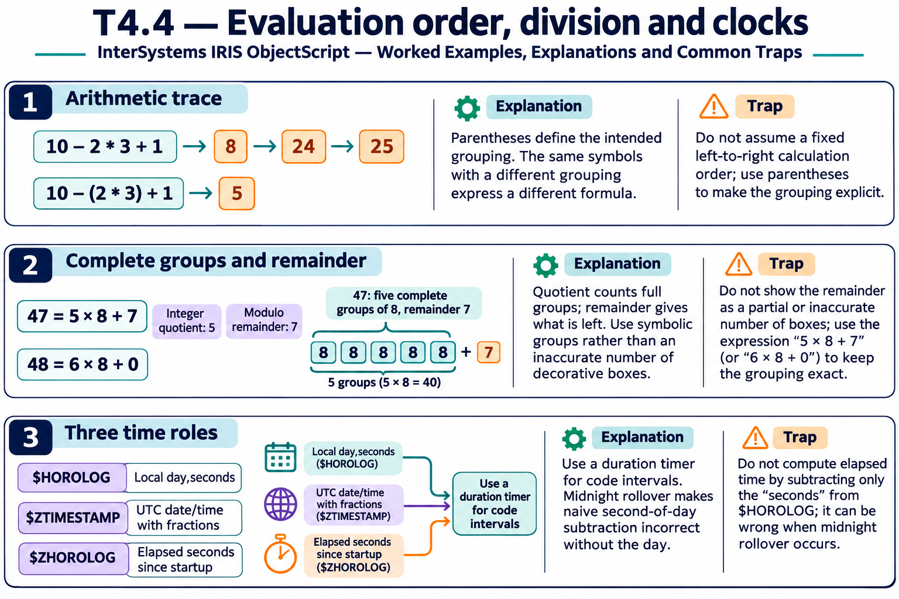

# T4.4 · 01 — Le parentesi rendono esplicito il calcolo

[Indice degli approfondimenti](README.md) · [Quiz originale](../quiz.md) · [Teoria](../study.md)

**Esercizi di partenza:** [Q1](../quiz.md#question-1-single) · [Q2](../quiz.md#question-2-single) · [Q3](../quiz.md#question-3-single) · [Q11](../quiz.md#question-11-single) · [Q13](../quiz.md#question-13-single). L’approfondimento rielabora il concetto e aggiunge una variante; non riproduce soltanto la risposta del quiz.

## Il caso concreto

10-2*3+1 viene valutato progressivamente in ObjectScript.

```objectscript
write 10 - 2 * 3 + 1, !
write 10 - (2 * 3) + 1
```

## Ragionamento passo per passo

Nella prima riga: 10-2=8, 8*3=24, 24+1=25. Nella seconda il prodotto vale prima 6 e il risultato è 5. Importare automaticamente la precedenza aritmetica di un altro linguaggio cambia l’output.

## Perché il distrattore è plausibile

Dare per implicita la precedenza usuale di moltiplicazione e divisione.

## Lo spunto da portare oltre l’esercizio

Usa parentesi per esprimere l’intenzione, anche quando conosci la regola di valutazione.



*Leggi il pannello 1; gli altri due collegano il caso agli altri approfondimenti del capitolo.*

## Variante: prova prima di leggere la soluzione

Quanto valgono 2+3*4 e 2+(3*4)?

<details>
<summary>Soluzione ragionata</summary>

20 e 14.

</details>

## Riferimenti e precisazioni

- [Operatori](https://docs.intersystems.com/irislatest/csp/docbook/DocBook.UI.Page.cls?KEY=GCOS_operators)
- [$HOROLOG](https://docs.intersystems.com/irislatest/csp/docbook/DocBook.UI.Page.cls?KEY=RCOS_vhorolog)
- [$ZTIMESTAMP](https://docs.intersystems.com/irislatest/csp/docbook/DocBook.UI.Page.cls?KEY=RCOS_vztimestamp)
- [$ZHOROLOG](https://docs.intersystems.com/irislatest/csp/docbook/DocBook.UI.Page.cls?KEY=RCOS_vzhorolog)

[Note specifiche del capitolo](README.md#precisazioni-rispetto-al-quiz) · [Metodo e limiti della revisione](../../../approfondimenti-esercizi.md#metodo-e-limiti)
