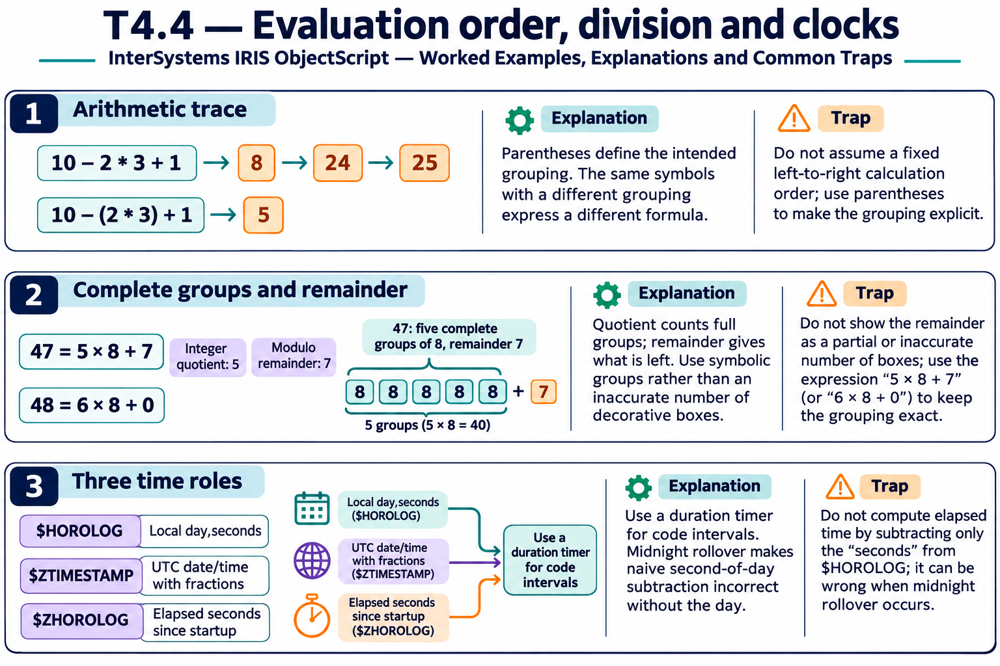

# T4.4 · 02 — Quoziente e resto rispondono a domande diverse

[Indice degli approfondimenti](README.md) · [Quiz originale](../quiz.md) · [Teoria](../study.md)

**Esercizi di partenza:** [Q4](../quiz.md#question-4-single) · [Q5](../quiz.md#question-5-single) · [Q6](../quiz.md#question-6-single). L’approfondimento rielabora il concetto e aggiunge una variante; non riproduce soltanto la risposta del quiz.

## Il caso concreto

47 elementi sono distribuiti in gruppi da 8. Il quoziente intero e il resto non sono intercambiabili.

```objectscript
write 47 \ 8, !
write 47 # 8
```

## Ragionamento passo per passo

Il quoziente intero è 5 e il resto è 7: cinque gruppi completi da otto e sette elementi residui. Per valori negativi verifica la convenzione dell’operatore: nell’esempio -7#3 vale 2. Una formula per pagina o bucket deve dichiarare anche se parte da zero o da uno.

## Perché il distrattore è plausibile

Usare il resto come numero della pagina o dimenticare il confine fra indice zero-based e numerazione umana.

## Lo spunto da portare oltre l’esercizio

Collega ogni operatore a una quantità concreta e verifica i casi sul bordo esatto del gruppo.



*Leggi il pannello 2; gli altri due collegano il caso agli altri approfondimenti del capitolo.*

## Variante: prova prima di leggere la soluzione

Con 48 elementi e gruppi da 8, quanti gruppi completi e quanti residui?

<details>
<summary>Soluzione ragionata</summary>

6 e 0.

</details>

## Riferimenti e precisazioni

- [Operatori](https://docs.intersystems.com/irislatest/csp/docbook/DocBook.UI.Page.cls?KEY=GCOS_operators)
- [$HOROLOG](https://docs.intersystems.com/irislatest/csp/docbook/DocBook.UI.Page.cls?KEY=RCOS_vhorolog)
- [$ZTIMESTAMP](https://docs.intersystems.com/irislatest/csp/docbook/DocBook.UI.Page.cls?KEY=RCOS_vztimestamp)
- [$ZHOROLOG](https://docs.intersystems.com/irislatest/csp/docbook/DocBook.UI.Page.cls?KEY=RCOS_vzhorolog)

[Note specifiche del capitolo](README.md#precisazioni-rispetto-al-quiz) · [Metodo e limiti della revisione](../../../approfondimenti-esercizi.md#metodo-e-limiti)
