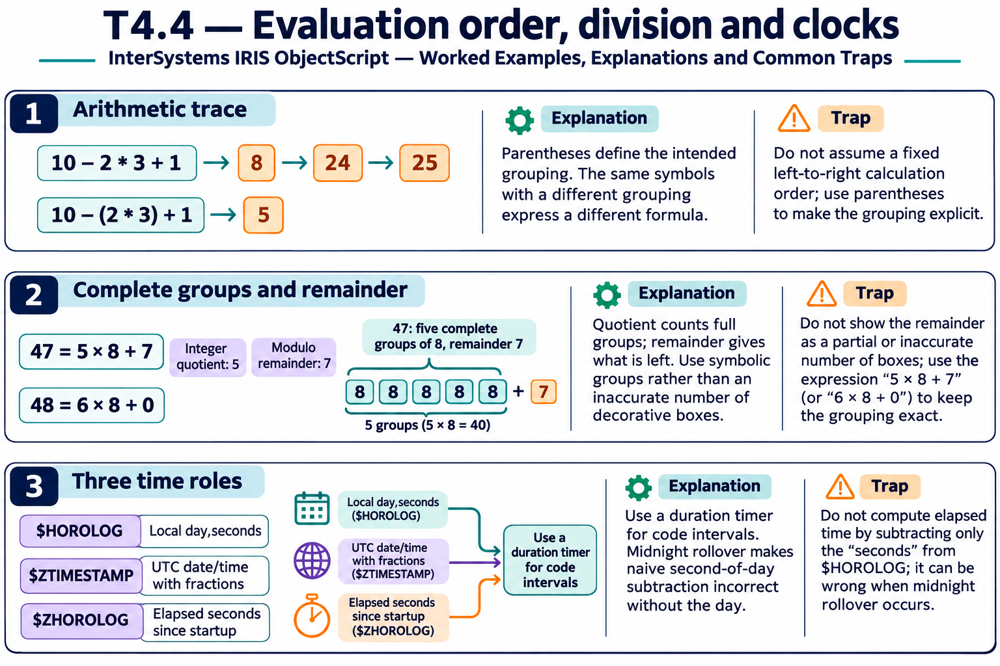

# T4.4 · 03 — Data civile, orario e durata hanno rappresentazioni diverse

[Indice degli approfondimenti](README.md) · [Quiz originale](../quiz.md) · [Teoria](../study.md)

**Esercizi di partenza:** [Q7](../quiz.md#question-7-single) · [Q8](../quiz.md#question-8-single) · [Q9](../quiz.md#question-9-multiple) · [Q10](../quiz.md#question-10-single) · [Q12](../quiz.md#question-12-single) · [Q14](../quiz.md#question-14-multiple) · [Q15](../quiz.md#question-15-single). L’approfondimento rielabora il concetto e aggiunge una variante; non riproduce soltanto la risposta del quiz.

## Il caso concreto

$HOROLOG rappresenta giorno,secondi. $ZTIMESTAMP descrive data/ora UTC con frazioni; $ZHOROLOG è un contatore di secondi dall’avvio.

```objectscript
set h=$HOROLOG
set day=$PIECE(h,",",1)
set seconds=$PIECE(h,",",2)
```

## Ragionamento passo per passo

I componenti di h non sono una singola durata numerica. Per aggiungere giorni a una sola data opera sul componente giorno; per mantenere un timestamp ricomponi anche l’orario. Al passaggio di mezzanotte i secondi si azzerano e il giorno aumenta. La scelta UTC/local va resa esplicita.

## Perché il distrattore è plausibile

Sottrarre due stringhe giorno,secondi e chiamare il risultato “secondi trascorsi”.

## Lo spunto da portare oltre l’esercizio

Scegli la rappresentazione a partire dall’operazione: calendario, istante o intervallo.



*Leggi il pannello 3; gli altri due collegano il caso agli altri approfondimenti del capitolo.*

## Variante: prova prima di leggere la soluzione

23:59:50 più 20 secondi: basta tenere lo stesso giorno e scrivere 00:00:10?

<details>
<summary>Soluzione ragionata</summary>

No: serve incrementare il giorno.

</details>

## Riferimenti e precisazioni

- [Operatori](https://docs.intersystems.com/irislatest/csp/docbook/DocBook.UI.Page.cls?KEY=GCOS_operators)
- [$HOROLOG](https://docs.intersystems.com/irislatest/csp/docbook/DocBook.UI.Page.cls?KEY=RCOS_vhorolog)
- [$ZTIMESTAMP](https://docs.intersystems.com/irislatest/csp/docbook/DocBook.UI.Page.cls?KEY=RCOS_vztimestamp)
- [$ZHOROLOG](https://docs.intersystems.com/irislatest/csp/docbook/DocBook.UI.Page.cls?KEY=RCOS_vzhorolog)

[Note specifiche del capitolo](README.md#precisazioni-rispetto-al-quiz) · [Metodo e limiti della revisione](../../../approfondimenti-esercizi.md#metodo-e-limiti)
