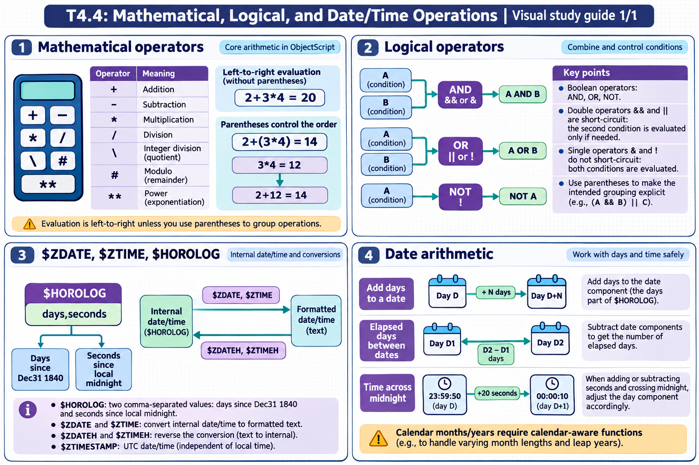
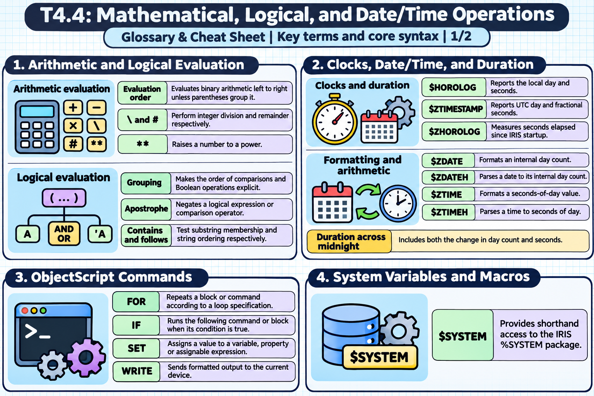
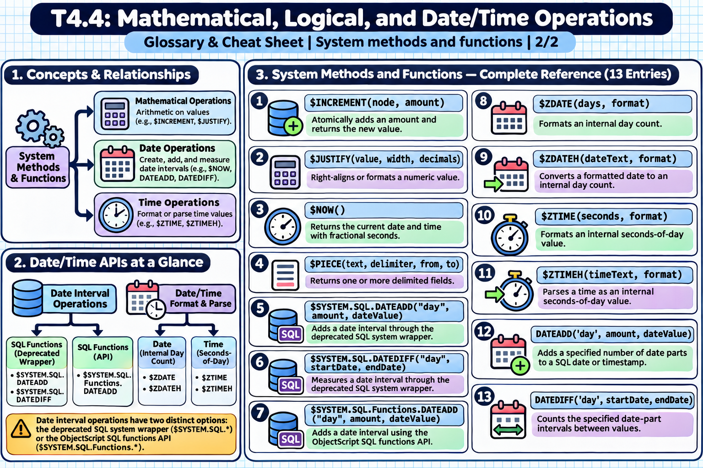

# T4.4: Mathematical, Logical, and Date/Time Operations — visual study guides

[Approfondimenti dagli esercizi](<Approfondimenti esercizi/README.md>)

[Chapter contents](index.md) · [Full guide](study.md) · [Practice questions](quiz.md)

Generated learning summaries. Read the full notes for detailed explanations and exact code. [Technical review notes](../../visual-technical-notes.md).

## Visual guide — sections 1–4

Covers:

- 1. Mathematical operators
- 2. Logical operators
- 3. $ZDATE, $ZTIME, $HOROLOG
- 4. Date arithmetic

## Glossary & Cheat Sheet

[Open the text recap](study.md#glossary--cheat-sheet).
