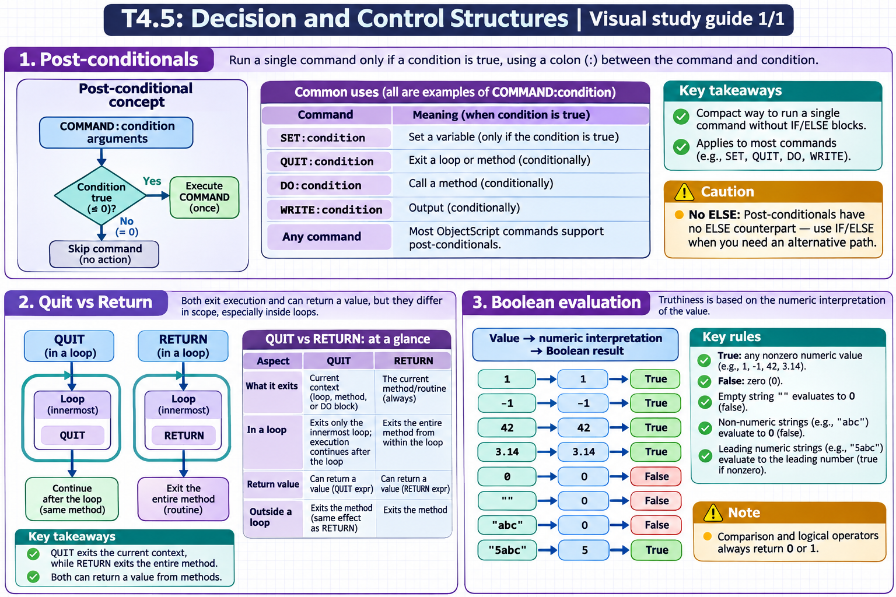

[Topic contents](../index.md) · [Full topic guide](../study.md) · [All topics](../../../index.md)

# T4.5: Decision and Control Structures

Saved 2 November 2026 from [exam-prep.es](https://exam-prep.es/exams/objectscript/knowledge/T4.5.html). Reference links require internet access.

## 1. Post-conditionals



*This diagram covers sections 1–3; use the matching numbered panel for this page.* [Chapter diagrams](../visuals.md) · [Technical review notes](../../../visual-technical-notes.md)

### Key Points

- **Syntax**: COMMAND:condition arguments -- colon between command and condition
- **Compact code**: Execute a single command conditionally without IF/ELSE blocks
- **SET:condition**: SET:condition var = value -- only sets if condition is true
- **QUIT:condition**: Exit a loop or method conditionally
- **DO:condition**: Call a method conditionally
- **WRITE:condition**: Output conditionally
- **Any command**: Most ObjectScript commands support post-conditionals
- **No ELSE**: Post-conditionals have no ELSE counterpart -- use IF/ELSE for that

### Detailed Notes

#### Overview

Post-conditionals are a distinctive ObjectScript feature that allows any command to be executed conditionally by appending a colon and a boolean expression directly after the command keyword. This produces concise, readable code for simple conditional operations without the overhead of full IF/ELSE blocks.

#### Basic Post-Conditional Syntax

```objectscript
 SET x = 10

 // SET with post-conditional
 SET:x>5 message = "x is large"
 WRITE message, !                  // x is large

 // Equivalent to:
 IF x > 5 SET message = "x is large"

 // WRITE with post-conditional
 WRITE:x>5 "Greater than 5", !

 // Multiple post-conditionals (each independent)
 SET:x>20 category = "very large"
 SET:x>10 category = "large"
 SET:x>5 category = "medium"
 SET:x<=5 category = "small"
 WRITE category, !                 // medium
```

#### QUIT with Post-Conditional

```objectscript
 // Early exit from a FOR loop
 SET sum = 0
 FOR i = 1:1:100 {
     SET sum = sum + i
     QUIT:sum>100
 }
 WRITE "Sum: ", sum, " at i=", i, !
 // Output: Sum: 105 at i=14

 // In method: return early if precondition fails
 ClassMethod Divide(a As %Numeric, b As %Numeric) As %Numeric
 {
     QUIT:b=0 ""    // Return empty if division by zero
     QUIT a / b
 }
```

#### DO with Post-Conditional

```objectscript
 // Call a method only if condition is met
 DO:status'=$$$OK ..LogError(status)

 // Multiple conditional calls
 DO:age>=18 ..ProcessAdult(name)
 DO:age<18 ..ProcessMinor(name)
```

#### Post-Conditional with Complex Expressions

```objectscript
 // Parentheses for complex conditions
 SET:(x>0)&&(x<100) range = "valid"

 // String conditions
 SET name = "Alice"
 WRITE:name="Alice" "Found Alice!", !

 // Negation
 SET:(obj'="") result = obj.Calculate()

 // Post-conditional on KILL
 KILL:cleanup tempVar
```

#### Common Patterns

```objectscript
 // Default value assignment
 SET:('$DATA(config)) config = "default"

 // Conditional increment
 SET:isValid count = count + 1

 // Guard clause in a method
 ClassMethod Process(input As %String) As %Status
 {
     QUIT:input="" $$$ERROR($$$GeneralError, "Input required")
     // ... rest of processing
     QUIT $$$OK
 }

 // Conditional THROW
 THROW:status'=$$$OK ##class(%Exception.StatusException).CreateFromStatus(status)
```

### Documentation References

- [Post-Conditional Expressions](https://docs.intersystems.com/irislatest/csp/docbook/DocBook.UI.Page.cls?KEY=GCOS_commands#GCOS_commands_postconditional)
- [SET Command](https://docs.intersystems.com/irislatest/csp/docbook/DocBook.UI.Page.cls?KEY=RCOS_cset)
- [QUIT Command](https://docs.intersystems.com/irislatest/csp/docbook/DocBook.UI.Page.cls?KEY=RCOS_cquit)
