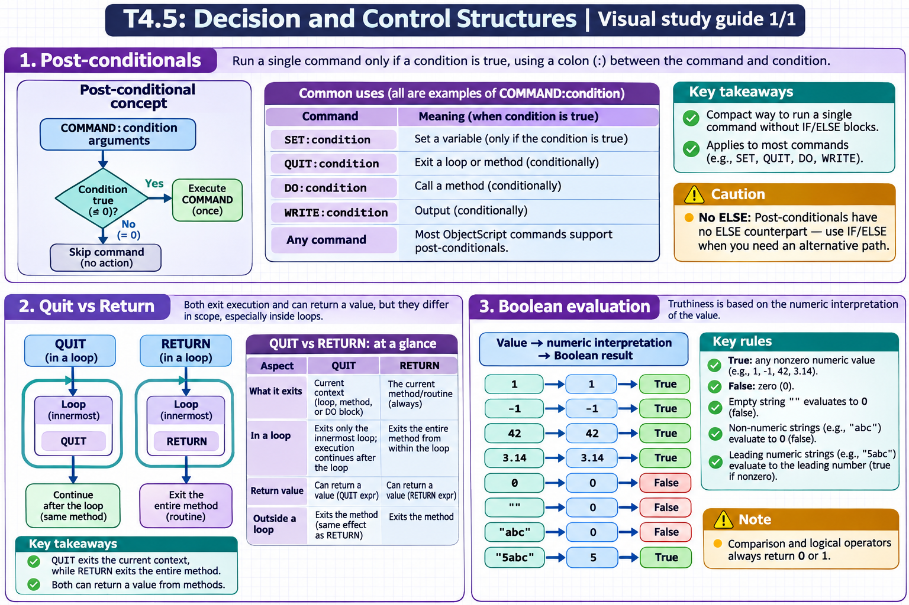

[Topic contents](../index.md) · [Full topic guide](../study.md) · [All topics](../../../index.md)

# T4.5: Decision and Control Structures

Saved 2 November 2026 from [exam-prep.es](https://exam-prep.es/exams/objectscript/knowledge/T4.5.html). Reference links require internet access.

## 2. Quit vs Return



*This diagram covers sections 1–3; use the matching numbered panel for this page.* [Chapter diagrams](../visuals.md) · [Technical review notes](../../../visual-technical-notes.md)

### Key Points

- **QUIT**: Exits the current context -- loop body, method, or DO block
- **RETURN**: Always exits the current method/routine, even from within a loop
- **QUIT in loop**: Exits only the innermost loop, continues after the loop
- **RETURN in loop**: Exits the entire method from within the loop
- **Return value**: Both QUIT expr and RETURN expr can return values from methods
- **QUIT from method**: When used outside a loop, QUIT exits the method (same as RETURN)

### Detailed Notes

#### Overview

QUIT and RETURN both exit code, but they differ in what they exit. QUIT exits the nearest enclosing context (loop or method), while RETURN always exits the method. This distinction is critical when you need to exit a method from inside a nested loop.

#### QUIT in Loops vs Methods

```objectscript
 ClassMethod Example1()
 {
     WRITE "Before loop", !
     FOR i = 1:1:10 {
         QUIT:i=3         // Exits the FOR loop only
     }
     WRITE "After loop, i=", i, !    // Prints! i=3
     WRITE "Method continues", !      // Also prints
 }
```

```objectscript
 ClassMethod Example2()
 {
     WRITE "Before loop", !
     FOR i = 1:1:10 {
         RETURN:i=3       // Exits the ENTIRE METHOD
     }
     WRITE "After loop", !            // NEVER reached
 }
```

#### QUIT vs RETURN in Nested Loops

```objectscript
 ClassMethod NestedExample()
 {
     FOR i = 1:1:5 {
         FOR j = 1:1:5 {
             IF (i = 3) && (j = 2) {
                 QUIT    // Exits inner FOR loop only
                 // Outer loop continues with i=3, then i=4, i=5
             }
         }
         WRITE "i=", i, !    // Prints for all i values
     }
     WRITE "Done", !          // Prints
 }
```

```objectscript
 ClassMethod NestedReturn()
 {
     FOR i = 1:1:5 {
         FOR j = 1:1:5 {
             IF (i = 3) && (j = 2) {
                 RETURN   // Exits the ENTIRE method immediately
             }
         }
         WRITE "i=", i, !    // Prints for i=1, i=2 only
     }
     WRITE "Done", !          // NEVER reached
 }
```

#### Returning Values

```objectscript
 // QUIT with return value (in a method returning a value)
 ClassMethod Add(a, b) As %Integer
 {
     QUIT a + b
 }

 // RETURN with return value
 ClassMethod FindFirst(list As %ListOfDataTypes) As %String
 {
     FOR i = 1:1:list.Count() {
         SET item = list.GetAt(i)
         IF item [ "target" {
             RETURN item    // Exit method immediately with value
         }
     }
     RETURN ""              // Not found
 }

 // QUIT in a method with no return value
 ClassMethod Process()
 {
     QUIT:errorCondition    // Exit method (no return value)
     // ... processing
 }
```

#### QUIT in DO Blocks

```objectscript
 // QUIT exits a DO block (argumentless DO with code block)
 DO {
     SET x = $RANDOM(10)
     QUIT:x=5              // Exits the DO block, not any outer loop
     WRITE x, " "
 } WHILE x '= 5
```

### Documentation References

- [QUIT Command](https://docs.intersystems.com/irislatest/csp/docbook/DocBook.UI.Page.cls?KEY=RCOS_cquit)
- [RETURN Command](https://docs.intersystems.com/irislatest/csp/docbook/DocBook.UI.Page.cls?KEY=RCOS_creturn)
