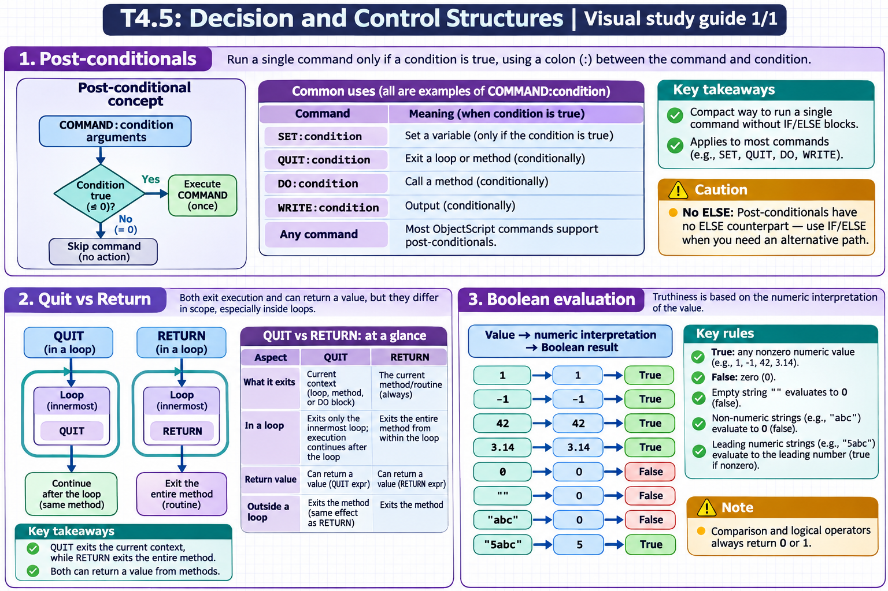

[Topic contents](../index.md) · [Full topic guide](../study.md) · [All topics](../../../index.md)

# T4.5: Decision and Control Structures

Saved 2 November 2026 from [exam-prep.es](https://exam-prep.es/exams/objectscript/knowledge/T4.5.html). Reference links require internet access.

## 3. Boolean evaluation



*This diagram covers sections 1–3; use the matching numbered panel for this page.* [Chapter diagrams](../visuals.md) · [Technical review notes](../../../visual-technical-notes.md)

### Key Points

- **True**: Any nonzero numeric value is true (1, -1, 42, 3.14)
- **False**: Zero (0) is false
- **Empty string**: "" evaluates to 0, which is false
- **Non-numeric strings**: "abc" evaluates to 0 (false) because its numeric value is 0
- **Leading numeric strings**: "5abc" evaluates to 5, which is true
- **Canonical**: Truthiness depends on the numeric interpretation of the value
- **Boolean result**: Comparison and logical operators always return 0 or 1

### Detailed Notes

#### Overview

ObjectScript does not have a dedicated boolean type. Instead, it uses numeric evaluation: zero is false, any nonzero value is true. When a string is evaluated as a boolean, it is first converted to its numeric value. Understanding this coercion is critical for writing correct conditions.

#### Truthiness Rules

```objectscript
 // Nonzero = true
 IF 1 WRITE "1 is true", !            // prints
 IF -1 WRITE "-1 is true", !          // prints
 IF 42 WRITE "42 is true", !          // prints
 IF 0.001 WRITE "0.001 is true", !    // prints

 // Zero = false
 IF 0 WRITE "0 is true", !            // does NOT print
 IF '0 WRITE "0 is false", !          // prints

 // Empty string = 0 = false
 IF "" WRITE "empty is true", !       // does NOT print
 SET x = ""
 IF 'x WRITE "empty is false", !      // prints

 // Non-numeric strings = 0 = false
 IF "abc" WRITE "abc is true", !      // does NOT print
 IF "hello" WRITE "hello is true", !  // does NOT print

 // Leading numeric strings = their numeric value
 IF "5abc" WRITE "5abc is true", !    // prints (5 is nonzero)
 IF "0abc" WRITE "0abc is true", !    // does NOT print (0)
```

#### Boolean Results from Comparisons

```objectscript
 // Comparisons return exactly 0 or 1
 WRITE 5 > 3, !             // 1
 WRITE 3 > 5, !             // 0
 WRITE "A" = "A", !         // 1
 WRITE "A" = "B", !         // 0

 // Can store boolean results
 SET isAdult = (age >= 18)
 SET isValid = (name '= "") && (age > 0)

 // Boolean arithmetic
 SET total = (a > 0) + (b > 0) + (c > 0)
 WRITE "Number of positive values: ", total, !
```

#### Common Boolean Pitfalls

```objectscript
 // PITFALL: Testing a string that should be boolean
 SET flag = "yes"
 IF flag WRITE "flag is true", !      // does NOT print!
 // "yes" has numeric value 0, so it is false in boolean context

 // Correct approach: test against specific values
 IF flag = "yes" WRITE "flag is yes", !  // prints

 // PITFALL: Empty string vs zero
 // In boolean context (IF), "" acts like 0 (false)
 // But "" and 0 are NOT equal with the = operator!
 SET val = ""
 IF val WRITE "truthy", !             // does NOT print ("" is falsy)
 IF val = 0 WRITE "equal to zero", !  // does NOT print! ("" '= 0)
 IF val = "" WRITE "equal to empty", ! // prints

 SET zero = 0
 IF zero WRITE "truthy", !            // does NOT print (0 is falsy)
 IF zero = "" WRITE "equal to empty", ! // does NOT print! (0 '= "")
 IF zero = 0 WRITE "equal to zero", ! // prints

 // To coerce "" to numeric before comparison, use unary +
 WRITE +"" = 0, !            // 1 (+"" gives 0, then 0 = 0)
 WRITE "" = 0, !             // 0 ("" is not 0)

 // PITFALL: Non-numeric strings are all falsy
 IF "yes" WRITE "yes", !     // does NOT print ("yes" = 0 numerically)
 IF "true" WRITE "true", !   // does NOT print
 IF "abc" WRITE "abc", !     // does NOT print
 WRITE "yes" = 0, !          // 0 ("yes" is not 0 -- different values)
 WRITE +"yes" = 0, !         // 1 (+"yes" coerces to 0, then 0 = 0)
```

#### NOT Operator

```objectscript
 SET x = 5
 WRITE 'x, !                // 0 (NOT 5 = false)

 SET y = 0
 WRITE 'y, !                // 1 (NOT 0 = true)

 // Double negation
 WRITE ''x, !               // 1 (NOT NOT 5 = true)
 WRITE ''y, !               // 0 (NOT NOT 0 = false)

 // '' can normalize any value to 0 or 1
 SET normalized = ''someValue
 // normalized is now exactly 0 or 1
```

#### Truthiness in Control Flow

```objectscript
 // IF uses truthiness
 SET name = "Alice"
 IF name WRITE "name has a value", !    // does NOT print ("Alice" = 0)

 // Correct: check for non-empty
 IF name '= "" WRITE "name is not empty", !  // prints

 // $DATA returns 0 (falsy) or 1/10/11 (truthy)
 IF $DATA(^config("key")) WRITE "key exists", !

 // $LENGTH returns 0 for empty, positive for non-empty
 IF $LENGTH(name) WRITE "name has length", !  // prints (5 > 0)
```

### Documentation References

- [Boolean Expressions](https://docs.intersystems.com/irislatest/csp/docbook/DocBook.UI.Page.cls?KEY=GCOS_operators#GCOS_operators_truth)
- [Numeric Interpretation of Strings](https://docs.intersystems.com/irislatest/csp/docbook/DocBook.UI.Page.cls?KEY=GCOS_types#GCOS_types_numericstrings)
