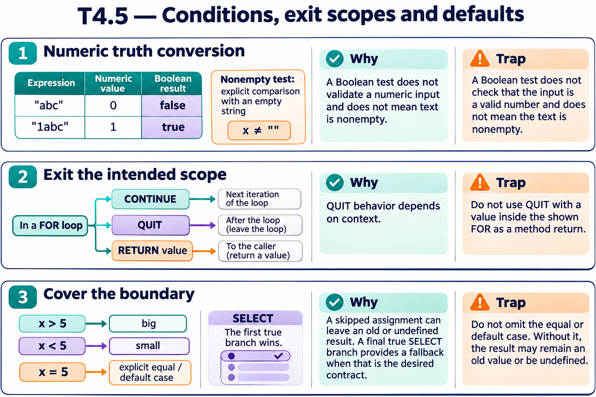

# T4.5 · 01 — Una stringa non vuota può essere falsa

[Indice degli approfondimenti](README.md) · [Quiz originale](../quiz.md) · [Teoria](../study.md)

**Esercizi di partenza:** [Q1](../quiz.md#question-1-single) · [Q2](../quiz.md#question-2-single) · [Q3](../quiz.md#question-3-multiple) · [Q7](../quiz.md#question-7-single) · [Q10](../quiz.md#question-10-single) · [Q11](../quiz.md#question-11-single) · [Q14](../quiz.md#question-14-multiple). L’approfondimento rielabora il concetto e aggiunge una variante; non riproduce soltanto la risposta del quiz.

## Il caso concreto

"abc" è non vuota ma nel contesto booleano la conversione numerica produce zero; "1abc" produce un valore non nullo.

## Ragionamento passo per passo

ObjectScript valuta il valore numerico nel contesto booleano. Quindi "",0,"0","abc" sono falsi negli esempi, mentre "1abc" e "2dogs" sono veri. Per chiedere “testo non vuoto” confronta esplicitamente con ""; non affidarti al valore booleano del contenuto.

## Perché il distrattore è plausibile

Trasferire la regola “ogni stringa non vuota è vera” da altri linguaggi.

## Lo spunto da portare oltre l’esercizio

Prima di IF decidi se stai chiedendo un booleano, una presenza o una validità di formato.

*Leggi il pannello 1; gli altri due collegano il caso agli altri approfondimenti del capitolo.*

## Variante: prova prima di leggere la soluzione

"abc" deve essere accettata perché è una descrizione non vuota. IF value esprime correttamente questo requisito?

Soluzione ragionata

No: verifica esplicitamente che value sia definita e diversa da "".

## Riferimenti e precisazioni

- [RETURN](https://docs.intersystems.com/irislatest/csp/docbook/DocBook.UI.Page.cls?KEY=RCOS_creturn)
- [QUIT](https://docs.intersystems.com/irislatest/csp/docbook/DocBook.UI.Page.cls?KEY=RCOS_cquit)
- [$SELECT](https://docs.intersystems.com/irislatest/csp/docbook/DocBook.UI.Page.cls?KEY=RCOS_fselect)
- [Operatori](https://docs.intersystems.com/irislatest/csp/docbook/DocBook.UI.Page.cls?KEY=GCOS_operators)

[Note specifiche del capitolo](README.md#precisazioni-rispetto-al-quiz) · [Metodo e limiti della revisione](../../../approfondimenti-esercizi.md#metodo-e-limiti)
