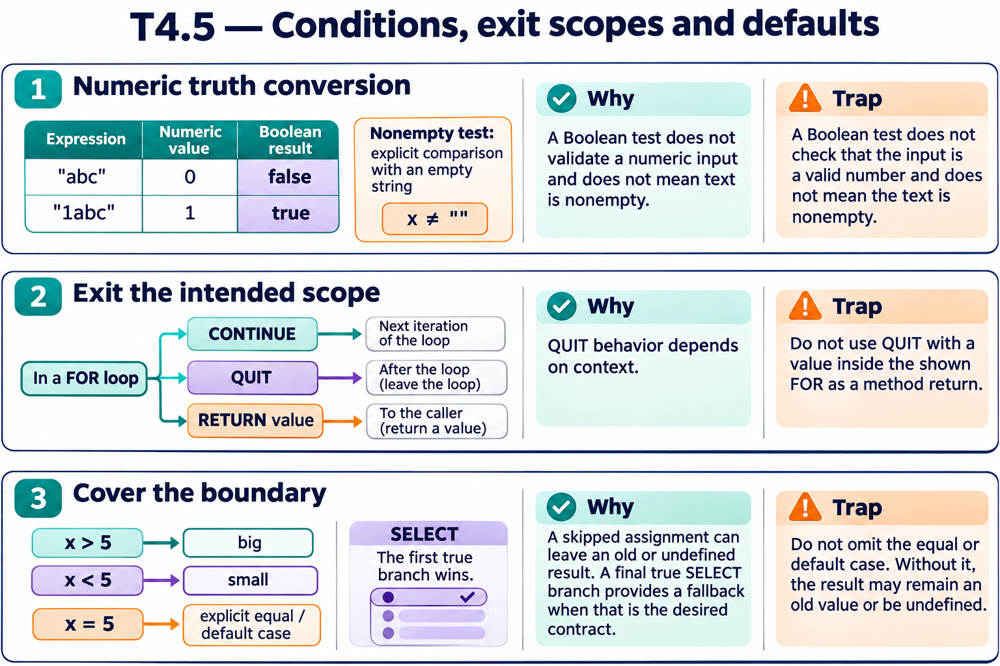

# T4.5 · 02 — Saltare, uscire dal ciclo e tornare al chiamante

[Indice degli approfondimenti](README.md) · [Quiz originale](../quiz.md) · [Teoria](../study.md)

**Esercizi di partenza:** [Q5](../quiz.md#question-5-single) · [Q6](../quiz.md#question-6-single) · [Q8](../quiz.md#question-8-multiple) · [Q9](../quiz.md#question-9-single) · [Q15](../quiz.md#question-15-single). L’approfondimento rielabora il concetto e aggiunge una variante; non riproduce soltanto la risposta del quiz.

## Il caso concreto

Il quiz usa CONTINUE per saltare i pari e RETURN per terminare un metodo appena trova il risultato.

```objectscript
set count=0
for i=1:1:10 {
  continue:i#2=0
  set count=count+1
}
write count
```

## Ragionamento passo per passo

I pari saltano il resto dell’iterazione; i dispari incrementano count, che arriva a 5. QUIT senza argomento esce dal ciclo nel contesto appropriato; RETURN termina il metodo con il risultato. Scrivere QUIT i dentro il FOR non è la forma corretta per restituire l’indice dal metodo.

## Perché il distrattore è plausibile

Usare CONTINUE come se terminasse tutto il ciclo o usare QUIT con valore al posto di RETURN.

## Lo spunto da portare oltre l’esercizio

Annota il bersaglio di ogni salto: iterazione, ciclo o metodo.



*Leggi il pannello 2; gli altri due collegano il caso agli altri approfondimenti del capitolo.*

## Variante: prova prima di leggere la soluzione

In un metodo trovi il target alla posizione 2 e vuoi restituire 2 subito. Quale comando esprime il ritorno?

<details>
<summary>Soluzione ragionata</summary>

RETURN 2 nel metodo.

</details>

## Riferimenti e precisazioni

- [RETURN](https://docs.intersystems.com/irislatest/csp/docbook/DocBook.UI.Page.cls?KEY=RCOS_creturn)
- [QUIT](https://docs.intersystems.com/irislatest/csp/docbook/DocBook.UI.Page.cls?KEY=RCOS_cquit)
- [$SELECT](https://docs.intersystems.com/irislatest/csp/docbook/DocBook.UI.Page.cls?KEY=RCOS_fselect)
- [Operatori](https://docs.intersystems.com/irislatest/csp/docbook/DocBook.UI.Page.cls?KEY=GCOS_operators)

[Note specifiche del capitolo](README.md#precisazioni-rispetto-al-quiz) · [Metodo e limiti della revisione](../../../approfondimenti-esercizi.md#metodo-e-limiti)
