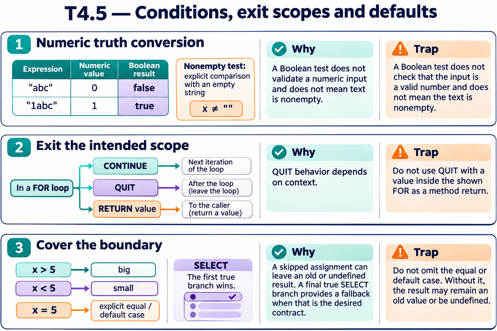

# T4.5 · 03 — Una scelta totale ha un caso di riserva

[Indice degli approfondimenti](README.md) · [Quiz originale](../quiz.md) · [Teoria](../study.md)

**Esercizi di partenza:** [Q4](../quiz.md#question-4-single) · [Q12](../quiz.md#question-12-single) · [Q13](../quiz.md#question-13-single). L’approfondimento rielabora il concetto e aggiunge una variante; non riproduce soltanto la risposta del quiz.

## Il caso concreto

Due SET postcondizionali gestiscono x>5 e x<5. Con x=5 nessuno dei due assegna result.

```objectscript
set result="equal"
set:x>5 result="big"
set:x<5 result="small"
```

## Ragionamento passo per passo

L’inizializzazione esplicita rende definito l’esito del confine x=5. Analogamente una $SELECT che non trova condizioni vere genera un errore: un ramo finale 1:default rende totale la scelta quando il dominio richiede un fallback.

## Perché il distrattore è plausibile

Esaminare soltanto il caso 10 del quiz e non la soglia, oppure lasciare che un valore precedente di result mascheri il ramo mancante.

## Lo spunto da portare oltre l’esercizio

Per ogni selezione prova un valore sotto, uno sulla soglia e uno sopra.



*Leggi il pannello 3; gli altri due collegano il caso agli altri approfondimenti del capitolo.*

## Variante: prova prima di leggere la soluzione

x vale esattamente 5. Nel frammento qual è result?

<details>
<summary>Soluzione ragionata</summary>

equal. Senza inizializzazione potrebbe restare un valore precedente o risultare non definita.

</details>

## Riferimenti e precisazioni

- [RETURN](https://docs.intersystems.com/irislatest/csp/docbook/DocBook.UI.Page.cls?KEY=RCOS_creturn)
- [QUIT](https://docs.intersystems.com/irislatest/csp/docbook/DocBook.UI.Page.cls?KEY=RCOS_cquit)
- [$SELECT](https://docs.intersystems.com/irislatest/csp/docbook/DocBook.UI.Page.cls?KEY=RCOS_fselect)
- [Operatori](https://docs.intersystems.com/irislatest/csp/docbook/DocBook.UI.Page.cls?KEY=GCOS_operators)

[Note specifiche del capitolo](README.md#precisazioni-rispetto-al-quiz) · [Metodo e limiti della revisione](../../../approfondimenti-esercizi.md#metodo-e-limiti)
