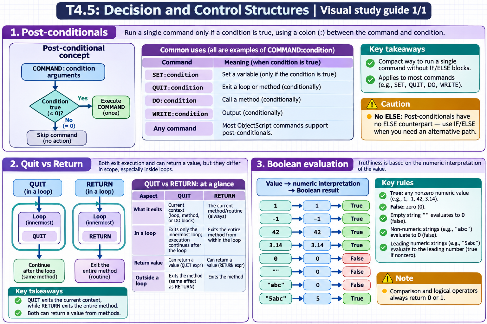

[All topics](../../index.md) · [Practice quiz](quiz.md)

# T4.5: Decision and Control Structures

[Approfondimenti dagli esercizi](<Approfondimenti esercizi/README.md>)

Saved 2 November 2026 from [exam-prep.es](https://exam-prep.es/exams/objectscript/knowledge/T4.5.html). Reference links require internet access.

### Contents

1. [Post-conditionals](#1-post-conditionals)
2. [Quit vs Return](#2-quit-vs-return)
3. [Boolean evaluation](#3-boolean-evaluation)

### Visual study guide — sections 1–3



[View all chapter diagrams](visuals.md) · [Technical review notes](../../visual-technical-notes.md)

## 1. Post-conditionals

### Key Points

- **Syntax**: COMMAND:condition arguments -- colon between command and condition
- **Compact code**: Execute a single command conditionally without IF/ELSE blocks
- **SET:condition**: SET:condition var = value -- only sets if condition is true
- **QUIT:condition**: Exit a loop or method conditionally
- **DO:condition**: Call a method conditionally
- **WRITE:condition**: Output conditionally
- **Any command**: Most ObjectScript commands support post-conditionals
- **No ELSE**: Post-conditionals have no ELSE counterpart -- use IF/ELSE for that

### Detailed Notes

#### Overview

Post-conditionals are a distinctive ObjectScript feature that allows any command to be executed conditionally by appending a colon and a boolean expression directly after the command keyword. This produces concise, readable code for simple conditional operations without the overhead of full IF/ELSE blocks.

A post-conditional applies only to the command on that line. `WRITE:count>0 "Items found"` either runs or skips that write; it does not condition later commands. If several statements must share the condition, use an `IF` block so the boundary is visible.

#### Basic Post-Conditional Syntax

```objectscript
 SET x = 10

 // SET with post-conditional
 SET:x>5 message = "x is large"
 WRITE message, !                  // x is large

 // Equivalent to:
 IF x > 5 SET message = "x is large"

 // WRITE with post-conditional
 WRITE:x>5 "Greater than 5", !

 // Multiple post-conditionals (each independent)
 SET:x>20 category = "very large"
 SET:x>10 category = "large"
 SET:x>5 category = "medium"
 SET:x<=5 category = "small"
 WRITE category, !                 // medium
```

#### QUIT with Post-Conditional

```objectscript
 // Early exit from a FOR loop
 SET sum = 0
 FOR i = 1:1:100 {
     SET sum = sum + i
     QUIT:sum>100
 }
 WRITE "Sum: ", sum, " at i=", i, !
 // Output: Sum: 105 at i=14

 // In method: return early if precondition fails
 ClassMethod Divide(a As %Numeric, b As %Numeric) As %Numeric
 {
     QUIT:b=0 ""    // Return empty if division by zero
     QUIT a / b
 }
```

#### DO with Post-Conditional

```objectscript
 // Call a method only if condition is met
 DO:status'=$$$OK ..LogError(status)

 // Multiple conditional calls
 DO:age>=18 ..ProcessAdult(name)
 DO:age<18 ..ProcessMinor(name)
```

#### Post-Conditional with Complex Expressions

```objectscript
 // Parentheses for complex conditions
 SET:(x>0)&&(x<100) range = "valid"

 // String conditions
 SET name = "Alice"
 WRITE:name="Alice" "Found Alice!", !

 // Negation
 SET:(obj'="") result = obj.Calculate()

 // Post-conditional on KILL
 KILL:cleanup tempVar
```

#### Common Patterns

```objectscript
 // Default value assignment
 SET:('$DATA(config)) config = "default"

 // Conditional increment
 SET:isValid count = count + 1

 // Guard clause in a method
 ClassMethod Process(input As %String) As %Status
 {
     QUIT:input="" $$$ERROR($$$GeneralError, "Input required")
     // ... rest of processing
     QUIT $$$OK
 }

 // Conditional THROW
 THROW:status'=$$$OK ##class(%Exception.StatusException).CreateFromStatus(status)
```

### Documentation References

- [Post-Conditional Expressions](https://docs.intersystems.com/irislatest/csp/docbook/DocBook.UI.Page.cls?KEY=GCOS_commands#GCOS_commands_postconditional)
- [SET Command](https://docs.intersystems.com/irislatest/csp/docbook/DocBook.UI.Page.cls?KEY=RCOS_cset)
- [QUIT Command](https://docs.intersystems.com/irislatest/csp/docbook/DocBook.UI.Page.cls?KEY=RCOS_cquit)

## 2. Quit vs Return

### Key Points

- **QUIT**: Exits the current context -- loop body, method, or DO block
- **RETURN**: Always exits the current method/routine, even from within a loop
- **QUIT in loop**: Exits only the innermost loop, continues after the loop
- **RETURN in loop**: Exits the entire method from within the loop
- **Return value**: Both QUIT expr and RETURN expr can return values from methods
- **QUIT from method**: When used outside a loop, QUIT exits the method (same as RETURN)

### Detailed Notes

#### Overview

QUIT and RETURN both exit code, but they differ in what they exit. QUIT exits the nearest enclosing context (loop or method), while RETURN always exits the method. This distinction is critical when you need to exit a method from inside a nested loop.

Inside a `FOR` loop, `QUIT` stops the loop and execution continues after it; `RETURN value` exits the method and gives the caller a result. For a search method, `QUIT` can stop scanning when an item is found, then code after the loop can return the index. Use `RETURN` inside the loop when the method should finish immediately.

#### QUIT in Loops vs Methods

```objectscript
 ClassMethod Example1()
 {
     WRITE "Before loop", !
     FOR i = 1:1:10 {
         QUIT:i=3         // Exits the FOR loop only
     }
     WRITE "After loop, i=", i, !    // Prints! i=3
     WRITE "Method continues", !      // Also prints
 }
```

```objectscript
 ClassMethod Example2()
 {
     WRITE "Before loop", !
     FOR i = 1:1:10 {
         RETURN:i=3       // Exits the ENTIRE METHOD
     }
     WRITE "After loop", !            // NEVER reached
 }
```

#### QUIT vs RETURN in Nested Loops

```objectscript
 ClassMethod NestedExample()
 {
     FOR i = 1:1:5 {
         FOR j = 1:1:5 {
             IF (i = 3) && (j = 2) {
                 QUIT    // Exits inner FOR loop only
                 // Outer loop continues with i=3, then i=4, i=5
             }
         }
         WRITE "i=", i, !    // Prints for all i values
     }
     WRITE "Done", !          // Prints
 }
```

```objectscript
 ClassMethod NestedReturn()
 {
     FOR i = 1:1:5 {
         FOR j = 1:1:5 {
             IF (i = 3) && (j = 2) {
                 RETURN   // Exits the ENTIRE method immediately
             }
         }
         WRITE "i=", i, !    // Prints for i=1, i=2 only
     }
     WRITE "Done", !          // NEVER reached
 }
```

#### Returning Values

```objectscript
 // QUIT with return value (in a method returning a value)
 ClassMethod Add(a, b) As %Integer
 {
     QUIT a + b
 }

 // RETURN with return value
 ClassMethod FindFirst(list As %ListOfDataTypes) As %String
 {
     FOR i = 1:1:list.Count() {
         SET item = list.GetAt(i)
         IF item [ "target" {
             RETURN item    // Exit method immediately with value
         }
     }
     RETURN ""              // Not found
 }

 // QUIT in a method with no return value
 ClassMethod Process()
 {
     QUIT:errorCondition    // Exit method (no return value)
     // ... processing
 }
```

#### QUIT in DO Blocks

```objectscript
 // QUIT exits a DO block (argumentless DO with code block)
 DO {
     SET x = $RANDOM(10)
     QUIT:x=5              // Exits the DO block, not any outer loop
     WRITE x, " "
 } WHILE x '= 5
```

### Documentation References

- [QUIT Command](https://docs.intersystems.com/irislatest/csp/docbook/DocBook.UI.Page.cls?KEY=RCOS_cquit)
- [RETURN Command](https://docs.intersystems.com/irislatest/csp/docbook/DocBook.UI.Page.cls?KEY=RCOS_creturn)

## 3. Boolean evaluation

### Key Points

- **True**: Any nonzero numeric value is true (1, -1, 42, 3.14)
- **False**: Zero (0) is false
- **Empty string**: "" evaluates to 0, which is false
- **Non-numeric strings**: "abc" evaluates to 0 (false) because its numeric value is 0
- **Leading numeric strings**: "5abc" evaluates to 5, which is true
- **Canonical**: Truthiness depends on the numeric interpretation of the value
- **Boolean result**: Comparison and logical operators always return 0 or 1

### Detailed Notes

#### Overview

ObjectScript does not have a dedicated boolean type. Instead, it uses numeric evaluation: zero is false, any nonzero value is true. When a string is evaluated as a boolean, it is first converted to its numeric value. Understanding this coercion is critical for writing correct conditions.

ObjectScript evaluates values numerically when they are used as conditions, so a string that begins with a number can behave differently from an empty or nonnumeric string. If the requirement is “the field is not blank,” check that it is defined and compare it with `""` explicitly instead of relying on truthiness. The code examples show the difference between a condition check and numeric conversion.

#### Truthiness Rules

```objectscript
 // Nonzero = true
 IF 1 WRITE "1 is true", !            // prints
 IF -1 WRITE "-1 is true", !          // prints
 IF 42 WRITE "42 is true", !          // prints
 IF 0.001 WRITE "0.001 is true", !    // prints

 // Zero = false
 IF 0 WRITE "0 is true", !            // does NOT print
 IF '0 WRITE "0 is false", !          // prints

 // Empty string = 0 = false
 IF "" WRITE "empty is true", !       // does NOT print
 SET x = ""
 IF 'x WRITE "empty is false", !      // prints

 // Non-numeric strings = 0 = false
 IF "abc" WRITE "abc is true", !      // does NOT print
 IF "hello" WRITE "hello is true", !  // does NOT print

 // Leading numeric strings = their numeric value
 IF "5abc" WRITE "5abc is true", !    // prints (5 is nonzero)
 IF "0abc" WRITE "0abc is true", !    // does NOT print (0)
```

#### Boolean Results from Comparisons

```objectscript
 // Comparisons return exactly 0 or 1
 WRITE 5 > 3, !             // 1
 WRITE 3 > 5, !             // 0
 WRITE "A" = "A", !         // 1
 WRITE "A" = "B", !         // 0

 // Can store boolean results
 SET isAdult = (age >= 18)
 SET isValid = (name '= "") && (age > 0)

 // Boolean arithmetic
 SET total = (a > 0) + (b > 0) + (c > 0)
 WRITE "Number of positive values: ", total, !
```

#### Common Boolean Pitfalls

```objectscript
 // PITFALL: Testing a string that should be boolean
 SET flag = "yes"
 IF flag WRITE "flag is true", !      // does NOT print!
 // "yes" has numeric value 0, so it is false in boolean context

 // Correct approach: test against specific values
 IF flag = "yes" WRITE "flag is yes", !  // prints

 // PITFALL: Empty string vs zero
 // In boolean context (IF), "" acts like 0 (false)
 // But "" and 0 are NOT equal with the = operator!
 SET val = ""
 IF val WRITE "truthy", !             // does NOT print ("" is falsy)
 IF val = 0 WRITE "equal to zero", !  // does NOT print! ("" '= 0)
 IF val = "" WRITE "equal to empty", ! // prints

 SET zero = 0
 IF zero WRITE "truthy", !            // does NOT print (0 is falsy)
 IF zero = "" WRITE "equal to empty", ! // does NOT print! (0 '= "")
 IF zero = 0 WRITE "equal to zero", ! // prints

 // To coerce "" to numeric before comparison, use unary +
 WRITE +"" = 0, !            // 1 (+"" gives 0, then 0 = 0)
 WRITE "" = 0, !             // 0 ("" is not 0)

 // PITFALL: Non-numeric strings are all falsy
 IF "yes" WRITE "yes", !     // does NOT print ("yes" = 0 numerically)
 IF "true" WRITE "true", !   // does NOT print
 IF "abc" WRITE "abc", !     // does NOT print
 WRITE "yes" = 0, !          // 0 ("yes" is not 0 -- different values)
 WRITE +"yes" = 0, !         // 1 (+"yes" coerces to 0, then 0 = 0)
```

#### NOT Operator

```objectscript
 SET x = 5
 WRITE 'x, !                // 0 (NOT 5 = false)

 SET y = 0
 WRITE 'y, !                // 1 (NOT 0 = true)

 // Double negation
 WRITE ''x, !               // 1 (NOT NOT 5 = true)
 WRITE ''y, !               // 0 (NOT NOT 0 = false)

 // '' can normalize any value to 0 or 1
 SET normalized = ''someValue
 // normalized is now exactly 0 or 1
```

#### Truthiness in Control Flow

```objectscript
 // IF uses truthiness
 SET name = "Alice"
 IF name WRITE "name has a value", !    // does NOT print ("Alice" = 0)

 // Correct: check for non-empty
 IF name '= "" WRITE "name is not empty", !  // prints

 // $DATA returns 0 (falsy) or 1/10/11 (truthy)
 IF $DATA(^config("key")) WRITE "key exists", !

 // $LENGTH returns 0 for empty, positive for non-empty
 IF $LENGTH(name) WRITE "name has length", !  // prints (5 > 0)
```

### Documentation References

- [Boolean Expressions](https://docs.intersystems.com/irislatest/csp/docbook/DocBook.UI.Page.cls?KEY=GCOS_operators#GCOS_operators_truth)
- [Numeric Interpretation of Strings](https://docs.intersystems.com/irislatest/csp/docbook/DocBook.UI.Page.cls?KEY=GCOS_types#GCOS_types_numericstrings)

## Exam Preparation Summary

### Critical Concepts to Master:

1. **Post-conditional syntax**: COMMAND:condition -- colon directly after command, no space
2. **QUIT vs RETURN**: QUIT exits nearest context (loop or method); RETURN always exits the method
3. **QUIT in nested loops**: Only exits the innermost loop -- use RETURN to exit the method
4. **Boolean evaluation**: 0 = false, nonzero = true; "" is falsy; "abc" is falsy (numeric value 0)
5. **String truthiness trap**: "yes", "true", "abc" are all FALSE because their numeric value is 0
6. **"" vs 0**: Both are falsy in boolean context, but `"" = 0` is FALSE — they are different values. Use unary `+` to coerce strings to numbers before numeric comparison
7. **Post-conditionals on any command**: SET, QUIT, DO, WRITE, KILL, THROW all support them
8. **Return values**: Both QUIT expr and RETURN expr can return values from methods

### Common Exam Scenarios:

- Predicting whether QUIT exits a loop or method based on context
- Determining the output of code with post-conditionals
- Evaluating boolean expressions with string values (truthiness traps)
- Choosing between QUIT and RETURN for a given flow control need
- Writing guard clauses with QUIT:condition in methods
- Understanding that "" and 0 are both falsy but `"" = 0` is false
- Determining which lines execute after QUIT in a nested loop

### Hands-On Practice Recommendations:

- Write methods using post-conditionals instead of IF blocks and verify behavior
- Create nested loops and test QUIT vs RETURN at different levels
- Experiment with truthiness of various values: "", "abc", "0", "1", 0, 1, "5abc"
- Test `"" = 0`, `0 = ""`, `+"" = 0` to understand coercion vs comparison
- Write a method that uses QUIT:condition as a guard clause
- Practice the pattern of QUIT:errorCondition $$$ERROR(...)
- Test double negation ('') to normalize values to boolean 0/1
