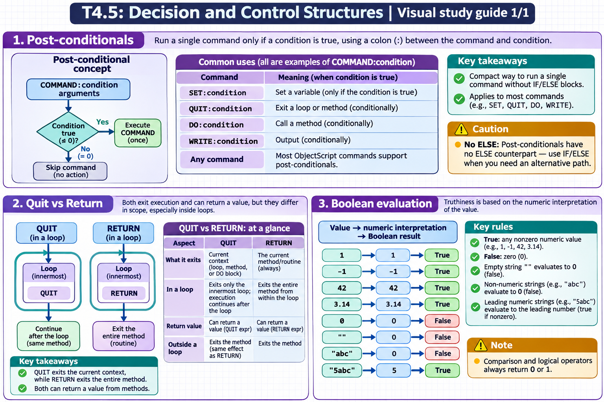
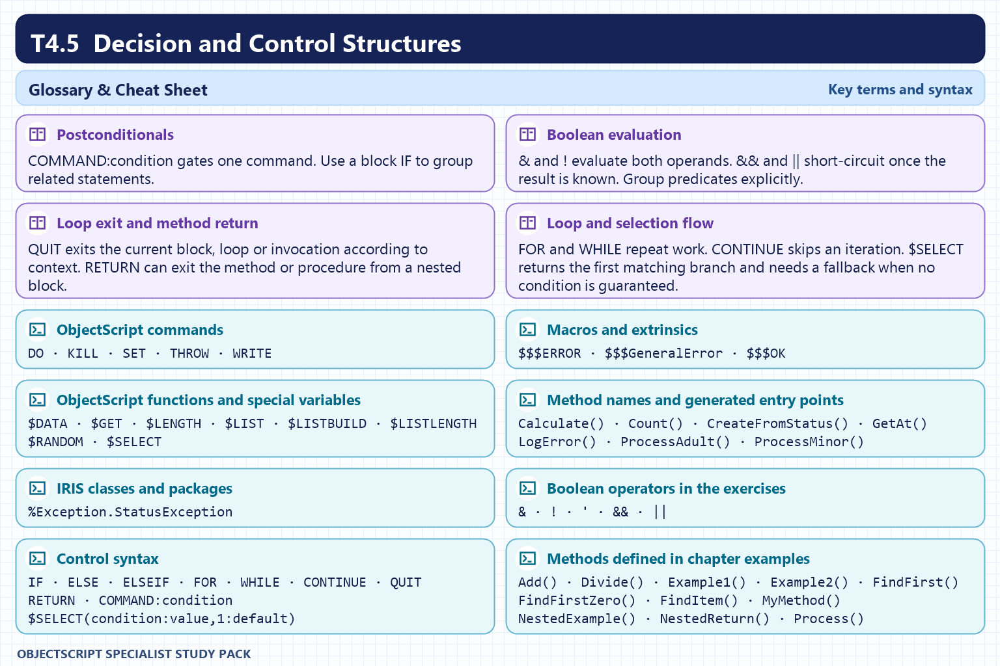
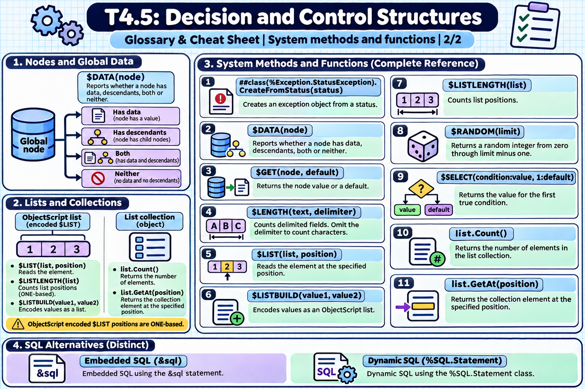

# T4.5: Decision and Control Structures — visual study guides

[Approfondimenti dagli esercizi](<Approfondimenti esercizi/README.md>)

[Chapter contents](index.md) · [Full guide](study.md) · [Practice questions](quiz.md)

Generated learning summaries. Read the full notes for detailed explanations and exact code. [Technical review notes](../../visual-technical-notes.md).

## Visual guide — sections 1–3

Covers:

- 1. Post-conditionals
- 2. Quit vs Return
- 3. Boolean evaluation

## Glossary & Cheat Sheet

[Open the text recap](study.md#glossary--cheat-sheet).
