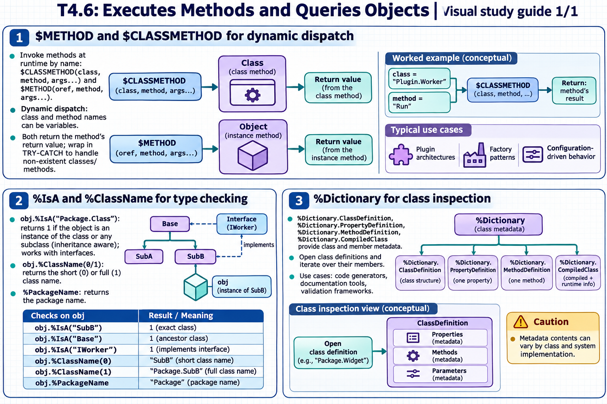

[Topic contents](../index.md) · [Full topic guide](../study.md) · [All topics](../../../index.md)

# T4.6: Executes Methods and Queries Objects

Saved 2 November 2026 from [exam-prep.es](https://exam-prep.es/exams/objectscript/knowledge/T4.6.html). Reference links require internet access.

## 1. $METHOD and $CLASSMETHOD for dynamic dispatch



*This diagram covers sections 1–3; use the matching numbered panel for this page.* [Chapter diagrams](../visuals.md) · [Technical review notes](../../../visual-technical-notes.md)

### Key Points

- **$CLASSMETHOD(class, method, args...)**: Invokes a class method by name at runtime
- **$METHOD(oref, method, args...)**: Invokes an instance method on an object reference at runtime
- **Dynamic dispatch**: Method and class names can be variables, enabling runtime flexibility
- **Use cases**: Plugin architectures, factory patterns, configuration-driven behavior
- **Return value**: Both functions return the method's return value
- **Error handling**: Wrap in TRY-CATCH to handle non-existent classes/methods

### Detailed Notes

#### Overview

$CLASSMETHOD and $METHOD allow you to invoke methods where the class name, method name, or both are determined at runtime (stored in variables). This is ObjectScript's mechanism for dynamic dispatch, analogous to reflection-based method invocation in Java or Python's getattr().

#### $CLASSMETHOD: Dynamic Class Method Calls

```objectscript
 // Static call (compile-time)
 SET obj = ##class(User.Person).%New()

 // Dynamic equivalent using $CLASSMETHOD
 SET className = "User.Person"
 SET obj = $CLASSMETHOD(className, "%New")

 // Dynamic method name too
 SET methodName = "%New"
 SET obj = $CLASSMETHOD(className, methodName)

 // With arguments
 SET className = "User.Calculator"
 SET result = $CLASSMETHOD(className, "Add", 5, 3)
 WRITE result, !    // 8

 // Factory pattern: create objects based on configuration
 SET type = ^config("objectType")    // e.g., "User.Admin" or "User.Guest"
 SET obj = $CLASSMETHOD(type, "%New")
```

#### $METHOD: Dynamic Instance Method Calls

```objectscript
 SET person = ##class(User.Person).%New()
 SET person.Name = "Alice"

 // Static call
 WRITE person.GetFullName(), !

 // Dynamic equivalent
 SET methodName = "GetFullName"
 WRITE $METHOD(person, methodName), !

 // With arguments
 SET methodName = "SetAge"
 DO $METHOD(person, methodName, 30)

 // Dynamic method name from data
 SET action = "Validate"
 SET status = $METHOD(obj, action)
```

#### Practical Dynamic Dispatch Patterns

```objectscript
 // Plugin/handler pattern
 SET handlerClass = ^config("handler")
 SET status = $CLASSMETHOD(handlerClass, "Process", message)

 // Iterate over a list of operations
 SET operations = $LB("Validate", "Transform", "Save")
 SET ptr = 0
 WHILE $LISTNEXT(operations, ptr, op) {
     SET status = $METHOD(processor, op, data)
     QUIT:$$$ISERR(status)
 }

 // Error handling for dynamic dispatch
 TRY {
     SET result = $CLASSMETHOD(className, methodName, arg1)
 } CATCH ex {
     WRITE "Error: ", ex.DisplayString(), !
     // Handle missing class or method
 }
```

#### $CLASSMETHOD vs ##class() Syntax

```objectscript
 // Static (compile-time resolution):
 SET obj = ##class(User.Person).%New()
 // Compiler verifies class exists at compile time

 // Dynamic (runtime resolution):
 SET obj = $CLASSMETHOD("User.Person", "%New")
 // Class resolved at runtime -- more flexible but no compile-time check
```

### Documentation References

- [$CLASSMETHOD Function](https://docs.intersystems.com/irislatest/csp/docbook/DocBook.UI.Page.cls?KEY=RCOS_fclassmethod)
- [$METHOD Function](https://docs.intersystems.com/irislatest/csp/docbook/DocBook.UI.Page.cls?KEY=RCOS_fmethod)
