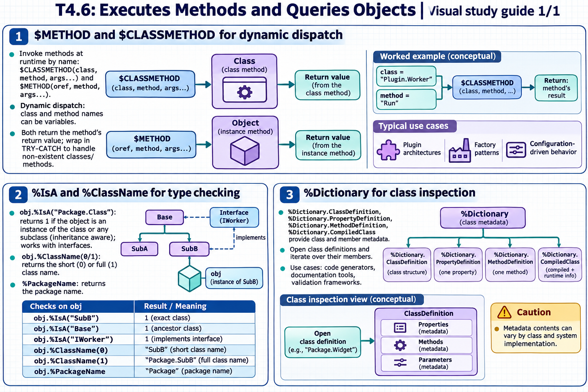

[Topic contents](../index.md) · [Full topic guide](../study.md) · [All topics](../../../index.md)

# T4.6: Executes Methods and Queries Objects

Saved 2 November 2026 from [exam-prep.es](https://exam-prep.es/exams/objectscript/knowledge/T4.6.html). Reference links require internet access.

## 2. %IsA and %ClassName for type checking



*This diagram covers sections 1–3; use the matching numbered panel for this page.* [Chapter diagrams](../visuals.md) · [Technical review notes](../../../visual-technical-notes.md)

### Key Points

- **obj.%IsA("Package.Class")**: Returns 1 if object is an instance of the class or any subclass
- **Inheritance aware**: %IsA returns true for any ancestor class in the hierarchy
- **Interface checking**: %IsA works with classes that implement a given interface
- **obj.%ClassName(0)**: Returns the short class name (no package)
- **obj.%ClassName(1)**: Returns the full class name (with package)
- **%PackageName**: Returns the package name

### Detailed Notes

#### Overview

%IsA and %ClassName are methods inherited from %Library.RegisteredObject (the root class for all registered objects). They enable runtime type inspection, which is useful for polymorphic code, validation, and debugging.

#### %IsA: Checking Class Hierarchy

```objectscript
 // Given: User.Employee extends User.Person
 SET emp = ##class(User.Employee).%New()

 // Check exact class
 WRITE emp.%IsA("User.Employee"), !     // 1

 // Check parent class
 WRITE emp.%IsA("User.Person"), !       // 1

 // Check root class
 WRITE emp.%IsA("%Library.RegisteredObject"), !  // 1

 // Check unrelated class
 WRITE emp.%IsA("User.Product"), !      // 0

 // Use in conditional logic
 IF obj.%IsA("User.Person") {
     WRITE "Processing person: ", obj.Name, !
 } ELSEIF obj.%IsA("User.Product") {
     WRITE "Processing product: ", obj.SKU, !
 }
```

#### %IsA with Interfaces

```objectscript
 // If User.Employee implements User.Printable interface
 IF obj.%IsA("User.Printable") {
     DO obj.Print()
 }
```

#### %ClassName: Getting the Class Name

```objectscript
 SET emp = ##class(User.Employee).%New()

 // Short name (no package)
 WRITE emp.%ClassName(0), !    // Employee

 // Full name (with package)
 WRITE emp.%ClassName(1), !    // User.Employee

 // Default (no argument) returns short name
 WRITE emp.%ClassName(), !     // Employee

 // Package name only
 WRITE emp.%PackageName(), !   // User
```

#### Practical Patterns

```objectscript
 // Logging with type information
 ClassMethod LogObject(obj As %RegisteredObject)
 {
     SET className = obj.%ClassName(1)
     WRITE "Processing object of type: ", className, !

     // Type-based dispatch
     IF obj.%IsA("User.Employee") {
         DO ..ProcessEmployee(obj)
     } ELSEIF obj.%IsA("User.Customer") {
         DO ..ProcessCustomer(obj)
     } ELSE {
         WRITE "Unknown type: ", className, !
     }
 }

 // Runtime class comparison
 ClassMethod AreSameType(obj1, obj2) As %Boolean
 {
     QUIT obj1.%ClassName(1) = obj2.%ClassName(1)
 }

 // Check before casting
 IF obj.%IsA("User.Admin") {
     SET admin = obj    // Safe to treat as Admin
     DO admin.GrantAccess(resource)
 }
```

### Documentation References

- [%IsA Method](https://docs.intersystems.com/irislatest/csp/documatic/%25CSP.Documatic.cls?LIBRARY=%25SYS&CLASSNAME=%25Library.RegisteredObject#%25IsA)
- [%ClassName Method](https://docs.intersystems.com/irislatest/csp/documatic/%25CSP.Documatic.cls?LIBRARY=%25SYS&CLASSNAME=%25Library.RegisteredObject#%25ClassName)
- [Object Basics](https://docs.intersystems.com/irislatest/csp/docbook/DocBook.UI.Page.cls?KEY=GOBJ_intro)
