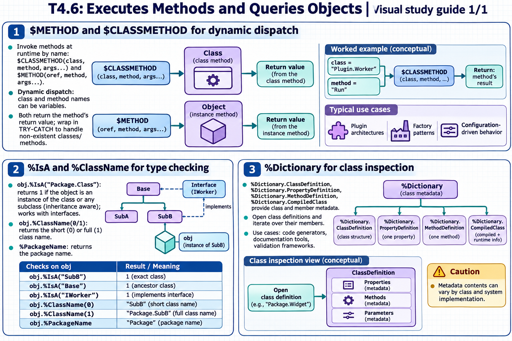

[Topic contents](../index.md) · [Full topic guide](../study.md) · [All topics](../../../index.md)

# T4.6: Executes Methods and Queries Objects

Saved 2 November 2026 from [exam-prep.es](https://exam-prep.es/exams/objectscript/knowledge/T4.6.html). Reference links require internet access.

## 3. %Dictionary for class inspection



*This diagram covers sections 1–3; use the matching numbered panel for this page.* [Chapter diagrams](../visuals.md) · [Technical review notes](../../../visual-technical-notes.md)

### Key Points

- **%Dictionary.ClassDefinition**: Represents a class definition -- properties, methods, parameters
- **%Dictionary.PropertyDefinition**: Metadata about a single property
- **%Dictionary.MethodDefinition**: Metadata about a single method
- **%Dictionary.CompiledClass**: Compiled version with additional runtime information
- **Querying metadata**: Open class definitions and iterate over their members
- **Use cases**: Code generators, documentation tools, validation frameworks

### Detailed Notes

#### Overview

The %Dictionary package provides classes that represent class definitions as persistent objects. You can open any class definition and inspect its properties, methods, parameters, indices, and more. This is ObjectScript's reflection/introspection mechanism.

#### Opening a Class Definition

```objectscript
 // Open a class definition
 SET classDef = ##class(%Dictionary.ClassDefinition).%OpenId("User.Person")

 IF classDef '= "" {
     WRITE "Class: ", classDef.Name, !
     WRITE "Super: ", classDef.Super, !
     WRITE "Description: ", classDef.Description, !
 }
```

#### Listing Properties

```objectscript
 SET classDef = ##class(%Dictionary.ClassDefinition).%OpenId("User.Person")
 IF classDef = "" WRITE "Class not found", ! QUIT

 // Iterate over properties
 WRITE "Properties:", !
 FOR i = 1:1:classDef.Properties.Count() {
     SET prop = classDef.Properties.GetAt(i)
     WRITE "  ", prop.Name
     WRITE " (", prop.Type, ")"
     WRITE:prop.Required " [Required]"
     WRITE !
 }
 // Example output:
 //   Name (%Library.String) [Required]
 //   Age (%Library.Integer)
 //   City (%Library.String)
```

#### Listing Methods

```objectscript
 SET classDef = ##class(%Dictionary.ClassDefinition).%OpenId("User.Person")

 WRITE "Methods:", !
 FOR i = 1:1:classDef.Methods.Count() {
     SET method = classDef.Methods.GetAt(i)
     WRITE "  ", method.Name
     WRITE:method.ClassMethod " [ClassMethod]"
     WRITE " Returns: ", method.ReturnType
     WRITE !
 }
```

#### Using Compiled Class for Runtime Info

```objectscript
 // CompiledClass includes inherited members
 SET compiled = ##class(%Dictionary.CompiledClass).%OpenId("User.Employee")

 IF compiled '= "" {
     WRITE "All properties (including inherited):", !
     FOR i = 1:1:compiled.Properties.Count() {
         SET prop = compiled.Properties.GetAt(i)
         WRITE "  ", prop.Name, " : ", prop.Type
         WRITE " (from ", prop.Origin, ")"
         WRITE !
     }
 }
 // Shows properties from User.Employee AND User.Person
```

#### Querying Class Metadata via SQL

```objectscript
 // Alternative: query %Dictionary tables via SQL
 SET sql = "SELECT Name, Type, Required FROM %Dictionary.PropertyDefinition WHERE parent = ?"
 SET stmt = ##class(%SQL.Statement).%New()
 SET status = stmt.%Prepare(sql)
 SET rs = stmt.%Execute("User.Person")
 WHILE rs.%Next() {
     WRITE rs.Name, " : ", rs.Type
     WRITE:rs.Required " [Required]"
     WRITE !
 }
```

#### Checking if a Property or Method Exists

```objectscript
 // Check if a class has a specific property
 SET classDef = ##class(%Dictionary.ClassDefinition).%OpenId("User.Person")
 SET found = 0
 FOR i = 1:1:classDef.Properties.Count() {
     IF classDef.Properties.GetAt(i).Name = "Email" {
         SET found = 1
         QUIT
     }
 }
 WRITE:found "Email property exists", !
 WRITE:'found "Email property not found", !

 // Simpler: use compiled class and %ExistsId
 SET exists = ##class(%Dictionary.CompiledProperty).%ExistsId("User.Person||Email")
 WRITE "Email exists: ", exists, !
```

#### Practical: Dynamic Property Access

```objectscript
 // Get all property values from an object dynamically
 SET obj = ##class(User.Person).%OpenId(1)
 SET classDef = ##class(%Dictionary.CompiledClass).%OpenId("User.Person")

 FOR i = 1:1:classDef.Properties.Count() {
     SET propName = classDef.Properties.GetAt(i).Name
     CONTINUE:$E(propName)="%"    // Skip system properties
     SET value = $PROPERTY(obj, propName)
     WRITE propName, " = ", value, !
 }
```

### Documentation References

- [%Dictionary.ClassDefinition](https://docs.intersystems.com/irislatest/csp/documatic/%25CSP.Documatic.cls?LIBRARY=%25SYS&CLASSNAME=%25Dictionary.ClassDefinition)
- [%Dictionary.PropertyDefinition](https://docs.intersystems.com/irislatest/csp/documatic/%25CSP.Documatic.cls?LIBRARY=%25SYS&CLASSNAME=%25Dictionary.PropertyDefinition)
- [%Dictionary.CompiledClass](https://docs.intersystems.com/irislatest/csp/documatic/%25CSP.Documatic.cls?LIBRARY=%25SYS&CLASSNAME=%25Dictionary.CompiledClass)
- [$PROPERTY Function](https://docs.intersystems.com/irislatest/csp/docbook/DocBook.UI.Page.cls?KEY=RCOS_fproperty)
