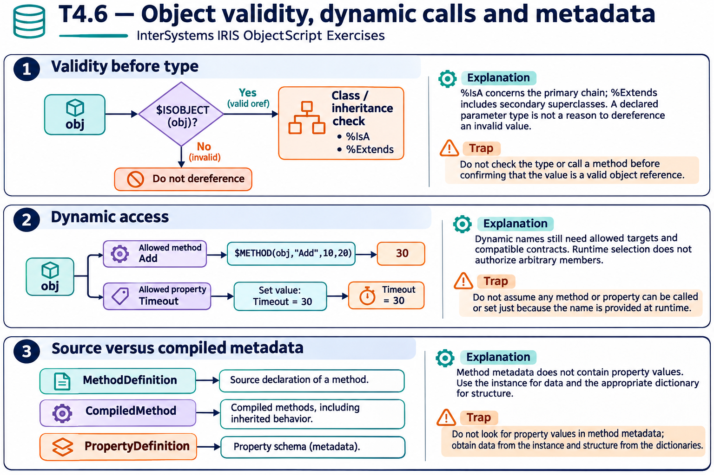

# T4.6 · 01 — Validare un riferimento prima di interrogarne la classe

[Indice degli approfondimenti](README.md) · [Quiz originale](../quiz.md) · [Teoria](../study.md)

**Esercizi di partenza:** [Q1](../quiz.md#question-1-single) · [Q2](../quiz.md#question-2-single) · [Q5](../quiz.md#question-5-single) · [Q6](../quiz.md#question-6-single) · [Q10](../quiz.md#question-10-multiple) · [Q11](../quiz.md#question-11-single). L’approfondimento rielabora il concetto e aggiunge una variante; non riproduce soltanto la risposta del quiz.

## Il caso concreto

x="Hello" non è un oggetto; emp è un’istanza di Employee che eredita da Person ed Entity.

```objectscript
if $ISOBJECT(obj) {
  write obj.%IsA("App.Person")
}
```

## Ragionamento passo per passo

$ISOBJECT evita di chiamare un metodo su un valore che non è un oref valido. %IsA esamina la compatibilità nella gerarchia, non soltanto il nome esatto della classe concreta. Un Employee può soddisfare più controlli di appartenenza.

## Perché il distrattore è plausibile

Chiamare %IsA per verificare se qualcosa è un oggetto: la chiamata presuppone già un riferimento valido.

## Lo spunto da portare oltre l’esercizio

Separa validità del riferimento e compatibilità del tipo.



*Leggi il pannello 1; gli altri due collegano il caso agli altri approfondimenti del capitolo.*

## Variante: prova prima di leggere la soluzione

Employee estende Person. Un Employee può avere %IsA("App.Person")=1 pur chiamandosi Employee?

<details>
<summary>Soluzione ragionata</summary>

Sì: il test segue l’ereditarietà.

</details>

## Riferimenti e precisazioni

- [API degli oggetti](https://docs.intersystems.com/irislatest/csp/docbook/DocBook.UI.Page.cls?KEY=GOBJ_objapi)
- [$METHOD](https://docs.intersystems.com/irislatest/csp/docbook/DocBook.UI.Page.cls?KEY=RCOS_fmethod)
- [$PROPERTY](https://docs.intersystems.com/irislatest/csp/docbook/DocBook.UI.Page.cls?KEY=RCOS_fproperty)
- [Riferimento classi e metadati](https://docs.intersystems.com/irislatest/csp/docbook/DocBook.UI.Page.cls?KEY=ROBJ)

[Note specifiche del capitolo](README.md#precisazioni-rispetto-al-quiz) · [Metodo e limiti della revisione](../../../approfondimenti-esercizi.md#metodo-e-limiti)
