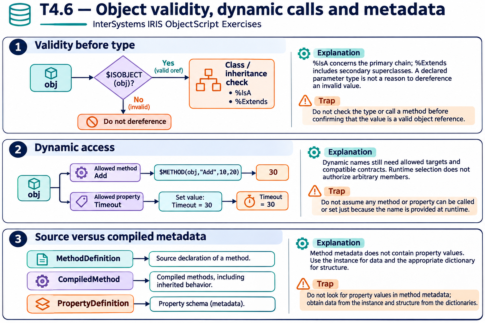

# T4.6 · 02 — Il dispatch dinamico cambia il nome, non il contratto

[Indice degli approfondimenti](README.md) · [Quiz originale](../quiz.md) · [Teoria](../study.md)

**Esercizi di partenza:** [Q3](../quiz.md#question-3-single) · [Q4](../quiz.md#question-4-single) · [Q7](../quiz.md#question-7-single) · [Q12](../quiz.md#question-12-single) · [Q15](../quiz.md#question-15-single). L’approfondimento rielabora il concetto e aggiunge una variante; non riproduce soltanto la risposta del quiz.

## Il caso concreto

Un metodo Add viene scelto tramite una stringa e invocato con 10 e 20; una proprietà Timeout viene selezionata per nome.

```objectscript
set methodName="Add"
set result=$METHOD(obj,methodName,10,20)
set $PROPERTY(config,"Timeout")=30
```

## Ragionamento passo per passo

La chiamata dinamica restituisce 30 se Add ha il contratto descritto. L’API non rende corretto qualunque nome ricevuto dall’esterno: controlla il set di metodi/proprietà ammessi e gli argomenti. La scrittura dinamica agisce sulla stessa istanza config.

## Perché il distrattore è plausibile

Confondere riflessione con assenza di validazione o considerare una stringa qualsiasi un metodo sicuro da esporre.

## Lo spunto da portare oltre l’esercizio

Il nome può essere deciso a runtime, ma i confini dell’operazione restano espliciti.



*Leggi il pannello 2; gli altri due collegano il caso agli altri approfondimenti del capitolo.*

## Variante: prova prima di leggere la soluzione

Un utente sceglie liberamente il nome del metodo amministrativo da invocare. Basta che il metodo esista?

<details>
<summary>Soluzione ragionata</summary>

No: serve limitare e autorizzare le operazioni esposte.

</details>

## Riferimenti e precisazioni

- [API degli oggetti](https://docs.intersystems.com/irislatest/csp/docbook/DocBook.UI.Page.cls?KEY=GOBJ_objapi)
- [$METHOD](https://docs.intersystems.com/irislatest/csp/docbook/DocBook.UI.Page.cls?KEY=RCOS_fmethod)
- [$PROPERTY](https://docs.intersystems.com/irislatest/csp/docbook/DocBook.UI.Page.cls?KEY=RCOS_fproperty)
- [Riferimento classi e metadati](https://docs.intersystems.com/irislatest/csp/docbook/DocBook.UI.Page.cls?KEY=ROBJ)

[Note specifiche del capitolo](README.md#precisazioni-rispetto-al-quiz) · [Metodo e limiti della revisione](../../../approfondimenti-esercizi.md#metodo-e-limiti)
