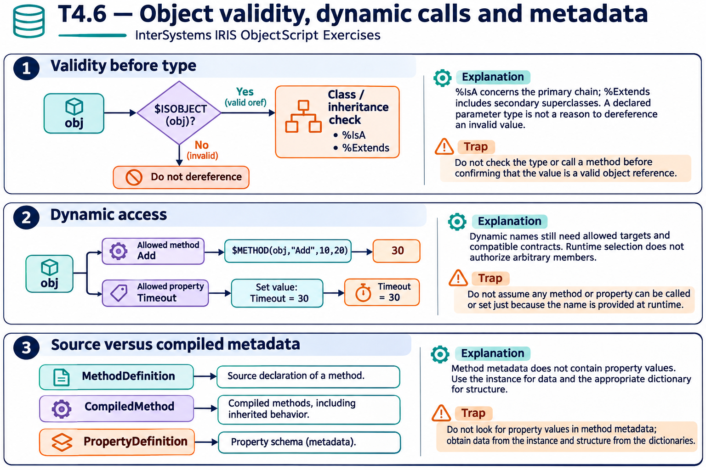

# T4.6 · 03 — Definizione e classe compilata sono viste diverse

[Indice degli approfondimenti](README.md) · [Quiz originale](../quiz.md) · [Teoria](../study.md)

**Esercizi di partenza:** [Q8](../quiz.md#question-8-single) · [Q9](../quiz.md#question-9-single) · [Q13](../quiz.md#question-13-single) · [Q14](../quiz.md#question-14-multiple). L’approfondimento rielabora il concetto e aggiunge una variante; non riproduce soltanto la risposta del quiz.

## Il caso concreto

Vuoi generare una tabella dei membri e includere anche metodi ereditati dalla classe compilata.

## Ragionamento passo per passo

La definizione descrive ciò che è dichiarato nella sorgente; i metadati compilati descrivono il risultato dopo compilazione e risoluzione dell’ereditarietà. Scegli la vista in funzione della domanda. Per ogni proprietà distingui nome ObjectScript, tipo, Required e nome della colonna SQL: non sono tutti la stessa stringa.

## Perché il distrattore è plausibile

Usare la sola definizione sorgente per dichiarare che un membro ereditato non esiste o assumere identità fra nome proprietà e nome SQL.

## Lo spunto da portare oltre l’esercizio

Chiedi se stai documentando la dichiarazione locale o il contratto effettivo compilato.

*Leggi il pannello 3; gli altri due collegano il caso agli altri approfondimenti del capitolo.*

## Variante: prova prima di leggere la soluzione

Un metodo è ereditato e non appare come dichiarazione locale. Questo prova che l’istanza non possa chiamarlo?

Soluzione ragionata

No: la vista compilata e la gerarchia possono includerlo.

## Riferimenti e precisazioni

- [API degli oggetti](https://docs.intersystems.com/irislatest/csp/docbook/DocBook.UI.Page.cls?KEY=GOBJ_objapi)
- [$METHOD](https://docs.intersystems.com/irislatest/csp/docbook/DocBook.UI.Page.cls?KEY=RCOS_fmethod)
- [$PROPERTY](https://docs.intersystems.com/irislatest/csp/docbook/DocBook.UI.Page.cls?KEY=RCOS_fproperty)
- [Riferimento classi e metadati](https://docs.intersystems.com/irislatest/csp/docbook/DocBook.UI.Page.cls?KEY=ROBJ)

[Note specifiche del capitolo](README.md#precisazioni-rispetto-al-quiz) · [Metodo e limiti della revisione](../../../approfondimenti-esercizi.md#metodo-e-limiti)
