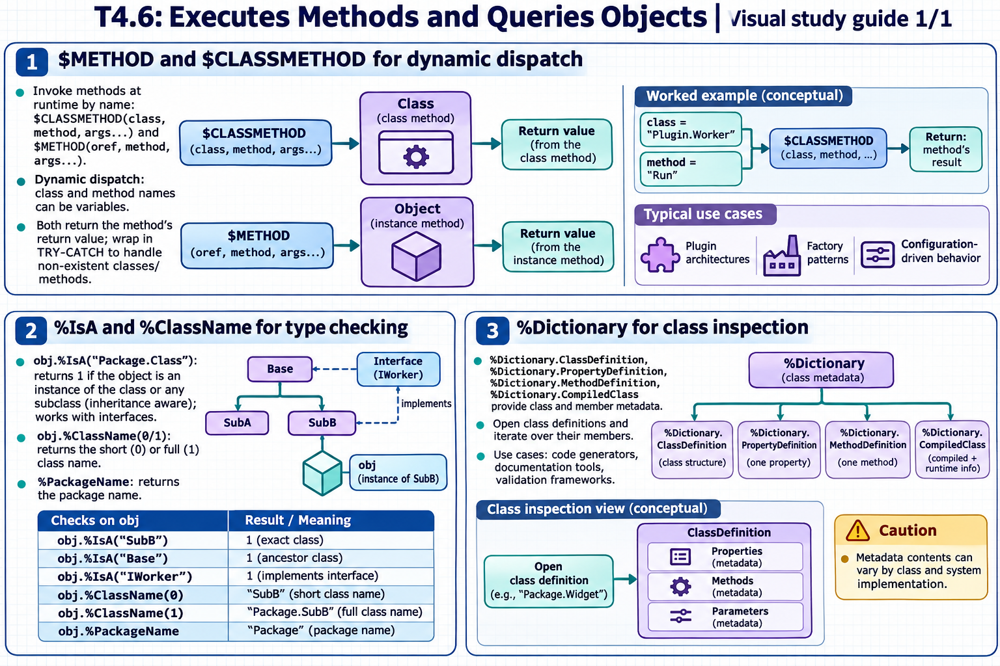

[All topics](../../index.md) · [Practice quiz](quiz.md)

# T4.6: Executes Methods and Queries Objects

[Approfondimenti dagli esercizi](<Approfondimenti esercizi/README.md>)

Saved 2 November 2026 from [exam-prep.es](https://exam-prep.es/exams/objectscript/knowledge/T4.6.html). Reference links require internet access.

### Contents

1. [$METHOD and $CLASSMETHOD for dynamic dispatch](#1-method-and-classmethod-for-dynamic-dispatch)
2. [%IsA and %ClassName for type checking](#2-isa-and-classname-for-type-checking)
3. [%Dictionary for class inspection](#3-dictionary-for-class-inspection)

### Visual study guide — sections 1–3



[View all chapter diagrams](visuals.md) · [Technical review notes](../../visual-technical-notes.md)

## 1. $METHOD and $CLASSMETHOD for dynamic dispatch

### Key Points

- **$CLASSMETHOD(class, method, args...)**: Invokes a class method by name at runtime
- **$METHOD(oref, method, args...)**: Invokes an instance method on an object reference at runtime
- **Dynamic dispatch**: Method and class names can be variables, enabling runtime flexibility
- **Use cases**: Plugin architectures, factory patterns, configuration-driven behavior
- **Return value**: Both functions return the method's return value
- **Error handling**: Wrap in TRY-CATCH to handle non-existent classes/methods

### Detailed Notes

#### Overview

$CLASSMETHOD and $METHOD allow you to invoke methods where the class name, method name, or both are determined at runtime (stored in variables). This is ObjectScript's mechanism for dynamic dispatch, analogous to reflection-based method invocation in Java or Python's getattr().

Use `$METHOD(object, methodName)` for an instance method and `$CLASSMETHOD(className, methodName)` for a class method. A serializer might choose `ToJSON` from a small approved list of operations. Keep the method name allowlisted: dynamic dispatch should not let external input select arbitrary methods.

#### $CLASSMETHOD: Dynamic Class Method Calls

```objectscript
 // Static call (compile-time)
 SET obj = ##class(User.Person).%New()

 // Dynamic equivalent using $CLASSMETHOD
 SET className = "User.Person"
 SET obj = $CLASSMETHOD(className, "%New")

 // Dynamic method name too
 SET methodName = "%New"
 SET obj = $CLASSMETHOD(className, methodName)

 // With arguments
 SET className = "User.Calculator"
 SET result = $CLASSMETHOD(className, "Add", 5, 3)
 WRITE result, !    // 8

 // Factory pattern: create objects based on configuration
 SET type = ^config("objectType")    // e.g., "User.Admin" or "User.Guest"
 SET obj = $CLASSMETHOD(type, "%New")
```

#### $METHOD: Dynamic Instance Method Calls

```objectscript
 SET person = ##class(User.Person).%New()
 SET person.Name = "Alice"

 // Static call
 WRITE person.GetFullName(), !

 // Dynamic equivalent
 SET methodName = "GetFullName"
 WRITE $METHOD(person, methodName), !

 // With arguments
 SET methodName = "SetAge"
 DO $METHOD(person, methodName, 30)

 // Dynamic method name from data
 SET action = "Validate"
 SET status = $METHOD(obj, action)
```

#### Practical Dynamic Dispatch Patterns

```objectscript
 // Plugin/handler pattern
 SET handlerClass = ^config("handler")
 SET status = $CLASSMETHOD(handlerClass, "Process", message)

 // Iterate over a list of operations
 SET operations = $LB("Validate", "Transform", "Save")
 SET ptr = 0
 WHILE $LISTNEXT(operations, ptr, op) {
     SET status = $METHOD(processor, op, data)
     QUIT:$$$ISERR(status)
 }

 // Error handling for dynamic dispatch
 TRY {
     SET result = $CLASSMETHOD(className, methodName, arg1)
 } CATCH ex {
     WRITE "Error: ", ex.DisplayString(), !
     // Handle missing class or method
 }
```

#### $CLASSMETHOD vs ##class() Syntax

```objectscript
 // Static (compile-time resolution):
 SET obj = ##class(User.Person).%New()
 // Compiler verifies class exists at compile time

 // Dynamic (runtime resolution):
 SET obj = $CLASSMETHOD("User.Person", "%New")
 // Class resolved at runtime -- more flexible but no compile-time check
```

### Documentation References

- [$CLASSMETHOD Function](https://docs.intersystems.com/irislatest/csp/docbook/DocBook.UI.Page.cls?KEY=RCOS_fclassmethod)
- [$METHOD Function](https://docs.intersystems.com/irislatest/csp/docbook/DocBook.UI.Page.cls?KEY=RCOS_fmethod)

## 2. %IsA and %ClassName for type checking

### Key Points

- **obj.%IsA("Package.Class")**: Returns 1 if object is an instance of the class or any subclass
- **Inheritance aware**: %IsA returns true for any ancestor class in the hierarchy
- **Interface checking**: %IsA works with classes that implement a given interface
- **obj.%ClassName(0)**: Returns the short class name (no package)
- **obj.%ClassName(1)**: Returns the full class name (with package)
- **%PackageName**: Returns the package name

### Detailed Notes

#### Overview

%IsA and %ClassName are methods inherited from %Library.RegisteredObject (the root class for all registered objects). They enable runtime type inspection, which is useful for polymorphic code, validation, and debugging.

`%ClassName()` reports the object's actual class, while `%IsA("Tutor.Employee")` checks whether it is an instance of that class or a subclass. A `Tutor.Specialist` object can therefore report its own class and still pass the `Tutor.Employee` check. If the input might not be an object, check it with `$ISOBJECT` before calling these instance methods.

#### %IsA: Checking Class Hierarchy

```objectscript
 // Given: User.Employee extends User.Person
 SET emp = ##class(User.Employee).%New()

 // Check exact class
 WRITE emp.%IsA("User.Employee"), !     // 1

 // Check parent class
 WRITE emp.%IsA("User.Person"), !       // 1

 // Check root class
 WRITE emp.%IsA("%Library.RegisteredObject"), !  // 1

 // Check unrelated class
 WRITE emp.%IsA("User.Product"), !      // 0

 // Use in conditional logic
 IF obj.%IsA("User.Person") {
     WRITE "Processing person: ", obj.Name, !
 } ELSEIF obj.%IsA("User.Product") {
     WRITE "Processing product: ", obj.SKU, !
 }
```

#### %IsA with Interfaces

```objectscript
 // If User.Employee implements User.Printable interface
 IF obj.%IsA("User.Printable") {
     DO obj.Print()
 }
```

#### %ClassName: Getting the Class Name

```objectscript
 SET emp = ##class(User.Employee).%New()

 // Short name (no package)
 WRITE emp.%ClassName(0), !    // Employee

 // Full name (with package)
 WRITE emp.%ClassName(1), !    // User.Employee

 // Default (no argument) returns short name
 WRITE emp.%ClassName(), !     // Employee

 // Package name only
 WRITE emp.%PackageName(), !   // User
```

#### Practical Patterns

```objectscript
 // Logging with type information
 ClassMethod LogObject(obj As %RegisteredObject)
 {
     SET className = obj.%ClassName(1)
     WRITE "Processing object of type: ", className, !

     // Type-based dispatch
     IF obj.%IsA("User.Employee") {
         DO ..ProcessEmployee(obj)
     } ELSEIF obj.%IsA("User.Customer") {
         DO ..ProcessCustomer(obj)
     } ELSE {
         WRITE "Unknown type: ", className, !
     }
 }

 // Runtime class comparison
 ClassMethod AreSameType(obj1, obj2) As %Boolean
 {
     QUIT obj1.%ClassName(1) = obj2.%ClassName(1)
 }

 // Check before casting
 IF obj.%IsA("User.Admin") {
     SET admin = obj    // Safe to treat as Admin
     DO admin.GrantAccess(resource)
 }
```

### Documentation References

- [%IsA Method](https://docs.intersystems.com/irislatest/csp/documatic/%25CSP.Documatic.cls?LIBRARY=%25SYS&CLASSNAME=%25Library.RegisteredObject#%25IsA)
- [%ClassName Method](https://docs.intersystems.com/irislatest/csp/documatic/%25CSP.Documatic.cls?LIBRARY=%25SYS&CLASSNAME=%25Library.RegisteredObject#%25ClassName)
- [Object Basics](https://docs.intersystems.com/irislatest/csp/docbook/DocBook.UI.Page.cls?KEY=GOBJ_intro)

## 3. %Dictionary for class inspection

### Key Points

- **%Dictionary.ClassDefinition**: Represents a class definition -- properties, methods, parameters
- **%Dictionary.PropertyDefinition**: Metadata about a single property
- **%Dictionary.MethodDefinition**: Metadata about a single method
- **%Dictionary.CompiledClass**: Compiled version with additional runtime information
- **Querying metadata**: Open class definitions and iterate over their members
- **Use cases**: Code generators, documentation tools, validation frameworks

### Detailed Notes

#### Overview

The %Dictionary package provides classes that represent class definitions as persistent objects. You can open any class definition and inspect its properties, methods, parameters, indices, and more. This is ObjectScript's reflection/introspection mechanism.

`%Dictionary` describes compiled class definitions, not individual business records. For example, metadata can tell a tool that a property is a `%Date` or show a method's definition; `%OpenId()` is what you use to read a saved patient. Use dictionary classes when code needs to inspect or adapt to the schema at runtime.

#### Opening a Class Definition

```objectscript
 // Open a class definition
 SET classDef = ##class(%Dictionary.ClassDefinition).%OpenId("User.Person")

 IF classDef '= "" {
     WRITE "Class: ", classDef.Name, !
     WRITE "Super: ", classDef.Super, !
     WRITE "Description: ", classDef.Description, !
 }
```

#### Listing Properties

```objectscript
 SET classDef = ##class(%Dictionary.ClassDefinition).%OpenId("User.Person")
 IF classDef = "" WRITE "Class not found", ! QUIT

 // Iterate over properties
 WRITE "Properties:", !
 FOR i = 1:1:classDef.Properties.Count() {
     SET prop = classDef.Properties.GetAt(i)
     WRITE "  ", prop.Name
     WRITE " (", prop.Type, ")"
     WRITE:prop.Required " [Required]"
     WRITE !
 }
 // Example output:
 //   Name (%Library.String) [Required]
 //   Age (%Library.Integer)
 //   City (%Library.String)
```

#### Listing Methods

```objectscript
 SET classDef = ##class(%Dictionary.ClassDefinition).%OpenId("User.Person")

 WRITE "Methods:", !
 FOR i = 1:1:classDef.Methods.Count() {
     SET method = classDef.Methods.GetAt(i)
     WRITE "  ", method.Name
     WRITE:method.ClassMethod " [ClassMethod]"
     WRITE " Returns: ", method.ReturnType
     WRITE !
 }
```

#### Using Compiled Class for Runtime Info

```objectscript
 // CompiledClass includes inherited members
 SET compiled = ##class(%Dictionary.CompiledClass).%OpenId("User.Employee")

 IF compiled '= "" {
     WRITE "All properties (including inherited):", !
     FOR i = 1:1:compiled.Properties.Count() {
         SET prop = compiled.Properties.GetAt(i)
         WRITE "  ", prop.Name, " : ", prop.Type
         WRITE " (from ", prop.Origin, ")"
         WRITE !
     }
 }
 // Shows properties from User.Employee AND User.Person
```

#### Querying Class Metadata via SQL

```objectscript
 // Alternative: query %Dictionary tables via SQL
 SET sql = "SELECT Name, Type, Required FROM %Dictionary.PropertyDefinition WHERE parent = ?"
 SET stmt = ##class(%SQL.Statement).%New()
 SET status = stmt.%Prepare(sql)
 SET rs = stmt.%Execute("User.Person")
 WHILE rs.%Next() {
     WRITE rs.Name, " : ", rs.Type
     WRITE:rs.Required " [Required]"
     WRITE !
 }
```

#### Checking if a Property or Method Exists

```objectscript
 // Check if a class has a specific property
 SET classDef = ##class(%Dictionary.ClassDefinition).%OpenId("User.Person")
 SET found = 0
 FOR i = 1:1:classDef.Properties.Count() {
     IF classDef.Properties.GetAt(i).Name = "Email" {
         SET found = 1
         QUIT
     }
 }
 WRITE:found "Email property exists", !
 WRITE:'found "Email property not found", !

 // Simpler: use compiled class and %ExistsId
 SET exists = ##class(%Dictionary.CompiledProperty).%ExistsId("User.Person||Email")
 WRITE "Email exists: ", exists, !
```

#### Practical: Dynamic Property Access

```objectscript
 // Get all property values from an object dynamically
 SET obj = ##class(User.Person).%OpenId(1)
 SET classDef = ##class(%Dictionary.CompiledClass).%OpenId("User.Person")

 FOR i = 1:1:classDef.Properties.Count() {
     SET propName = classDef.Properties.GetAt(i).Name
     CONTINUE:$E(propName)="%"    // Skip system properties
     SET value = $PROPERTY(obj, propName)
     WRITE propName, " = ", value, !
 }
```

### Documentation References

- [%Dictionary.ClassDefinition](https://docs.intersystems.com/irislatest/csp/documatic/%25CSP.Documatic.cls?LIBRARY=%25SYS&CLASSNAME=%25Dictionary.ClassDefinition)
- [%Dictionary.PropertyDefinition](https://docs.intersystems.com/irislatest/csp/documatic/%25CSP.Documatic.cls?LIBRARY=%25SYS&CLASSNAME=%25Dictionary.PropertyDefinition)
- [%Dictionary.CompiledClass](https://docs.intersystems.com/irislatest/csp/documatic/%25CSP.Documatic.cls?LIBRARY=%25SYS&CLASSNAME=%25Dictionary.CompiledClass)
- [$PROPERTY Function](https://docs.intersystems.com/irislatest/csp/docbook/DocBook.UI.Page.cls?KEY=RCOS_fproperty)

## Exam Preparation Summary

### Critical Concepts to Master:

1. **$CLASSMETHOD**: Dynamic class method invocation -- class and method names as strings/variables
2. **$METHOD**: Dynamic instance method invocation on an object reference
3. **%IsA**: Checks inheritance chain -- returns true for the class itself AND all ancestor classes
4. **%ClassName(0) vs %ClassName(1)**: Short name vs full name (with package)
5. **%Dictionary.ClassDefinition**: Source-level class metadata (only explicitly defined members)
6. **%Dictionary.CompiledClass**: Compiled metadata (includes inherited members)
7. **$PROPERTY**: Dynamic property access by name -- complement to $METHOD
8. **Compile-time vs runtime**: ##class() is compile-time; $CLASSMETHOD is runtime resolution

### Common Exam Scenarios:

- Choosing between ##class() and $CLASSMETHOD for a given scenario
- Using %IsA to check inheritance before performing operations
- Determining what %IsA returns for parent/child/unrelated classes
- Querying class metadata to discover properties or methods
- Using %Dictionary to build dynamic or reflective code
- Distinguishing ClassDefinition (source) from CompiledClass (includes inherited)
- Writing factory methods using $CLASSMETHOD with variable class names

### Hands-On Practice Recommendations:

- Create a class hierarchy and test %IsA at each level
- Use $CLASSMETHOD to instantiate objects with variable class names
- Use $METHOD to call methods dynamically on objects
- Open %Dictionary.ClassDefinition objects and explore the Properties and Methods collections
- Compare ClassDefinition vs CompiledClass to see inherited members
- Query %Dictionary tables via SQL for class metadata
- Build a utility that dumps all properties and values of any object using %Dictionary and $PROPERTY
