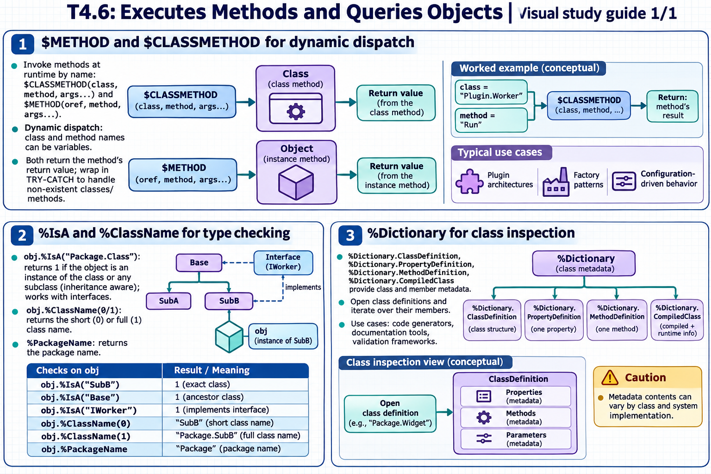

# T4.6: Executes Methods and Queries Objects — visual study guides

[Approfondimenti dagli esercizi](<Approfondimenti esercizi/README.md>)

[Chapter contents](index.md) · [Full guide](study.md) · [Practice questions](quiz.md)

Generated learning summaries. Read the full notes for detailed explanations and exact code. [Technical review notes](../../visual-technical-notes.md).

## Visual guide — sections 1–3

Covers:

- 1. $METHOD and $CLASSMETHOD for dynamic dispatch
- 2. %IsA and %ClassName for type checking
- 3. %Dictionary for class inspection
