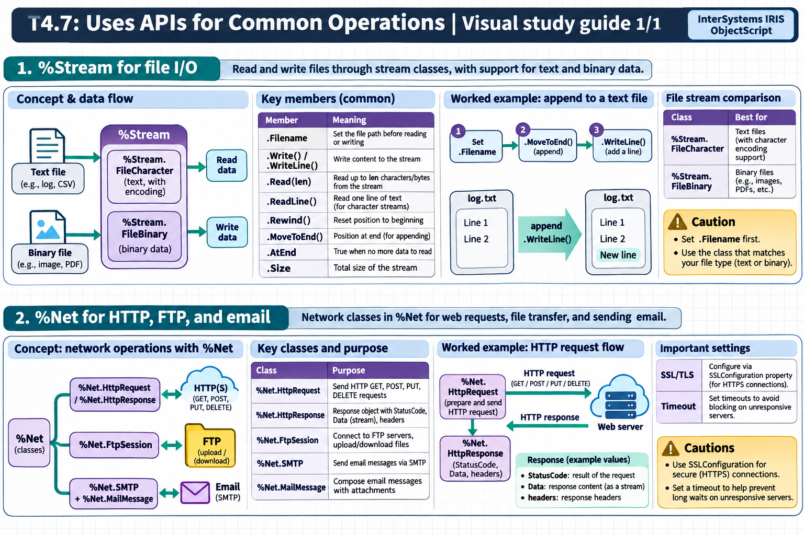

[Topic contents](../index.md) · [Full topic guide](../study.md) · [All topics](../../../index.md)

# T4.7: Uses APIs for Common Operations

Saved 2 November 2026 from [exam-prep.es](https://exam-prep.es/exams/objectscript/knowledge/T4.7.html). Reference links require internet access.

## 1. %Stream for file I/O



*This diagram covers sections 1–2; use the matching numbered panel for this page.* [Chapter diagrams](../visuals.md) · [Technical review notes](../../../visual-technical-notes.md)

### Key Points

- **%Stream.FileCharacter**: Read/write text files with character encoding support
- **%Stream.FileBinary**: Read/write binary files (images, PDFs, etc.)
- **.Filename property**: Set the file path before reading or writing
- **.Write() / .WriteLine()**: Write content to the stream
- **.Read(len)**: Read up to len characters/bytes from the stream
- **.ReadLine()**: Read one line of text (for character streams)
- **.Rewind()**: Reset position to beginning of stream
- **.MoveToEnd()**: Position at end of stream (for appending)
- **.AtEnd**: Property that is true when no more data to read
- **.Size**: Property containing the total size of the stream

### Detailed Notes

#### Overview

The %Stream classes provide ObjectScript's standard file I/O mechanism. Unlike traditional languages that use file handles, InterSystems IRIS uses stream objects that encapsulate the file, its position, and its encoding. Streams are also used extensively in web services, SQL BLOBs/CLOBs, and interoperability productions.

#### Writing a Text File

```objectscript
 SET stream = ##class(%Stream.FileCharacter).%New()
 SET stream.Filename = "/tmp/output.txt"

 // Write content
 DO stream.WriteLine("Line 1: Hello World")
 DO stream.WriteLine("Line 2: ObjectScript")
 DO stream.Write("No newline at end")

 // Save the stream to disk
 SET status = stream.%Save()
 IF $$$ISERR(status) {
     WRITE "Error saving: ", $SYSTEM.Status.GetErrorText(status), !
 } ELSE {
     WRITE "File written successfully", !
 }
```

#### Reading a Text File

```objectscript
 SET stream = ##class(%Stream.FileCharacter).%New()
 SET stream.Filename = "/tmp/output.txt"

 // Check if file exists via Size
 IF stream.Size = 0 {
     WRITE "File is empty or does not exist", !
     QUIT
 }

 // Read line by line
 WHILE 'stream.AtEnd {
     SET line = stream.ReadLine()
     WRITE line, !
 }
```

#### Reading a Fixed Number of Characters

```objectscript
 SET stream = ##class(%Stream.FileCharacter).%New()
 SET stream.Filename = "/tmp/largefile.txt"

 // Read in chunks of 32000 characters
 WHILE 'stream.AtEnd {
     SET chunk = stream.Read(32000)
     // Process chunk...
     SET totalLen = totalLen + $LENGTH(chunk)
 }
 WRITE "Total characters read: ", totalLen, !
```

#### Binary File Operations

```objectscript
 // Copy a binary file
 SET input = ##class(%Stream.FileBinary).%New()
 SET input.Filename = "/tmp/image.png"

 SET output = ##class(%Stream.FileBinary).%New()
 SET output.Filename = "/tmp/image_copy.png"

 // Copy content
 WHILE 'input.AtEnd {
     SET chunk = input.Read(32000)
     DO output.Write(chunk)
 }
 SET status = output.%Save()
```

#### Stream Navigation

```objectscript
 SET stream = ##class(%Stream.FileCharacter).%New()
 SET stream.Filename = "/tmp/data.txt"

 // Read first line
 SET firstLine = stream.ReadLine()
 WRITE "First: ", firstLine, !

 // Rewind to beginning
 DO stream.Rewind()

 // Read everything
 SET all = stream.Read(stream.Size)

 // Move to end for appending
 DO stream.MoveToEnd()
 DO stream.WriteLine("Appended line")
 SET status = stream.%Save()
```

#### Copying Between Streams

```objectscript
 // CopyFrom copies one stream's content into another
 SET source = ##class(%Stream.FileCharacter).%New()
 SET source.Filename = "/tmp/source.txt"

 SET dest = ##class(%Stream.FileCharacter).%New()
 SET dest.Filename = "/tmp/dest.txt"

 SET status = dest.CopyFrom(source)
 SET status = dest.%Save()
```

#### Stream Properties and Methods Summary

```objectscript
 SET stream = ##class(%Stream.FileCharacter).%New()
 SET stream.Filename = "/tmp/test.txt"

 // Properties
 WRITE "Size: ", stream.Size, !           // Total size in characters/bytes
 WRITE "At End: ", stream.AtEnd, !        // 1 if position is at end
 WRITE "Filename: ", stream.Filename, !   // File path

 // Key Methods
 // stream.Read(len)       - Read up to len chars
 // stream.ReadLine()      - Read one line (text streams)
 // stream.Write(data)     - Write data
 // stream.WriteLine(data) - Write data + newline
 // stream.Rewind()        - Go to beginning
 // stream.MoveToEnd()     - Go to end
 // stream.CopyFrom(src)   - Copy from another stream
 // stream.Clear()         - Remove all content
 // stream.%Save()         - Persist changes to disk
```

### Documentation References

- [%Stream.FileCharacter](https://docs.intersystems.com/irislatest/csp/documatic/%25CSP.Documatic.cls?LIBRARY=%25SYS&CLASSNAME=%25Stream.FileCharacter)
- [%Stream.FileBinary](https://docs.intersystems.com/irislatest/csp/documatic/%25CSP.Documatic.cls?LIBRARY=%25SYS&CLASSNAME=%25Stream.FileBinary)
- [Working with Streams](https://docs.intersystems.com/irislatest/csp/docbook/DocBook.UI.Page.cls?KEY=GOBJ_propstream)
