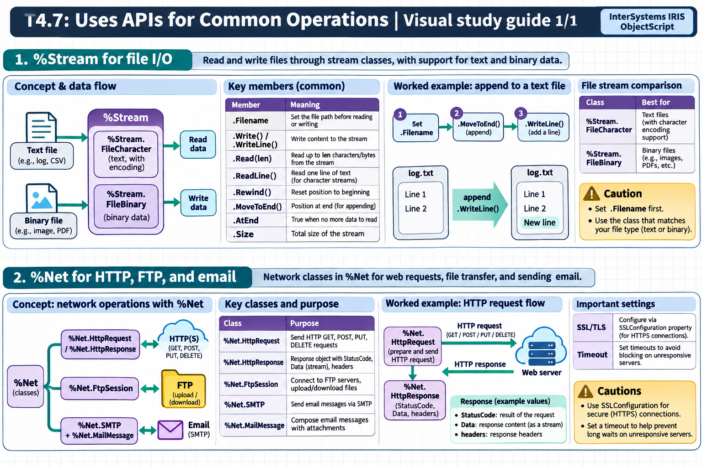

[Topic contents](../index.md) · [Full topic guide](../study.md) · [All topics](../../../index.md)

# T4.7: Uses APIs for Common Operations

Saved 2 November 2026 from [exam-prep.es](https://exam-prep.es/exams/objectscript/knowledge/T4.7.html). Reference links require internet access.

## 2. %Net for HTTP, FTP, and email



*This diagram covers sections 1–2; use the matching numbered panel for this page.* [Chapter diagrams](../visuals.md) · [Technical review notes](../../../visual-technical-notes.md)

### Key Points

- **%Net.HttpRequest**: Send HTTP GET, POST, PUT, DELETE requests
- **%Net.HttpResponse**: Response object with StatusCode, Data (stream), headers
- **%Net.FtpSession**: Connect to FTP servers, upload/download files
- **%Net.SMTP**: Send email messages via SMTP
- **%Net.MailMessage**: Compose email messages with attachments
- **SSL/TLS**: Configure via SSLConfiguration property for HTTPS connections
- **Timeout**: Set timeouts to avoid blocking on unresponsive servers

### Detailed Notes

#### Overview

The %Net package provides classes for common network protocols. %Net.HttpRequest handles HTTP communication (REST APIs, web services), %Net.FtpSession manages FTP file transfers, and %Net.SMTP sends email. These classes are essential for integrating InterSystems IRIS with external systems.

#### HTTP GET Request

```objectscript
 SET request = ##class(%Net.HttpRequest).%New()
 SET request.Server = "api.example.com"
 SET request.Port = 443
 SET request.Https = 1
 SET request.SSLConfiguration = "MySSLConfig"
 SET request.Timeout = 30

 // Send GET request
 SET status = request.Get("/api/users/1")
 IF $$$ISERR(status) {
     WRITE "Request failed: ", $SYSTEM.Status.GetErrorText(status), !
     QUIT
 }

 // Read response
 SET response = request.HttpResponse
 WRITE "Status: ", response.StatusCode, !
 WRITE "Content-Type: ", response.GetHeader("Content-Type"), !

 // Read response body
 SET body = ""
 WHILE 'response.Data.AtEnd {
     SET body = body _ response.Data.Read(32000)
 }
 WRITE "Body: ", body, !
```

#### HTTP POST Request with JSON

```objectscript
 SET request = ##class(%Net.HttpRequest).%New()
 SET request.Server = "api.example.com"
 SET request.ContentType = "application/json"

 // Build JSON body using %DynamicObject
 SET json = {}
 SET json.name = "Alice"
 SET json.age = 30
 SET json.city = "New York"

 // Write JSON to request body
 DO request.EntityBody.Write(json.%ToJSON())

 // Send POST
 SET status = request.Post("/api/users")
 IF $$$ISOK(status) {
     WRITE "Created! Status: ", request.HttpResponse.StatusCode, !
 }
```

#### HTTP with Custom Headers

```objectscript
 SET request = ##class(%Net.HttpRequest).%New()
 SET request.Server = "api.example.com"

 // Set custom headers
 DO request.SetHeader("Authorization", "Bearer " _ token)
 DO request.SetHeader("Accept", "application/json")
 DO request.SetHeader("X-Custom-Header", "value")

 SET status = request.Get("/api/protected-resource")
```

#### HTTP Response Handling

```objectscript
 // Check status codes
 SET response = request.HttpResponse
 IF response.StatusCode = 200 {
     // Parse JSON response
     SET jsonStr = response.Data.Read(response.Data.Size)
     SET obj = {}.%FromJSON(jsonStr)
     WRITE "Name: ", obj.name, !
 } ELSEIF response.StatusCode = 404 {
     WRITE "Not found", !
 } ELSEIF response.StatusCode >= 500 {
     WRITE "Server error: ", response.StatusCode, !
 }
```

#### FTP Operations

```objectscript
 SET ftp = ##class(%Net.FtpSession).%New()
 SET ftp.Server = "ftp.example.com"
 SET ftp.Username = "user"
 SET ftp.Password = "pass"

 // Connect
 SET status = ftp.Connect()
 IF $$$ISERR(status) {
     WRITE "FTP connect failed", !
     QUIT
 }

 // Change directory
 DO ftp.SetDirectory("/uploads")

 // Upload a file
 SET stream = ##class(%Stream.FileBinary).%New()
 SET stream.Filename = "/tmp/upload.txt"
 SET status = ftp.Store("remote_file.txt", stream)

 // Download a file
 SET download = ##class(%Stream.FileBinary).%New()
 SET download.Filename = "/tmp/downloaded.txt"
 SET status = ftp.Retrieve("remote_file.txt", .download)
 DO download.%Save()

 // List directory
 SET status = ftp.List(.list)

 // Disconnect
 DO ftp.Logout()
```

#### Sending Email via SMTP

```objectscript
 // Create the email message
 SET msg = ##class(%Net.MailMessage).%New()
 SET msg.From = "sender@example.com"
 DO msg.To.Insert("recipient@example.com")
 DO msg.Cc.Insert("cc@example.com")
 SET msg.Subject = "Test Email from IRIS"
 SET msg.IsSent = 0
 SET msg.IsHTML = 1

 // HTML body
 DO msg.TextData.Write("<h1>Hello!</h1>")
 DO msg.TextData.Write("<p>This email was sent from InterSystems IRIS.</p>")

 // Add attachment
 SET status = msg.AttachFile("/tmp", "report.pdf")

 // Configure and send via SMTP
 SET smtp = ##class(%Net.SMTP).%New()
 SET smtp.smtpserver = "smtp.example.com"
 SET smtp.port = 587
 SET smtp.timezone = "US/Eastern"

 // Authentication
 SET auth = ##class(%Net.Authenticator).%New()
 SET auth.UserName = "user@example.com"
 SET auth.Password = "password"
 SET smtp.authenticator = auth

 // Send
 SET status = smtp.Send(msg)
 IF $$$ISOK(status) {
     WRITE "Email sent successfully", !
 } ELSE {
     WRITE "Failed: ", $SYSTEM.Status.GetErrorText(status), !
 }
```

#### Plain Text Email

```objectscript
 SET msg = ##class(%Net.MailMessage).%New()
 SET msg.From = "noreply@example.com"
 DO msg.To.Insert("admin@example.com")
 SET msg.Subject = "Alert: System Notification"
 SET msg.IsHTML = 0

 // Plain text body
 DO msg.TextData.Write("This is a plain text alert.")
 DO msg.TextData.Write($CHAR(13, 10))    // CRLF
 DO msg.TextData.Write("Please check the system.")

 SET smtp = ##class(%Net.SMTP).%New()
 SET smtp.smtpserver = "smtp.example.com"
 SET status = smtp.Send(msg)
```

### Documentation References

- [%Net.HttpRequest](https://docs.intersystems.com/irislatest/csp/documatic/%25CSP.Documatic.cls?LIBRARY=%25SYS&CLASSNAME=%25Net.HttpRequest)
- [%Net.HttpResponse](https://docs.intersystems.com/irislatest/csp/documatic/%25CSP.Documatic.cls?LIBRARY=%25SYS&CLASSNAME=%25Net.HttpResponse)
- [%Net.FtpSession](https://docs.intersystems.com/irislatest/csp/documatic/%25CSP.Documatic.cls?LIBRARY=%25SYS&CLASSNAME=%25Net.FtpSession)
- [%Net.SMTP](https://docs.intersystems.com/irislatest/csp/documatic/%25CSP.Documatic.cls?LIBRARY=%25SYS&CLASSNAME=%25Net.SMTP)
- [%Net.MailMessage](https://docs.intersystems.com/irislatest/csp/documatic/%25CSP.Documatic.cls?LIBRARY=%25SYS&CLASSNAME=%25Net.MailMessage)
- [Sending HTTP Requests](https://docs.intersystems.com/irislatest/csp/docbook/DocBook.UI.Page.cls?KEY=GNET_http)
