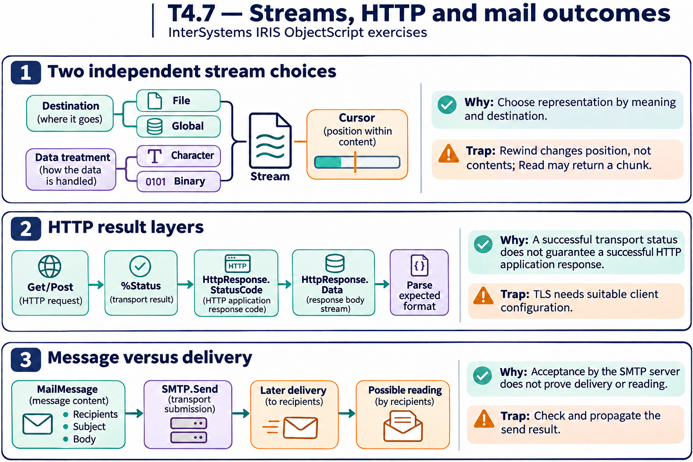

# T4.7 · 01 — Tipo di stream e posizione sono due scelte diverse

[Indice degli approfondimenti](README.md) · [Quiz originale](../quiz.md) · [Teoria](../study.md)

**Esercizi di partenza:** [Q1](../quiz.md#question-1-single) · [Q2](../quiz.md#question-2-single) · [Q3](../quiz.md#question-3-single) · [Q4](../quiz.md#question-4-single) · [Q5](../quiz.md#question-5-single) · [Q6](../quiz.md#question-6-single) · [Q7](../quiz.md#question-7-multiple). L’approfondimento rielabora il concetto e aggiunge una variante; non riproduce soltanto la risposta del quiz.

## Il caso concreto

Leggere un file di testo, memorizzare un PDF e copiare un contenuto richiedono API simili ma rappresentazioni diverse.

```objectscript
do stream.Rewind()
while 'stream.AtEnd {
  set line=stream.ReadLine()
  write line,!
}
```

## Ragionamento passo per passo

Character è per testo, Binary per byte che non devono subire conversioni testuali. File e Global decidono il supporto, non il tipo dei contenuti. Rewind rende esplicita la posizione. La copia deve dichiarare quale posizione sorgente intende usare e controllare lo status disponibile.

## Perché il distrattore è plausibile

Usare Character per un PDF o supporre che ogni ReadLine riparta dalla prima riga.

## Lo spunto da portare oltre l’esercizio

Scegli prima contenuto e supporto, poi gestisci il cursore.



*Leggi il pannello 1; gli altri due collegano il caso agli altri approfondimenti del capitolo.*

## Variante: prova prima di leggere la soluzione

Un PDF deve essere trattato come testo perché alla fine è comunque un file?

<details>
<summary>Soluzione ragionata</summary>

No: usa una rappresentazione binaria per preservarne i byte.

</details>

## Riferimenti e precisazioni

- [Proprietà stream](https://docs.intersystems.com/irislatest/csp/docbook/DocBook.UI.Page.cls?KEY=GOBJ_propstream)
- [Client HTTP](https://docs.intersystems.com/irislatest/csp/docbook/DocBook.UI.Page.cls?KEY=GNET_http)
- [Posta elettronica](https://docs.intersystems.com/irislatest/csp/docbook/DocBook.UI.Page.cls?KEY=GNET_email)
- [FTP](https://docs.intersystems.com/irislatest/csp/docbook/DocBook.UI.Page.cls?KEY=GNET_ftp)

[Note specifiche del capitolo](README.md#precisazioni-rispetto-al-quiz) · [Metodo e limiti della revisione](../../../approfondimenti-esercizi.md#metodo-e-limiti)
