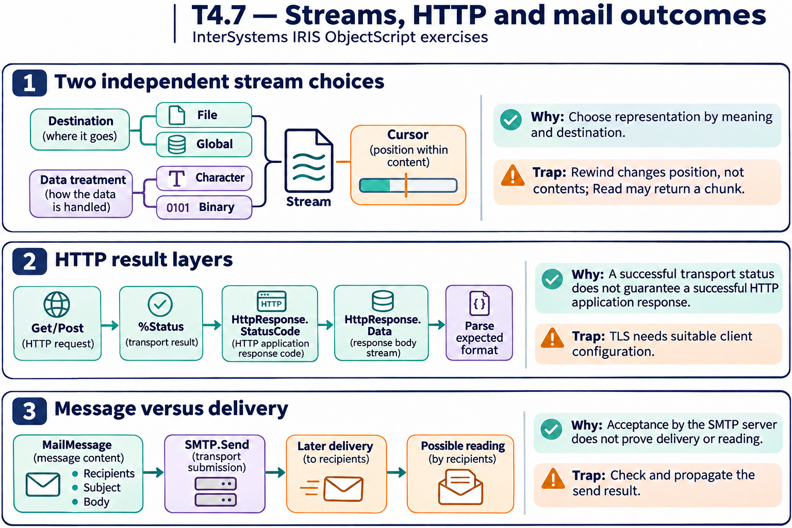

# T4.7 · 02 — Una chiamata HTTP ha due livelli di esito

[Indice degli approfondimenti](README.md) · [Quiz originale](../quiz.md) · [Teoria](../study.md)

**Esercizi di partenza:** [Q8](../quiz.md#question-8-single) · [Q9](../quiz.md#question-9-single) · [Q10](../quiz.md#question-10-single) · [Q11](../quiz.md#question-11-multiple) · [Q15](../quiz.md#question-15-multiple). L’approfondimento rielabora il concetto e aggiunge una variante; non riproduce soltanto la risposta del quiz.

## Il caso concreto

Il client invia una richiesta; il server può rispondere 404 anche se la comunicazione è avvenuta correttamente.

## Ragionamento passo per passo

Prima controlla lo status dell’operazione client; se esiste una risposta, controlla il suo codice HTTP e il body. Un body JSON non è automaticamente un oggetto già deserializzato: viene letto dallo stream della risposta e poi interpretato. Server, porta, TLS, Content-Type e credenziali sono configurazioni distinte.

## Perché il distrattore è plausibile

Interpretare la presenza del body come successo applicativo o confondere uno status IRIS con il codice HTTP.

## Lo spunto da portare oltre l’esercizio

Trasporto, protocollo e contenuto hanno contratti di errore diversi.

*Leggi il pannello 2; gli altri due collegano il caso agli altri approfondimenti del capitolo.*

## Variante: prova prima di leggere la soluzione

La connessione riesce ma il server restituisce 500. L’operazione applicativa ha avuto successo?

Soluzione ragionata

No: il percorso di trasporto è riuscito, ma la risposta HTTP segnala un errore del server.

## Riferimenti e precisazioni

- [Proprietà stream](https://docs.intersystems.com/irislatest/csp/docbook/DocBook.UI.Page.cls?KEY=GOBJ_propstream)
- [Client HTTP](https://docs.intersystems.com/irislatest/csp/docbook/DocBook.UI.Page.cls?KEY=GNET_http)
- [Posta elettronica](https://docs.intersystems.com/irislatest/csp/docbook/DocBook.UI.Page.cls?KEY=GNET_email)
- [FTP](https://docs.intersystems.com/irislatest/csp/docbook/DocBook.UI.Page.cls?KEY=GNET_ftp)

[Note specifiche del capitolo](README.md#precisazioni-rispetto-al-quiz) · [Metodo e limiti della revisione](../../../approfondimenti-esercizi.md#metodo-e-limiti)
