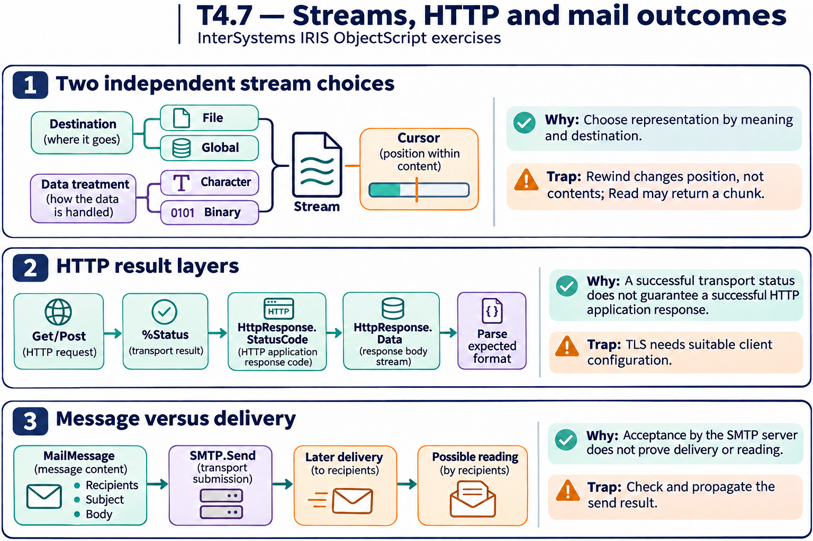

# T4.7 · 03 — Messaggio e canale di invio hanno ruoli distinti

[Indice degli approfondimenti](README.md) · [Quiz originale](../quiz.md) · [Teoria](../study.md)

**Esercizi di partenza:** [Q12](../quiz.md#question-12-single) · [Q13](../quiz.md#question-13-single) · [Q14](../quiz.md#question-14-single). L’approfondimento rielabora il concetto e aggiunge una variante; non riproduce soltanto la risposta del quiz.

## Il caso concreto

Per l’email un oggetto rappresenta destinatari e contenuto; un altro gestisce la comunicazione SMTP.

## Ragionamento passo per passo

%Net.MailMessage contiene i dati del messaggio; %Net.SMTP gestisce l’invio tramite server. Costruire il messaggio non dimostra che sia stato consegnato al server, e l’accettazione SMTP non prova la lettura del destinatario. FTP usa un’altra API e un altro protocollo, con configurazione e risposte proprie.

## Perché il distrattore è plausibile

Scambiare la costruzione del payload con la consegna finale o usare un’API perché il nome sembra simile.

## Lo spunto da portare oltre l’esercizio

Disegna una freccia per ogni passaggio di responsabilità e identifica il risultato verificabile di ciascuno.

*Leggi il pannello 3; gli altri due collegano il caso agli altri approfondimenti del capitolo.*

## Variante: prova prima di leggere la soluzione

Hai creato MailMessage con To, Subject e body. L’email è già stata inviata?

Soluzione ragionata

No: va passato al canale SMTP configurato e occorre controllare l’esito dell’invio.

## Riferimenti e precisazioni

- [Proprietà stream](https://docs.intersystems.com/irislatest/csp/docbook/DocBook.UI.Page.cls?KEY=GOBJ_propstream)
- [Client HTTP](https://docs.intersystems.com/irislatest/csp/docbook/DocBook.UI.Page.cls?KEY=GNET_http)
- [Posta elettronica](https://docs.intersystems.com/irislatest/csp/docbook/DocBook.UI.Page.cls?KEY=GNET_email)
- [FTP](https://docs.intersystems.com/irislatest/csp/docbook/DocBook.UI.Page.cls?KEY=GNET_ftp)

[Note specifiche del capitolo](README.md#precisazioni-rispetto-al-quiz) · [Metodo e limiti della revisione](../../../approfondimenti-esercizi.md#metodo-e-limiti)
