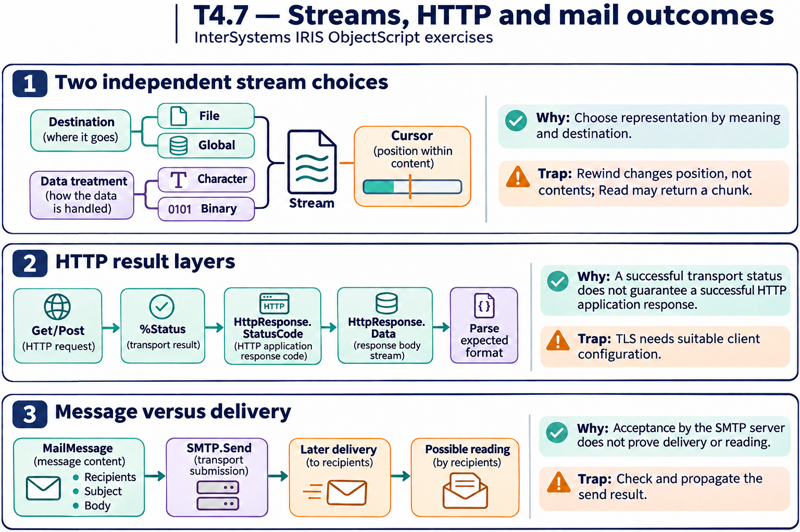
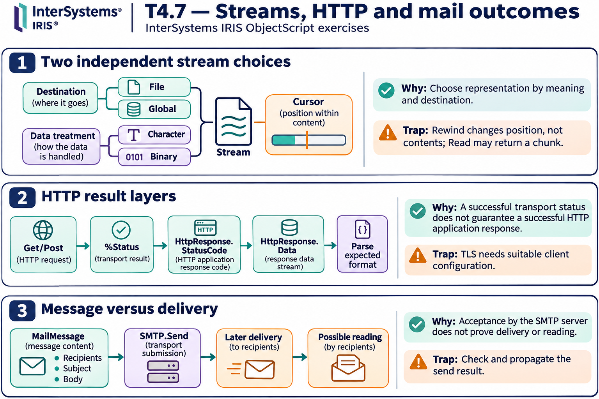

# T4.7 — Approfondimenti dagli esercizi

## Tutte le 15 domande approfondite

[Apri le schede domanda per domanda](<Domanda per domanda/README.md>) · [Tavole spiegate in inglese](tavole-esercizi.md)

Ogni domanda dispone ora di un commento specifico, un concetto ulteriore e una variante con soluzione. I tre casi seguenti sono percorsi tematici aggiuntivi. Le immagini sono in inglese.

[Teoria](../study.md) · [Quiz](../quiz.md) · [Tutti gli approfondimenti](../../../approfondimenti-esercizi.md)

Tre percorsi trasversali, da affiancare alle schede individuali, per capire il meccanismo dietro le risposte: scenario, ragionamento, distrattore, regola riutilizzabile e variante con soluzione. I riferimenti Q rimandano al quiz scaricato; la numerazione è locale al capitolo.

[Leggi esempi e spiegazioni dei pannelli](tavole-esercizi.md).

## Percorso consigliato

1. [Tipo di stream e posizione sono due scelte diverse](<01 - Tipo di stream e posizione sono due scelte diverse.md>) — Q1, Q2, Q3, Q4, Q5, Q6, Q7
2. [Una chiamata HTTP ha due livelli di esito](<02 - Una chiamata HTTP ha due livelli di esito.md>) — Q8, Q9, Q10, Q11, Q15
3. [Messaggio e canale di invio hanno ruoli distinti](<03 - Messaggio e canale di invio hanno ruoli distinti.md>) — Q12, Q13, Q14

[Indice di tutte le 15 domande del capitolo](mappa-domande.md). I percorsi sono tematici; ogni domanda ha inoltre una scheda individuale nella sottocartella dedicata.

## Precisazioni rispetto al quiz

Gli snippet di rete sono esempi di flusso, non configurazioni complete. Https richiede anche la configurazione TLS appropriata. Successo di trasporto e codice HTTP sono controlli distinti; gli esempi non eseguono alcuna richiesta reale.

Queste precisazioni si applicano agli approfondimenti nuovi. Il testo delle risposte scaricate rimane una testimonianza della fonte e non viene riscritto silenziosamente.

## Documentazione

- [Proprietà stream](https://docs.intersystems.com/irislatest/csp/docbook/DocBook.UI.Page.cls?KEY=GOBJ_propstream)
- [Client HTTP](https://docs.intersystems.com/irislatest/csp/docbook/DocBook.UI.Page.cls?KEY=GNET_http)
- [Posta elettronica](https://docs.intersystems.com/irislatest/csp/docbook/DocBook.UI.Page.cls?KEY=GNET_email)
- [FTP](https://docs.intersystems.com/irislatest/csp/docbook/DocBook.UI.Page.cls?KEY=GNET_ftp)

Gli snippet sono frammenti didattici: quando usano classi di esempio o macro, presuppongono le relative definizioni e include. Non costituiscono implementazioni complete né sono stati eseguiti in IRIS.
