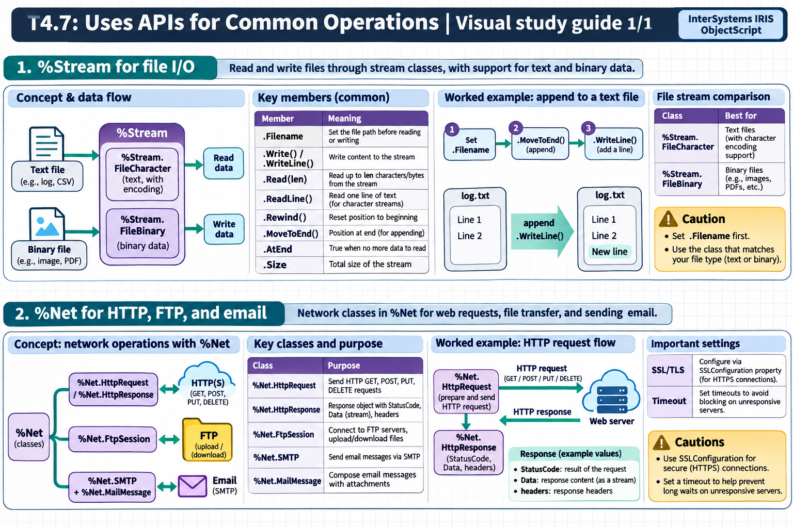

[All topics](../../index.md) · [Practice quiz](quiz.md)

# T4.7: Uses APIs for Common Operations

[Approfondimenti dagli esercizi](<Approfondimenti esercizi/README.md>)

Saved 2 November 2026 from [exam-prep.es](https://exam-prep.es/exams/objectscript/knowledge/T4.7.html). Reference links require internet access.

### Contents

1. [%Stream for file I/O](#1-stream-for-file-io)
2. [%Net for HTTP, FTP, and email](#2-net-for-http-ftp-and-email)

### Visual study guide — sections 1–2



[View all chapter diagrams](visuals.md) · [Technical review notes](../../visual-technical-notes.md)

## 1. %Stream for file I/O

### Key Points

- **%Stream.FileCharacter**: Read/write text files with character encoding support
- **%Stream.FileBinary**: Read/write binary files (images, PDFs, etc.)
- **.Filename property**: Set the file path before reading or writing
- **.Write() / .WriteLine()**: Write content to the stream
- **.Read(len)**: Read up to len characters/bytes from the stream
- **.ReadLine()**: Read one line of text (for character streams)
- **.Rewind()**: Reset position to beginning of stream
- **.MoveToEnd()**: Position at end of stream (for appending)
- **.AtEnd**: Property that is true when no more data to read
- **.Size**: Property containing the total size of the stream

### Detailed Notes

#### Overview

The %Stream classes provide ObjectScript's standard file I/O mechanism. Unlike traditional languages that use file handles, InterSystems IRIS uses stream objects that encapsulate the file, its position, and its encoding. Streams are also used extensively in web services, SQL BLOBs/CLOBs, and interoperability productions.

#### Writing a Text File

```objectscript
 SET stream = ##class(%Stream.FileCharacter).%New()
 SET stream.Filename = "/tmp/output.txt"

 // Write content
 DO stream.WriteLine("Line 1: Hello World")
 DO stream.WriteLine("Line 2: ObjectScript")
 DO stream.Write("No newline at end")

 // Save the stream to disk
 SET status = stream.%Save()
 IF $$$ISERR(status) {
     WRITE "Error saving: ", $SYSTEM.Status.GetErrorText(status), !
 } ELSE {
     WRITE "File written successfully", !
 }
```

#### Reading a Text File

```objectscript
 SET stream = ##class(%Stream.FileCharacter).%New()
 SET stream.Filename = "/tmp/output.txt"

 // Check if file exists via Size
 IF stream.Size = 0 {
     WRITE "File is empty or does not exist", !
     QUIT
 }

 // Read line by line
 WHILE 'stream.AtEnd {
     SET line = stream.ReadLine()
     WRITE line, !
 }
```

#### Reading a Fixed Number of Characters

```objectscript
 SET stream = ##class(%Stream.FileCharacter).%New()
 SET stream.Filename = "/tmp/largefile.txt"

 // Read in chunks of 32000 characters
 WHILE 'stream.AtEnd {
     SET chunk = stream.Read(32000)
     // Process chunk...
     SET totalLen = totalLen + $LENGTH(chunk)
 }
 WRITE "Total characters read: ", totalLen, !
```

#### Binary File Operations

```objectscript
 // Copy a binary file
 SET input = ##class(%Stream.FileBinary).%New()
 SET input.Filename = "/tmp/image.png"

 SET output = ##class(%Stream.FileBinary).%New()
 SET output.Filename = "/tmp/image_copy.png"

 // Copy content
 WHILE 'input.AtEnd {
     SET chunk = input.Read(32000)
     DO output.Write(chunk)
 }
 SET status = output.%Save()
```

#### Stream Navigation

```objectscript
 SET stream = ##class(%Stream.FileCharacter).%New()
 SET stream.Filename = "/tmp/data.txt"

 // Read first line
 SET firstLine = stream.ReadLine()
 WRITE "First: ", firstLine, !

 // Rewind to beginning
 DO stream.Rewind()

 // Read everything
 SET all = stream.Read(stream.Size)

 // Move to end for appending
 DO stream.MoveToEnd()
 DO stream.WriteLine("Appended line")
 SET status = stream.%Save()
```

#### Copying Between Streams

```objectscript
 // CopyFrom copies one stream's content into another
 SET source = ##class(%Stream.FileCharacter).%New()
 SET source.Filename = "/tmp/source.txt"

 SET dest = ##class(%Stream.FileCharacter).%New()
 SET dest.Filename = "/tmp/dest.txt"

 SET status = dest.CopyFrom(source)
 SET status = dest.%Save()
```

#### Stream Properties and Methods Summary

```objectscript
 SET stream = ##class(%Stream.FileCharacter).%New()
 SET stream.Filename = "/tmp/test.txt"

 // Properties
 WRITE "Size: ", stream.Size, !           // Total size in characters/bytes
 WRITE "At End: ", stream.AtEnd, !        // 1 if position is at end
 WRITE "Filename: ", stream.Filename, !   // File path

 // Key Methods
 // stream.Read(len)       - Read up to len chars
 // stream.ReadLine()      - Read one line (text streams)
 // stream.Write(data)     - Write data
 // stream.WriteLine(data) - Write data + newline
 // stream.Rewind()        - Go to beginning
 // stream.MoveToEnd()     - Go to end
 // stream.CopyFrom(src)   - Copy from another stream
 // stream.Clear()         - Remove all content
 // stream.%Save()         - Persist changes to disk
```

### Documentation References

- [%Stream.FileCharacter](https://docs.intersystems.com/irislatest/csp/documatic/%25CSP.Documatic.cls?LIBRARY=%25SYS&CLASSNAME=%25Stream.FileCharacter)
- [%Stream.FileBinary](https://docs.intersystems.com/irislatest/csp/documatic/%25CSP.Documatic.cls?LIBRARY=%25SYS&CLASSNAME=%25Stream.FileBinary)
- [Working with Streams](https://docs.intersystems.com/irislatest/csp/docbook/DocBook.UI.Page.cls?KEY=GOBJ_propstream)

## 2. %Net for HTTP, FTP, and email

### Key Points

- **%Net.HttpRequest**: Send HTTP GET, POST, PUT, DELETE requests
- **%Net.HttpResponse**: Response object with StatusCode, Data (stream), headers
- **%Net.FtpSession**: Connect to FTP servers, upload/download files
- **%Net.SMTP**: Send email messages via SMTP
- **%Net.MailMessage**: Compose email messages with attachments
- **SSL/TLS**: Configure via SSLConfiguration property for HTTPS connections
- **Timeout**: Set timeouts to avoid blocking on unresponsive servers

### Detailed Notes

#### Overview

The %Net package provides classes for common network protocols. %Net.HttpRequest handles HTTP communication (REST APIs, web services), %Net.FtpSession manages FTP file transfers, and %Net.SMTP sends email. These classes are essential for integrating InterSystems IRIS with external systems.

#### HTTP GET Request

```objectscript
 SET request = ##class(%Net.HttpRequest).%New()
 SET request.Server = "api.example.com"
 SET request.Port = 443
 SET request.Https = 1
 SET request.SSLConfiguration = "MySSLConfig"
 SET request.Timeout = 30

 // Send GET request
 SET status = request.Get("/api/users/1")
 IF $$$ISERR(status) {
     WRITE "Request failed: ", $SYSTEM.Status.GetErrorText(status), !
     QUIT
 }

 // Read response
 SET response = request.HttpResponse
 WRITE "Status: ", response.StatusCode, !
 WRITE "Content-Type: ", response.GetHeader("Content-Type"), !

 // Read response body
 SET body = ""
 WHILE 'response.Data.AtEnd {
     SET body = body _ response.Data.Read(32000)
 }
 WRITE "Body: ", body, !
```

#### HTTP POST Request with JSON

```objectscript
 SET request = ##class(%Net.HttpRequest).%New()
 SET request.Server = "api.example.com"
 SET request.ContentType = "application/json"

 // Build JSON body using %DynamicObject
 SET json = {}
 SET json.name = "Alice"
 SET json.age = 30
 SET json.city = "New York"

 // Write JSON to request body
 DO request.EntityBody.Write(json.%ToJSON())

 // Send POST
 SET status = request.Post("/api/users")
 IF $$$ISOK(status) {
     WRITE "Created! Status: ", request.HttpResponse.StatusCode, !
 }
```

#### HTTP with Custom Headers

```objectscript
 SET request = ##class(%Net.HttpRequest).%New()
 SET request.Server = "api.example.com"

 // Set custom headers
 DO request.SetHeader("Authorization", "Bearer " _ token)
 DO request.SetHeader("Accept", "application/json")
 DO request.SetHeader("X-Custom-Header", "value")

 SET status = request.Get("/api/protected-resource")
```

#### HTTP Response Handling

```objectscript
 // Check status codes
 SET response = request.HttpResponse
 IF response.StatusCode = 200 {
     // Parse JSON response
     SET jsonStr = response.Data.Read(response.Data.Size)
     SET obj = {}.%FromJSON(jsonStr)
     WRITE "Name: ", obj.name, !
 } ELSEIF response.StatusCode = 404 {
     WRITE "Not found", !
 } ELSEIF response.StatusCode >= 500 {
     WRITE "Server error: ", response.StatusCode, !
 }
```

#### FTP Operations

```objectscript
 SET ftp = ##class(%Net.FtpSession).%New()
 SET ftp.Server = "ftp.example.com"
 SET ftp.Username = "user"
 SET ftp.Password = "pass"

 // Connect
 SET status = ftp.Connect()
 IF $$$ISERR(status) {
     WRITE "FTP connect failed", !
     QUIT
 }

 // Change directory
 DO ftp.SetDirectory("/uploads")

 // Upload a file
 SET stream = ##class(%Stream.FileBinary).%New()
 SET stream.Filename = "/tmp/upload.txt"
 SET status = ftp.Store("remote_file.txt", stream)

 // Download a file
 SET download = ##class(%Stream.FileBinary).%New()
 SET download.Filename = "/tmp/downloaded.txt"
 SET status = ftp.Retrieve("remote_file.txt", .download)
 DO download.%Save()

 // List directory
 SET status = ftp.List(.list)

 // Disconnect
 DO ftp.Logout()
```

#### Sending Email via SMTP

```objectscript
 // Create the email message
 SET msg = ##class(%Net.MailMessage).%New()
 SET msg.From = "sender@example.com"
 DO msg.To.Insert("recipient@example.com")
 DO msg.Cc.Insert("cc@example.com")
 SET msg.Subject = "Test Email from IRIS"
 SET msg.IsSent = 0
 SET msg.IsHTML = 1

 // HTML body
 DO msg.TextData.Write("<h1>Hello!</h1>")
 DO msg.TextData.Write("<p>This email was sent from InterSystems IRIS.</p>")

 // Add attachment
 SET status = msg.AttachFile("/tmp", "report.pdf")

 // Configure and send via SMTP
 SET smtp = ##class(%Net.SMTP).%New()
 SET smtp.smtpserver = "smtp.example.com"
 SET smtp.port = 587
 SET smtp.timezone = "US/Eastern"

 // Authentication
 SET auth = ##class(%Net.Authenticator).%New()
 SET auth.UserName = "user@example.com"
 SET auth.Password = "password"
 SET smtp.authenticator = auth

 // Send
 SET status = smtp.Send(msg)
 IF $$$ISOK(status) {
     WRITE "Email sent successfully", !
 } ELSE {
     WRITE "Failed: ", $SYSTEM.Status.GetErrorText(status), !
 }
```

#### Plain Text Email

```objectscript
 SET msg = ##class(%Net.MailMessage).%New()
 SET msg.From = "noreply@example.com"
 DO msg.To.Insert("admin@example.com")
 SET msg.Subject = "Alert: System Notification"
 SET msg.IsHTML = 0

 // Plain text body
 DO msg.TextData.Write("This is a plain text alert.")
 DO msg.TextData.Write($CHAR(13, 10))    // CRLF
 DO msg.TextData.Write("Please check the system.")

 SET smtp = ##class(%Net.SMTP).%New()
 SET smtp.smtpserver = "smtp.example.com"
 SET status = smtp.Send(msg)
```

### Documentation References

- [%Net.HttpRequest](https://docs.intersystems.com/irislatest/csp/documatic/%25CSP.Documatic.cls?LIBRARY=%25SYS&CLASSNAME=%25Net.HttpRequest)
- [%Net.HttpResponse](https://docs.intersystems.com/irislatest/csp/documatic/%25CSP.Documatic.cls?LIBRARY=%25SYS&CLASSNAME=%25Net.HttpResponse)
- [%Net.FtpSession](https://docs.intersystems.com/irislatest/csp/documatic/%25CSP.Documatic.cls?LIBRARY=%25SYS&CLASSNAME=%25Net.FtpSession)
- [%Net.SMTP](https://docs.intersystems.com/irislatest/csp/documatic/%25CSP.Documatic.cls?LIBRARY=%25SYS&CLASSNAME=%25Net.SMTP)
- [%Net.MailMessage](https://docs.intersystems.com/irislatest/csp/documatic/%25CSP.Documatic.cls?LIBRARY=%25SYS&CLASSNAME=%25Net.MailMessage)
- [Sending HTTP Requests](https://docs.intersystems.com/irislatest/csp/docbook/DocBook.UI.Page.cls?KEY=GNET_http)

## Exam Preparation Summary

### Critical Concepts to Master:

1. **%Stream.FileCharacter vs %Stream.FileBinary**: Character streams for text, binary for everything else
2. **Stream reading pattern**: WHILE 'stream.AtEnd { SET data = stream.Read(len) }
3. **Stream writing**: .Write() for raw content, .WriteLine() adds newline, .%Save() persists to disk
4. **Stream navigation**: .Rewind() to start, .MoveToEnd() for appending, .AtEnd to check for more data
5. **%Net.HttpRequest flow**: Create -&gt; Set Server/Port -&gt; Set Headers -&gt; Get/Post -&gt; Read HttpResponse
6. **Response body is a stream**: request.HttpResponse.Data is a %Stream -- read it like any stream
7. **SMTP sending**: Create %Net.MailMessage -&gt; Configure %Net.SMTP -&gt; smtp.Send(msg)
8. **FTP flow**: Create %Net.FtpSession -&gt; Connect -&gt; Store/Retrieve -&gt; Logout
9. **SSL configuration**: Set SSLConfiguration property for HTTPS; requires pre-configured SSL config in IRIS
10. **Error handling**: Always check %Status return values from network operations

### Common Exam Scenarios:

- Writing code to read a text file line by line using %Stream.FileCharacter
- Sending an HTTP GET request and processing the JSON response
- Choosing between FileCharacter and FileBinary for a given file type
- Configuring an HTTP POST request with JSON body and custom headers
- Sending an email with an attachment using %Net.SMTP and %Net.MailMessage
- Reading an HTTP response body from the Data stream property
- Handling stream operations: Rewind, Read, AtEnd, MoveToEnd
- Setting up FTP file transfer with %Net.FtpSession

### Hands-On Practice Recommendations:

- Write a text file, then read it back line by line using %Stream.FileCharacter
- Copy a binary file using %Stream.FileBinary with chunked reads
- Send HTTP GET requests to a public API and parse JSON responses
- Send HTTP POST requests with JSON bodies
- Set up a simple SMTP test to send email (use a test SMTP server)
- Practice stream navigation: write, rewind, read, move to end, append
- Use CopyFrom to copy content between streams
- Experiment with HTTP response status codes and headers
