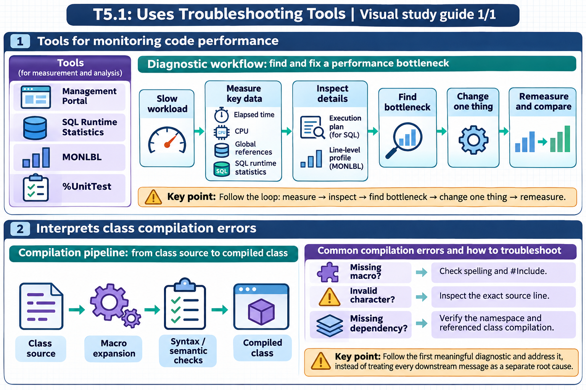

[Topic contents](../index.md) · [Full topic guide](../study.md) · [All topics](../../../index.md)

# T5.1: Uses Troubleshooting Tools

Saved 2 November 2026 from [exam-prep.es](https://exam-prep.es/exams/objectscript/knowledge/T5.1.html). Reference links require internet access.

## 1. Tools for monitoring code performance



*This diagram covers sections 1–2; use the matching numbered panel for this page.* [Chapter diagrams](../visuals.md) · [Technical review notes](../../../visual-technical-notes.md)

### Key Points

- **^PERFMON**: System-level performance monitoring utility capturing global references, commands, and routine statistics
- **%SYS.PTools**: SQL query performance analysis framework for identifying slow queries and optimizing execution plans
- **$ZH**: High-resolution timestamp (seconds with fractional precision) for measuring elapsed execution time
- **Management Portal**: System Operation pages provide real-time dashboards for processes, locks, and system health
- **^MONLBL**: Line-by-line monitoring utility that profiles execution time and hit counts for individual lines of code
- **^%SYS.MONLBL**: Enhanced line-by-line monitor available in modern IRIS versions

### Detailed Notes

#### Overview

InterSystems IRIS provides a rich set of performance monitoring tools, from coarse-grained system dashboards to fine-grained line-by-line profilers. Choosing the right tool depends on whether you are investigating a system-wide bottleneck, a slow SQL query, or a specific ObjectScript routine.

#### Using $ZH for Timing Code

The simplest and most direct way to measure performance is using the `$ZH` special variable, which returns the current timestamp as a high-resolution floating-point number of seconds. By capturing `$ZH` before and after a code block, you can calculate elapsed wall-clock time with sub-millisecond precision.

```objectscript
ClassMethod TimedOperation() As %String
{
    Set start = $ZH

    // Code to measure
    For i = 1:1:100000 {
        Set ^TempData(i) = $RANDOM(1000000)
    }

    Set elapsed = $ZH - start
    Write "Elapsed time: ", elapsed, " seconds", !
    Return elapsed
}
```

For comparing two approaches:

```objectscript
ClassMethod CompareApproaches()
{
    // Approach 1: String concatenation
    Set start1 = $ZH
    Set str = ""
    For i = 1:1:10000 {
        Set str = str _ "X"
    }
    Set time1 = $ZH - start1

    // Approach 2: $JUSTIFY pre-allocation
    Set start2 = $ZH
    Set str = $JUSTIFY("", 10000)
    Set str = $TRANSLATE(str, " ", "X")
    Set time2 = $ZH - start2

    Write "Concatenation: ", time1, " seconds", !
    Write "$JUSTIFY:       ", time2, " seconds", !
}
```

#### ^PERFMON System Performance Monitor

The `^PERFMON` utility is a system-level performance monitor that collects metrics including global references, routine calls, lines executed, and other counters. It runs as a background process sampling at configurable intervals. The routine lives in the `%SYS` namespace, so all invocations must be preceded by `zn "%SYS"`.

```objectscript
// Switch to %SYS namespace, then start the performance monitor (from Terminal)
zn "%SYS"
Do ^PERFMON

// Programmatic control
// Start collecting with 5-second sample interval
Do Start^PERFMON(5)

// Let it run for a period...
Hang 60

// Stop collecting
Do Stop^PERFMON

// Display collected results
Do Report^PERFMON
```

Key metrics captured by ^PERFMON include:

- **GloRef**: Number of global references (reads and sets)
- **GloSet**: Number of global SET operations
- **GloKill**: Number of global KILL operations
- **RouLine**: Lines of ObjectScript executed
- **RouLoad**: Number of routine loads from disk into cache

#### %SYS.PTools for SQL Performance

The `%SYS.PTools` package provides SQL query performance analysis. It captures execution plans, timing, and statistics for SQL queries.

```objectscript
// Enable SQL statistics collection
Do ##class(%SYS.PTools.SQLStats).SetSQLStatsJob(3)

// Execute your SQL queries...
Set rs = ##class(%SQL.Statement).%ExecDirect(,
    "SELECT Name, DOB FROM Sample.Person WHERE Age > 50")

// View collected statistics
Do ##class(%SYS.PTools.SQLStats).DisplayStats()

// Disable collection
Do ##class(%SYS.PTools.SQLStats).SetSQLStatsJob(0)
```

You can also analyze query plans directly:

```objectscript
// Show the query plan for a specific query
Set stmt = ##class(%SQL.Statement).%New()
Set sc = stmt.%Prepare("SELECT Name FROM Sample.Person WHERE SSN = ?")
Do stmt.%ShowPlan()
```

#### ^MONLBL Line-by-Line Monitoring

The `^MONLBL` utility provides line-by-line execution profiling, showing exactly how many times each line executed and how long each line took. This is invaluable for identifying hot spots within a routine.

```objectscript
// Start line-by-line monitoring for a specific routine
Do Start^%MONLBL("MyApp.MyClass.1")

// Execute the code you want to profile
Do ##class(MyApp.MyClass).MyMethod()

// Stop monitoring
Do Stop^%MONLBL

// Display results - shows each line with execution count and time
Do Report^%MONLBL
```

The report output shows columns for:

- **Line**: The source code line
- **Count**: Number of times the line executed
- **Total Time**: Cumulative time spent on the line
- **Average Time**: Average time per execution

#### Management Portal System Operation Pages

The Management Portal provides several key pages under **System Operation**:

- **System Dashboard**: Real-time overview of CPU, memory, disk, and cache utilization
- **Processes**: List of all active processes with CPU time, state, namespace, and current routine
- **Locks**: Current lock table showing all held locks and any lock conflicts
- **Task Manager**: Scheduled and running tasks with execution history
- **System Usage**: Detailed resource consumption breakdown

Navigate to: **System Operation &gt; System Dashboard** for the main overview. From the **Processes** page, you can drill into individual processes to see their call stack, variables, and resource usage.

### Documentation References

- [Monitoring Performance](https://docs.intersystems.com/irislatest/csp/docbook/DocBook.UI.Page.cls?KEY=GCM_dashboard)
- [SQL Performance Analysis Tools](https://docs.intersystems.com/irislatest/csp/docbook/DocBook.UI.Page.cls?KEY=GSQLOPT)
- [$ZH Special Variable](https://docs.intersystems.com/irislatest/csp/docbook/DocBook.UI.Page.cls?KEY=RCOS_vzh)
- [Line-by-Line Monitor ^%MONLBL](https://docs.intersystems.com/irislatest/csp/docbook/DocBook.UI.Page.cls?KEY=GCM_monlbl)
- [System Monitor](https://docs.intersystems.com/irislatest/csp/docbook/DocBook.UI.Page.cls?KEY=GCM_healthmon)
