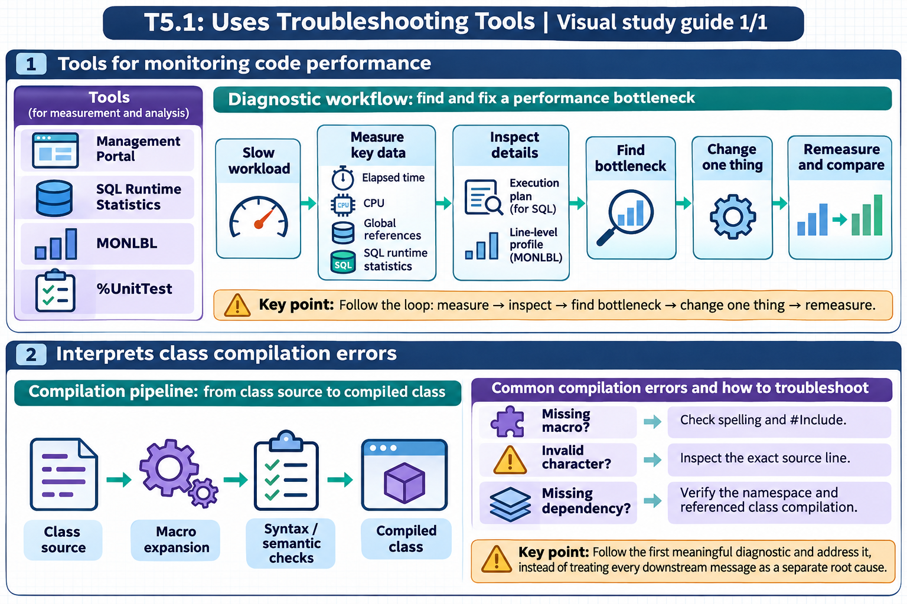

[Topic contents](../index.md) · [Full topic guide](../study.md) · [All topics](../../../index.md)

# T5.1: Uses Troubleshooting Tools

Saved 2 November 2026 from [exam-prep.es](https://exam-prep.es/exams/objectscript/knowledge/T5.1.html). Reference links require internet access.

## 2. Interprets class compilation errors



*This diagram covers sections 1–2; use the matching numbered panel for this page.* [Chapter diagrams](../visuals.md) · [Technical review notes](../../../visual-technical-notes.md)

### Key Points

- **MPP errors**: Macro Pre-Processor errors occur during the first phase of compilation before ObjectScript parsing
- **"Referenced macro not defined"**: Missing or misspelled macro name, or missing #Include statement
- **"Invalid character"**: Illegal character in source code, often from copy-paste from external editors
- **Dependency compilation order**: Classes that reference other classes must be compiled after their dependencies
- **#Include issues**: Include files (.inc) must exist and be accessible; case-sensitive on some platforms
- **Compilation flags**: Use "ck" flags to compile with keep-generated and dependency checking

### Detailed Notes

#### Overview

Class compilation in InterSystems IRIS involves multiple phases: macro pre-processing, syntax analysis, code generation, and final compilation of the generated intermediate routines. Errors can occur at any phase, and understanding which phase produced an error is critical to diagnosing the issue.

#### Common MPP (Macro Pre-Processor) Errors

MPP errors occur before the ObjectScript code is even parsed. They relate to macros, #Include directives, and preprocessor instructions.

**"Referenced macro not defined"** - This error occurs when code uses a macro (`$$$MacroName`) that the compiler cannot find:

```objectscript
// ERROR: Missing #Include
Class MyApp.Example Extends %Persistent
{
    Method Save() As %Status
    {
        Set sc = ..%Save()
        // ERROR: $$$ISERR is defined in %occStatus.inc
        // but we forgot to include it
        If $$$ISERR(sc) {
            Write "Error!", !
        }
    }
}
```

**Fix**: Add the appropriate #Include directive at the top of the class:

```objectscript
Include %occStatus

Class MyApp.Example Extends %Persistent
{
    Method Save() As %Status
    {
        Set sc = ..%Save()
        If $$$ISERR(sc) {
            Write "Error!", !
        }
    }
}
```

For multiple include files:

```objectscript
Include (%occStatus, %occErrors, MyApp.Macros)

Class MyApp.Example Extends %Persistent
{
    // Can now use macros from all three include files
}
```

#### Invalid Character Errors

These typically arise from invisible Unicode characters introduced by copy-paste from web pages, word processors, or external editors:

```objectscript
// ERROR: "Invalid character" - smart quotes instead of regular quotes
Set name = "John"    // Uses Unicode curly quotes (U+201C, U+201D)

// FIX: Use standard ASCII quotes
Set name = "John"    // Uses standard double quotes (U+0022)
```

Common culprits:

- Smart/curly quotes (" " instead of ")
- En-dash or em-dash (-- or --- instead of -)
- Non-breaking spaces (U+00A0 instead of regular space)
- Zero-width characters

#### Dependency Compilation Order

When classes reference each other, compilation order matters. If Class A extends Class B, then Class B must be compiled first.

```objectscript
// Class B must be compiled BEFORE Class A
Class MyApp.Base Extends %Persistent
{
    Property Name As %String;
}

Class MyApp.Child Extends MyApp.Base
{
    Property Age As %Integer;
}
```

Compiling with dependency checking:

```objectscript
// Compile a single class with dependency checking
Do $SYSTEM.OBJ.Compile("MyApp.Child", "ck")

// Compile an entire package (handles dependencies automatically)
Do $SYSTEM.OBJ.CompilePackage("MyApp", "ck")

// Compile all classes in namespace
Do $SYSTEM.OBJ.CompileAll("ck")
```

Compilation flag reference:

- **c**: Compile
- **k**: Keep generated source (useful for debugging)
- **d**: Display compilation output
- **b**: Include subclasses
- **u**: Update only (skip unchanged classes)

#### Diagnosing Compilation Errors in Practice

```objectscript
// Capture compilation status programmatically
Set sc = $SYSTEM.OBJ.Compile("MyApp.Problem", "ck")
If $$$ISERR(sc) {
    // Display the full error text
    Do $SYSTEM.Status.DisplayError(sc)
}

// View errors in the Management Portal:
// System Explorer > Classes > select class > Compile
// Errors appear in the Output pane
```

Common compilation error patterns and their causes:

| Error Message | Likely Cause |
| --- | --- |
| "Referenced macro not defined" | Missing #Include or typo in macro name |
| "Invalid character" | Non-ASCII characters from copy-paste |
| "Class 'X' does not exist" | Dependency not compiled or typo in class name |
| "Method 'X' does not exist in class 'Y'" | Wrong method name or class not recompiled |
| "Property 'X' does not exist" | Typo in property name or referencing wrong class |
| "Datatype class 'X' does not exist" | Missing or misspelled datatype class |

### Documentation References

- [Compiling Classes](https://docs.intersystems.com/irislatest/csp/docbook/DocBook.UI.Page.cls?KEY=GOBJ_classdef_modifying)
- [Using Macros and Include Files](https://docs.intersystems.com/irislatest/csp/docbook/DocBook.UI.Page.cls?KEY=GCOS_macros)
- [#Include Directive](https://docs.intersystems.com/irislatest/csp/docbook/DocBook.UI.Page.cls?KEY=RCOS_mppinclude)
- [$SYSTEM.OBJ Class](https://docs.intersystems.com/irislatest/csp/docbook/DocBook.UI.Page.cls?KEY=RCOS_dsystem_obj)
