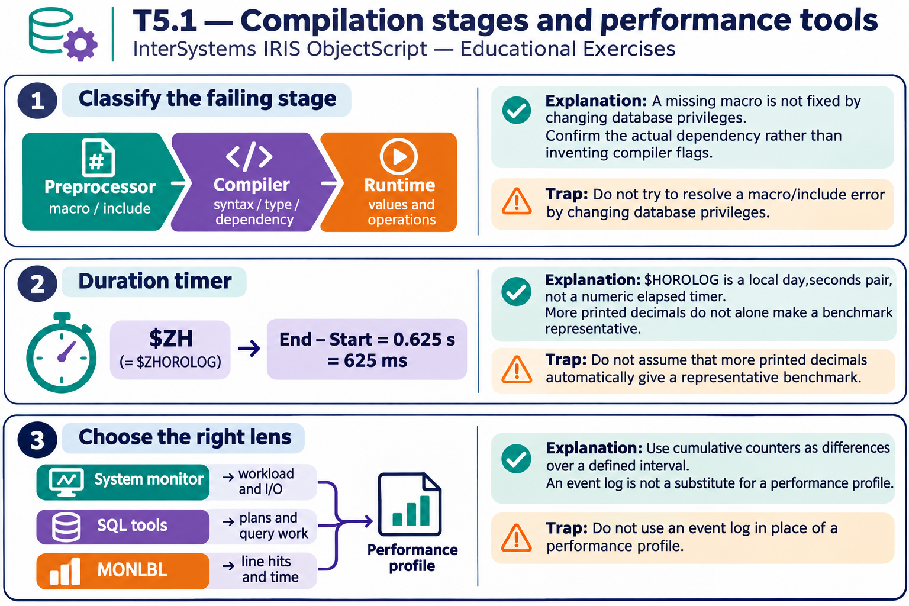

# T5.1 · 01 — Un errore di compilazione si risolve nel suo stadio

[Indice degli approfondimenti](README.md) · [Quiz originale](../quiz.md) · [Teoria](../study.md)

**Esercizi di partenza:** [Q1](../quiz.md#question-1-single) · [Q2](../quiz.md#question-2-single) · [Q6](../quiz.md#question-6-single) · [Q7](../quiz.md#question-7-single) · [Q10](../quiz.md#question-10-single) · [Q11](../quiz.md#question-11-single) · [Q12](../quiz.md#question-12-multiple) · [Q13](../quiz.md#question-13-single). L’approfondimento rielabora il concetto e aggiunge una variante; non riproduce soltanto la risposta del quiz.

## Il caso concreto

La macro LogError non è definita, oppure %Strig è scritto al posto di %String. Nessun controllo del runtime può completare quella compilazione.

## Ragionamento passo per passo

Classifica prima il messaggio: preprocessore e include, sintassi, risoluzione del tipo o dipendenza. Verifica che l’include effettivo contenga la macro e che le dipendenze siano compilabili. La maiuscola di Return non è il problema: i comandi ObjectScript non distinguono quel caso.

## Perché il distrattore è plausibile

Modificare il codice di gestione eccezioni quando l’errore impedisce ancora di produrre il codice eseguibile.

## Lo spunto da portare oltre l’esercizio

La fase che fallisce limita l’insieme delle cause possibili.

*Leggi il pannello 1; gli altri due collegano il caso agli altri approfondimenti del capitolo.*

## Variante: prova prima di leggere la soluzione

Il compilatore segnala macro DbName non definita. Controllare il database a runtime è il primo passo utile?

Soluzione ragionata

No: verifica include, definizione della macro e preprocessing.

## Riferimenti e precisazioni

- [$ZHOROLOG](https://docs.intersystems.com/irislatest/csp/docbook/DocBook.UI.Page.cls?KEY=RCOS_vzhorolog)
- [Macro](https://docs.intersystems.com/irislatest/csp/docbook/DocBook.UI.Page.cls?KEY=GCOS_macros)
- [Monitoraggio prestazioni](https://docs.intersystems.com/irislatest/csp/docbook/DocBook.UI.Page.cls?KEY=GCM_perfmon)

[Note specifiche del capitolo](README.md#precisazioni-rispetto-al-quiz) · [Metodo e limiti della revisione](../../../approfondimenti-esercizi.md#metodo-e-limiti)
